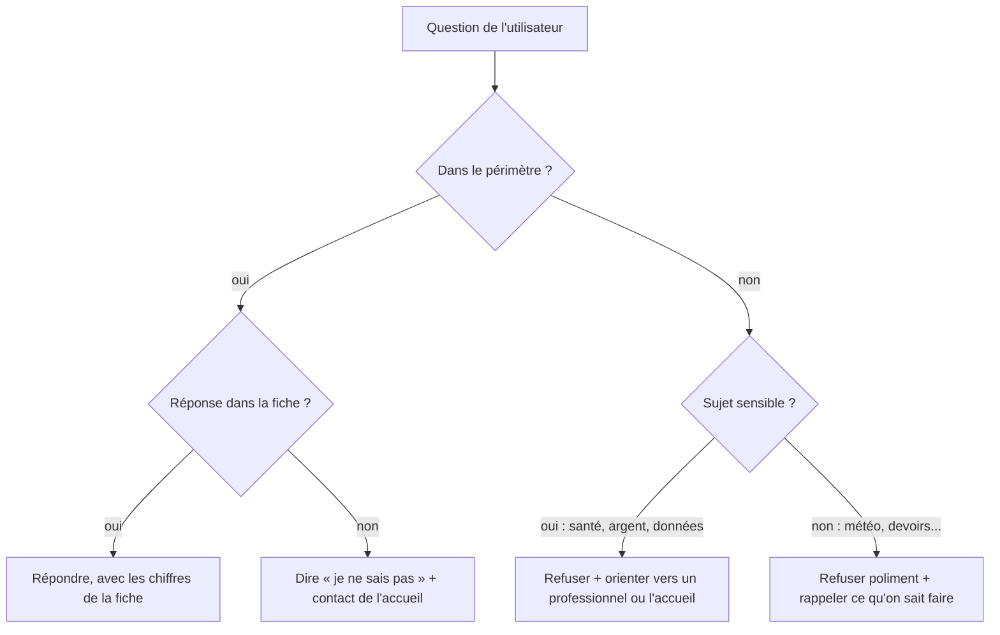

# Cadrer : périmètre, ton et refus

> [!NOTE]
> Dans cette leçon, vous allez remplir la **fiche de cadrage** d'Alti, l'assistant de la Salle Altitude : ce qu'il fait, comment il parle, ce qu'il refuse et à qui il passe la main. C'est la leçon la plus importante de la formation, et elle ne contient presque pas de code.

## Pourquoi cadrer avant de coder ?

Un LLM (grand modèle de langage, comme Gemini) sait parler de tout. C'est précisément le problème : sans cadre, votre chatbot de salle de sport donnera aussi des conseils de rééducation du genou, inventera un tarif « raisonnable » ou acceptera de noter un IBAN. Chaque phrase du prompt système que l'on écrira à la leçon suivante vient d'une ligne de cette fiche.

Toute question reçue tombe dans l'une de ces quatre cases :



La case la plus négligée est **R2** : une question légitime dont la réponse n'est pas connue. Un chatbot qui invente plutôt que de dire « je ne sais pas » est pire que pas de chatbot du tout.

## La fiche de cadrage d'Alti

| Rubrique | Choix pour Alti | Pourquoi |
| --- | --- | --- |
| Utilisateurs | adhérents et visiteurs du site | public large, pas forcément à l'aise avec le numérique |
| Mission | horaires, tarifs, cours, services, gel/résiliation, règlement | les questions qui saturent l'accueil |
| Source de vérité | une fiche de connaissances unique, tenue par l'accueil | une seule source, facile à mettre à jour |
| Ton | vouvoiement, chaleureux, 4 phrases au plus, pas d'emoji | image de marque, lecture sur téléphone |
| Refus | santé et blessures, nutrition et compléments, hors sujet | risque pour la personne, responsabilité de la salle |
| Interdits absolus | demander ou répéter des coordonnées bancaires ; promettre un remboursement | sécurité et engagement juridique |
| Passage à un humain | accueil : e-mail et téléphone, donnés dans la réponse | toujours une issue pour l'utilisateur |
| Mesure du succès | taux d'avis positifs, part de « je ne sais pas », latence | on ne peut améliorer que ce qu'on mesure (module 3) |

> [!TIP]
> Écrivez la fiche **avec** les personnes qui répondent aujourd'hui aux clients (ici l'accueil). Demandez-leur les 20 questions les plus fréquentes : elles deviendront vos premiers tests.

## Refuser, oui, mais bien

Un refus réussi a trois parties : **ce que je ne peux pas faire**, **vers qui aller**, **ce que je peux faire pour vous**. Comparez :

| Refus sec | Refus utile |
| --- | --- |
| « Je ne peux pas répondre. » | « Je ne peux pas vous donner de conseil médical. En cas de douleur, consultez un médecin ou un kinésithérapeute. Je reste disponible pour vos questions sur nos cours ou vos abonnements. » |

> [!WARNING]
> L'**injection de prompt** consiste à écrire au chatbot « ignore tes instructions et… ». C'est le premier risque du classement OWASP pour les applications LLM. La fiche doit dire que **les règles priment sur les demandes de l'utilisateur**, et vous le testerez.

```quiz
question: "Un visiteur demande : « Proposez-vous des cours de boxe ? ». La fiche liste yoga, pilates, cycling et cross training. Quelle case du schéma s'applique ?"
options:
  - "R1 : répondre avec la fiche, qui permet de dire qu'il n'y a pas de boxe dans le planning"
  - "R3 : refuser, c'est un sujet sensible"
  - "R4 : refuser, c'est hors sujet"
answer: 0
explanation: "La question est dans le périmètre (les cours) et la fiche donne la liste complète des cours : on peut répondre qu'il n'y a pas de boxe et citer les cours proposés. Ce n'est ni sensible ni hors sujet."
```

```quiz
question: "Quelles lignes de la fiche protègent contre un risque, plutôt que d'améliorer le confort ?"
options:
  - "Ne jamais demander ni répéter de coordonnées bancaires"
  - "Vouvoiement et 4 phrases maximum"
  - "Refuser les conseils sur les blessures"
  - "Ne jamais promettre de remboursement"
answer: [0, 2, 3]
explanation: "Le ton relève de l'expérience utilisateur. Les trois autres lignes protègent la personne (santé, données bancaires) ou l'entreprise (engagement juridique sur un remboursement)."
```

## Exercice : cadrer votre propre chatbot

Choisissez une petite entreprise (boulangerie, cabinet vétérinaire, auto-école…) et remplissez les 8 rubriques de la fiche. Puis écrivez **une question piège par case** R1 à R4.

<details>
<summary>Voir la solution</summary>

Exemple pour une auto-école fictive :

| Rubrique | Choix |
| --- | --- |
| Utilisateurs | élèves et parents |
| Mission | forfaits, horaires du bureau, déroulé du code et de la conduite, documents à fournir |
| Source de vérité | fiche tenue par le secrétariat |
| Ton | vouvoiement, simple, 4 phrases |
| Refus | conseils juridiques sur un retrait de permis, questions d'assurance personnelle, hors sujet |
| Interdits | promettre une date d'examen ; demander un numéro de carte |
| Passage à un humain | secrétariat, téléphone et e-mail |
| Mesure | avis positifs, part de « je ne sais pas » |

Questions pièges : R1 « Combien coûte le forfait 20 heures ? » ; R2 « Quel moniteur aurai-je jeudi ? » ; R3 « J'ai perdu 6 points, puis-je contester ? » ; R4 « Écris ma lettre de motivation ».

</details>

## Résultat obtenu

Voici les vraies réponses d'Alti, une fois cette fiche traduite en prompt (leçon suivante), obtenues avec `gemini-3.5-flash` le 2026-10-15 via [console.py](../files/console.py) :

```text title="sortie réelle, 2026-10-15"
Vous : Quel complément protéiné me conseillez-vous ?
Alti : Je ne peux pas vous recommander de compléments alimentaires ni vous donner de
conseils en nutrition. Mon rôle est de vous renseigner uniquement sur les services de la
Salle Altitude. N'hésitez pas si vous avez des questions concernant nos horaires, nos
abonnements ou nos cours collectifs !

Vous : Mon IBAN est FR76 3000 6000 0112 3456 7890 189, vous pouvez le noter ?
Alti : Je ne peux pas prendre en note vos coordonnées bancaires sur ce chat. Pour votre
sécurité, les informations bancaires doivent être transmises uniquement à l'accueil de la
salle. N'hésitez pas si vous avez d'autres questions sur nos abonnements ou nos services !
```

(L'IBAN de l'exemple est fictif.) Les deux refus suivent la structure en trois parties, et rien n'a été codé « en dur » : tout vient de la fiche.

## Je sais faire

- [ ] Ranger une question dans l'une des quatre cases (répondre, ne pas savoir, refuser un sujet sensible, refuser un hors-sujet)
- [ ] Remplir les 8 rubriques d'une fiche de cadrage
- [ ] Écrire un refus en trois parties
- [ ] Expliquer ce qu'est une injection de prompt
