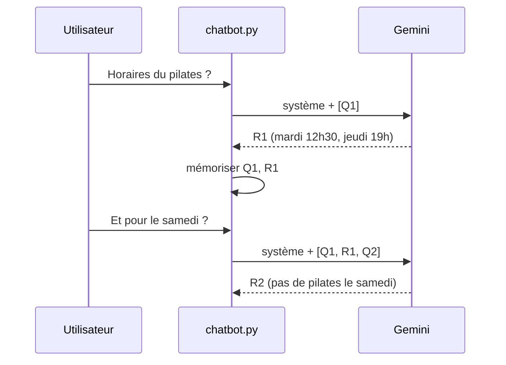

# La mémoire de conversation

> [!NOTE]
> Dans cette leçon, vous allez comprendre pourquoi un LLM « oublie » tout entre deux appels, puis donner à Alti une **mémoire courte** : les 10 derniers messages de chaque conversation, renvoyés au modèle à chaque tour.

## Le modèle n'a pas de mémoire

L'API Gemini est **sans état** : chaque appel est indépendant. Si l'utilisateur demande « Et pour le samedi ? », le modèle ne sait pas de quoi on parlait… sauf si on lui renvoie la conversation. La « mémoire » d'un chatbot, c'est donc **vous** qui la gérez : une liste de messages que vous ajoutez à chaque appel.



## Le code : une liste par session

Chaque conversation a un identifiant de **session** (une chaîne aléatoire créée par la page web). On garde un dictionnaire `session → liste de messages`, au format `types.Content` attendu par `google-genai` : un **rôle** (`user` pour l'utilisateur, `model` pour Gemini) et le texte.

```python title="files/chatbot.py (extrait)"
MAX_MESSAGES = 10  # mémoire courte : les 5 derniers échanges (question + réponse)
MEMOIRE: dict[str, list[types.Content]] = {}


def historique(session: str) -> list[types.Content]:
    return MEMOIRE.setdefault(session, [])


def memoriser(session: str, role: str, texte: str) -> None:
    """Ajoute un message ("user" ou "model") et oublie les plus anciens."""
    h = historique(session)
    h.append(types.Content(role=role, parts=[types.Part(text=texte)]))
    del h[:max(0, len(h) - MAX_MESSAGES)]  # garde les MAX_MESSAGES derniers (0 = aucun)
```

Et dans `repondre`, on envoie l'historique **suivi** de la nouvelle question ; on ne mémorise l'échange qu'**après** une réponse réussie :

```python title="files/chatbot.py (extrait de repondre)"
contenus = historique(session) + [
    types.Content(role="user", parts=[types.Part(text=message)])]
# ... appel en streaming ...
memoriser(session, "user", masquer(message))  # pas d'IBAN gardé en mémoire
memoriser(session, "model", reponse)
```

> [!TIP]
> Piège rencontré en écrivant ce lab : `del h[:-MAX_MESSAGES]` semble correct, mais avec `MAX_MESSAGES = 0` il devient `del h[:-0]`, c'est-à-dire `del h[:0]`, qui ne supprime **rien**. D'où la forme `max(0, len(h) - MAX_MESSAGES)`, couverte par un test.

## Pourquoi limiter la mémoire ?

| Mémoire | Avantage | Inconvénient |
| --- | --- | --- |
| Aucune | simple, économique | « Et pour le samedi ? » ne veut plus rien dire |
| Fenêtre glissante (N derniers messages) | coût stable, suffit pour un chatbot de questions-réponses | oublie le début des longues conversations |
| Tout l'historique | rien n'est oublié | coût et latence qui grandissent à chaque tour |
| Résumé + fenêtre | longues conversations possibles | un appel de plus pour résumer, risque de perdre un détail |

Chaque message renvoyé est facturé en **tokens** (morceaux de mots, l'unité de compte des LLM) à **chaque** tour : une conversation de 20 tours sans limite renvoie 20 fois le premier message.

> [!WARNING]
> Ici la mémoire vit dans la RAM du serveur : elle disparaît au redémarrage et n'est pas partagée entre plusieurs serveurs. C'est suffisant pour apprendre et pour une seule instance ; en production à plusieurs instances, on la range dans une base (Firestore, Redis…). Le code le signale par un commentaire.

```quiz
question: "Avec MAX_MESSAGES = 10, combien d'échanges complets (question + réponse) Alti garde-t-il en mémoire ?"
options:
  - "10"
  - "5"
  - "20"
answer: 1
explanation: "Chaque échange produit deux messages (rôle user puis rôle model). 10 messages = 5 échanges."
```

```quiz
question: "Pourquoi ne mémoriser l'échange qu'après une réponse réussie ?"
options:
  - "Pour économiser de la RAM"
  - "Pour ne pas laisser dans l'historique une question sans réponse ou un message d'erreur technique, qui fausserait les tours suivants"
  - "Parce que l'API Gemini refuse un historique de plus de 10 messages"
answer: 1
explanation: "Si le modèle est en panne, on renvoie un message d'excuse à l'utilisateur, mais on ne veut pas que Gemini relise ce message comme s'il l'avait écrit. Le test test_panne_du_modele_message_poli le vérifie."
```

## Exercice : un bouton « Nouvelle conversation »

Ajoutez à [chatbot.py](../files/chatbot.py) une fonction `oublier(session)` qui efface la mémoire d'une session, et à [app.py](../files/app.py) une route `POST /oublier` qui l'appelle. Écrivez le test correspondant.

<details>
<summary>Voir la solution</summary>

```python title="chatbot.py (ajout)"
def oublier(session: str) -> None:
    MEMOIRE.pop(session, None)
```

```python title="app.py (ajout)"
class Session(BaseModel):
    session: str = Field(min_length=1, max_length=64)


@app.post("/oublier")
def oublier(s: Session):
    chatbot.oublier(s.session)
    return {"ok": True}
```

```python title="test_chatbot.py (ajout)"
def test_oublier(faux):
    web.post("/chat", json={"session": "s9", "message": "Bonjour"})
    assert chatbot.historique("s9")
    web.post("/oublier", json={"session": "s9"})
    assert chatbot.historique("s9") == []
```

Côté page, le bouton peut simplement recharger la page : une nouvelle session est créée par `crypto.randomUUID()`.

</details>

## Résultat obtenu

Même question de suivi, avec et sans mémoire, `gemini-3.5-flash`, le 2026-10-15 :

```text title="sortie réelle, 2026-10-15 : MAX_MESSAGES = 0"
Q1: Les cours de Pilates ont lieu le mardi à 12h30 et le jeudi à 19h. [...]
Q2: Le samedi, la salle vous accueille de 8h à 20h, et l'accueil physique est ouvert de 9h
à 13h. Concernant les cours collectifs, nous proposons une séance de Yoga à 10h et un cours
de Cycling à 11h. [...]
messages en mémoire : []
```

```text title="sortie réelle, 2026-10-15 : MAX_MESSAGES = 10"
Q1: Les cours de Pilates ont lieu le mardi à 12h30 et le jeudi à 19h. [...]
Q2: Il n'y a pas de cours de Pilates le samedi. En revanche, le samedi, nous proposons un
cours de Yoga à 10h et un cours de Cycling à 11h.
messages en mémoire : ['user', 'model', 'user', 'model']
```

Sans mémoire, Alti répond à côté (les horaires du samedi en général) ; avec, il comprend que « samedi » porte sur le pilates.

## Je sais faire

- [ ] Expliquer pourquoi l'API est « sans état »
- [ ] Construire la liste `contents` avec les rôles `user` et `model`
- [ ] Limiter la mémoire à une fenêtre glissante, sans le piège `[:-0]`
- [ ] Choisir entre fenêtre, historique complet et résumé
