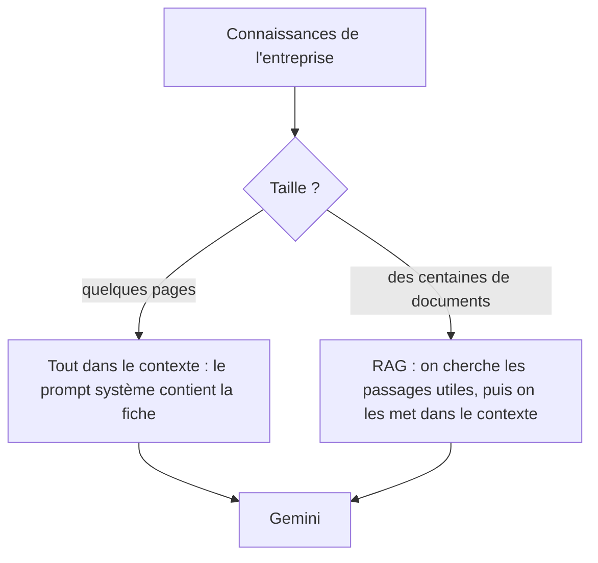

# Mettre la connaissance métier dans le contexte

> [!NOTE]
> Dans cette leçon, vous allez donner à Alti les informations de la salle (tarifs, horaires, règles) en les plaçant **directement dans le prompt système**, mesurer ce que cela coûte en tokens, et apprendre à écrire une fiche que le modèle exploite bien.

## Le modèle ne connaît pas votre entreprise

Gemini a appris sur des textes publics : il ne connaît ni les tarifs de la Salle Altitude ni ses horaires. Deux façons de lui donner cette connaissance :



Le **contexte** est tout le texte envoyé au modèle lors d'un appel (prompt système, historique, question). Le **RAG** (*Retrieval-Augmented Generation*, génération augmentée par recherche) ajoute une étape de recherche documentaire avant l'appel. Pour une fiche de quelques pages, le RAG est inutile : on met tout dans le contexte.

| Critère | Tout dans le contexte | RAG |
| --- | --- | --- |
| Volume adapté | quelques pages à quelques dizaines de pages | au-delà, ou documents nombreux |
| Mise en place | un fichier, une ligne de code | découpage, embeddings, index, recherche |
| Mise à jour | modifier le fichier, redémarrer | réindexer |
| Risque principal | coût en tokens à chaque appel | ne pas retrouver le bon passage |

## Le code : une ligne

```python title="files/chatbot.py (extrait)"
CONNAISSANCES = (ICI / "connaissances.md").read_text(encoding="utf-8")

SYSTEM_PROMPT = f"""...
## CONNAISSANCES
<connaissances>
{CONNAISSANCES}
</connaissances>
"""
```

La fiche [connaissances.md](../files/connaissances.md) est du Markdown ordinaire, que l'accueil peut modifier sans toucher au code.

## Écrire une fiche que le modèle exploite

| À faire | Exemple dans la fiche d'Alti |
| --- | --- |
| Des faits complets, avec unités | « 45 € la séance de 45 minutes » |
| Des tableaux pour les données comparables | le tableau des 6 formules (prix, engagement, contenu) |
| Les exceptions écrites noir sur blanc | « Fermeture le 25 décembre et le 1er janvier » |
| Les conditions à côté de la règle | « Étudiant : sur justificatif de moins de 26 ans » |
| Les procédures, avec qui fait quoi | « Résiliation Liberté : par e-mail à l'accueil, préavis d'un mois » |
| Une seule version de la vérité | pas de « ancien tarif » qui traîne |

> [!WARNING]
> Ne mettez dans la fiche **que** ce qui peut être dit à n'importe quel visiteur. Tout ce qui est dans le contexte peut ressortir dans une réponse, même avec une règle qui l'interdit. Pas de données d'adhérents, pas de marges, pas de mots de passe.

> [!TIP]
> Ajoutez une date de mise à jour en tête de la fiche et relisez-la à chaque changement de tarif. Le chatbot ne peut pas être plus juste que sa fiche.

## Combien ça coûte ?

La fiche est envoyée à **chaque** appel. On mesure sa taille avec `count_tokens`, qui ne génère rien :

```python title="mesure"
n = client.models.count_tokens(model=MODEL, contents=SYSTEM_PROMPT)
print(n.total_tokens)
```

Pour Alti, environ 1 260 tokens (voir plus bas) : c'est faible. Si votre fiche dépasse quelques dizaines de milliers de tokens, regardez la **mise en cache du contexte** de l'API Gemini (facturation réduite d'un préfixe répété) ou passez au RAG.

```quiz
question: "Une agence immobilière veut un chatbot qui répond sur ses 3 000 annonces, mises à jour chaque jour. Quelle approche ?"
options:
  - "Tout dans le prompt système, c'est plus simple"
  - "Un RAG (ou une recherche dans la base d'annonces) qui ne met dans le contexte que les annonces pertinentes"
  - "Réentraîner le modèle chaque nuit sur les annonces"
answer: 1
explanation: "3 000 annonces changeantes, c'est trop volumineux et trop mouvant pour le contexte. On cherche les annonces pertinentes puis on les donne au modèle. Réentraîner chaque nuit serait lent, cher et inutile."
```

```quiz
question: "Quelles informations peuvent aller dans connaissances.md ?"
options:
  - "Les horaires des cours collectifs"
  - "La liste des adhérents en retard de paiement"
  - "La procédure de gel de l'abonnement"
  - "Le mot de passe du logiciel de réservation"
answer: [0, 2]
explanation: "La fiche peut ressortir dans n'importe quelle réponse : elle ne doit contenir que de l'information publique. Les données d'adhérents et les secrets n'ont rien à y faire."
```

## Exercice : une question à laquelle la fiche ne répond pas

Trouvez trois questions légitimes auxquelles [connaissances.md](../files/connaissances.md) ne répond **pas** (par exemple sur le Wi-Fi). Posez-les avec `console.py`. Alti doit dire qu'il ne sait pas et donner le contact de l'accueil. Puis ajoutez l'information pour l'une d'elles et vérifiez que la réponse change.

<details>
<summary>Voir la solution</summary>

Exemples : « Y a-t-il le Wi-Fi ? », « Peut-on payer en espèces ? », « Comment s'appelle le professeur de yoga ? ».

Ajout dans la fiche, rubrique Services :

```markdown
- Wi-Fi gratuit : réseau « Altitude-Invites », mot de passe affiché à l'accueil.
```

Le mot de passe lui-même n'est **pas** dans la fiche : il est affiché à l'accueil. Après redémarrage, « Y a-t-il le Wi-Fi ? » obtient une réponse positive, sans mot de passe.

</details>

## Résultat obtenu

Mesures et réponses réelles, `gemini-3.5-flash`, le 2026-10-15 :

```text title="sortie réelle, 2026-10-15"
tokens du prompt système (fiche incluse) : 1257
caractères de connaissances.md : 2898
SANS FICHE : Je ne dispose pas du tarif concernant les séances de coaching individuel. Je vous
invite à contacter directement l'accueil par e-mail à accueil@salle-altitude.example ou par
téléphone au 04 00 00 00 00. [...]
AVEC FICHE : La séance de coaching individuel coûte 45 € pour une durée de 45 minutes.
Les rendez-vous se prennent directement auprès de l'accueil de la salle. Pour information,
la formule d'abonnement Premium comprend déjà une séance de coaching offerte par mois.
```

Sans fiche, la règle « n'invente jamais un prix » a joué : Alti renvoie vers l'accueil au lieu d'inventer un tarif. Avec la fiche, il répond juste et ajoute même une information utile (la séance incluse dans Premium).

## Je sais faire

- [ ] Expliquer ce qu'est le contexte d'un appel
- [ ] Choisir entre « tout dans le contexte » et RAG
- [ ] Écrire une fiche factuelle, complète et sans donnée sensible
- [ ] Mesurer le poids d'un prompt avec `count_tokens`
