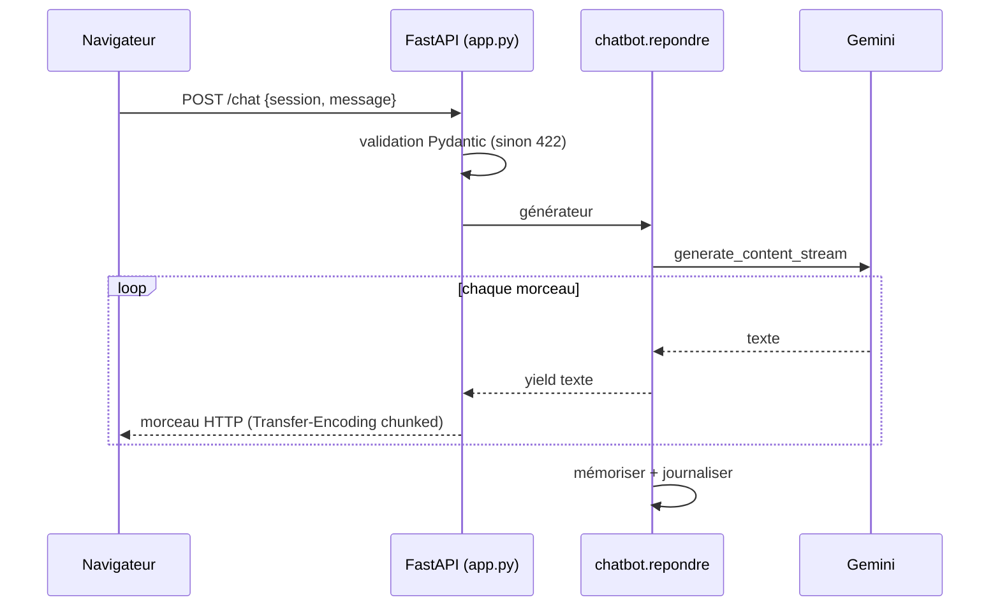

# Une API web en streaming avec FastAPI

> [!NOTE]
> Dans cette leçon, vous allez exposer Alti sur le web avec **FastAPI** : une route `POST /chat` qui renvoie la réponse **au fil de l'eau**, des entrées validées, et une route de santé. Vous la testerez avec `curl` puis avec pytest, sans clé.

## Le rôle de l'API

Une **API** (interface de programmation) est ici un petit serveur HTTP : la page web lui envoie une question en JSON, il renvoie la réponse. **FastAPI** est un framework Python qui transforme des fonctions en routes HTTP et valide les données grâce à **Pydantic** (des classes qui décrivent la forme attendue). **Uvicorn** est le serveur qui fait tourner l'application.



## Le code de l'API

[app.py](../files/app.py) ne contient aucune logique métier : il traduit HTTP en appels à [chatbot.py](../files/chatbot.py).

```python title="files/app.py (extrait)"
class Question(BaseModel):
    session: str = Field(min_length=1, max_length=64)
    message: str = Field(min_length=1, max_length=2000)


@app.post("/chat")
def chat(q: Question):
    echange_id = uuid.uuid4().hex[:12]
    return StreamingResponse(
        chatbot.repondre(q.session, q.message, echange_id),
        media_type="text/plain; charset=utf-8",
        headers={"X-Echange-Id": echange_id})
```

- `StreamingResponse` accepte un **générateur** Python (une fonction qui fait `yield`) : chaque `yield` part immédiatement vers le navigateur.
- `X-Echange-Id` est un **en-tête** HTTP : l'identifiant de l'échange, envoyé avant le texte. La page s'en servira pour rattacher l'avis 👍/👎 à la bonne réponse.
- `max_length=2000` protège votre facture : personne ne pourra envoyer un roman à chaque requête.

> [!TIP]
> Pourquoi du texte brut et pas des **SSE** (*Server-Sent Events*, un format de flux standard) ? Parce qu'on n'envoie qu'un seul type d'information : du texte. Le texte brut se lit en 5 lignes de JavaScript. Passez aux SSE si vous devez envoyer plusieurs types d'événements (texte, sources, fin).

## Les erreurs du modèle

Si Gemini renvoie une erreur passagère (429 : trop de requêtes ; 503 : service surchargé), `repondre` réessaie deux fois avec une attente croissante, **seulement si rien n'a encore été envoyé**. Sinon l'utilisateur reçoit un message d'excuse poli, jamais une trace d'erreur Python.

```python title="files/chatbot.py (extrait de repondre)"
except errors.APIError as e:
    erreur = f"{e.code} {e.status}"
    if e.code in (429, 500, 503) and not morceaux and essai < 2:
        time.sleep(2 ** essai * 2)
        continue
    break
```

| Code | Signification | Réaction |
| --- | --- | --- |
| 200 | réponse en streaming | afficher au fil de l'eau |
| 422 | entrée invalide (message vide, trop long) | renvoyé par FastAPI, sans appel au modèle |
| 429 / 503 côté Gemini | quota ou surcharge | réessai, puis message d'excuse (le HTTP reste 200) |

```quiz
question: "Que se passe-t-il si la page envoie un message vide ?"
options:
  - "Gemini répond « Je n'ai pas compris »"
  - "FastAPI renvoie une erreur 422 avant tout appel au modèle"
  - "Le serveur plante"
answer: 1
explanation: "Le modèle Pydantic Question impose min_length=1. FastAPI valide la requête avant d'appeler votre fonction : pas d'appel facturé, pas de plantage."
```

```quiz
question: "Pourquoi ne réessaie-t-on pas si des morceaux ont déjà été envoyés ?"
options:
  - "Parce que l'utilisateur verrait le début de la réponse deux fois"
  - "Parce que l'API Gemini l'interdit"
  - "Pour économiser de la mémoire"
answer: 0
explanation: "Le texte déjà envoyé est affiché à l'écran : recommencer depuis le début collerait une deuxième réponse à la première."
```

## Tester sans clé

[test_chatbot.py](../files/test_chatbot.py) remplace Gemini par un **faux modèle** qui renvoie des morceaux prévus à l'avance, et appelle l'API avec le `TestClient` de FastAPI :

```python title="files/test_chatbot.py (extrait)"
class FauxModele:
    def __init__(self, morceaux=("Bonjour, ", "la salle ouvre à 6h.")):
        self.morceaux, self.appels = morceaux, []

    def generate_content_stream(self, model, contents, config):
        self.appels.append(contents)
        for m in self.morceaux:
            yield SimpleNamespace(text=m)
```

## Exercice : limiter la taille de la session

Un client malveillant pourrait créer des milliers de sessions et remplir la RAM. Proposez une protection simple dans `chatbot.py`, sans base de données.

<details>
<summary>Voir la solution</summary>

Limiter le nombre de sessions gardées, en oubliant les plus anciennes (un `dict` Python garde l'ordre d'insertion) :

```python title="chatbot.py (modification)"
MAX_SESSIONS = 1000


def historique(session: str) -> list[types.Content]:
    if session not in MEMOIRE and len(MEMOIRE) >= MAX_SESSIONS:
        MEMOIRE.pop(next(iter(MEMOIRE)))  # la plus ancienne
    return MEMOIRE.setdefault(session, [])
```

Côté infrastructure, Cloud Run permet aussi de limiter le nombre d'instances (`--max-instances`), ce qui plafonne la dépense.

</details>

## Résultat obtenu

Serveur lancé avec `uvicorn app:app --port 18001`, requêtes réelles avec `curl`, le 2026-10-15 :

```text title="sortie réelle, 2026-10-15"
$ curl -s localhost:18001/sante
{"ok":true,"modele":"gemini-3.5-flash"}

$ curl -sN -D - -X POST localhost:18001/chat -H 'Content-Type: application/json' \
       -d '{"session":"demo","message":"Puis-je venir avec un invité ?"}'
HTTP/1.1 200 OK
x-echange-id: b181c0955625
content-type: text/plain; charset=utf-8
Transfer-Encoding: chunked

Si vous disposez de la formule Premium, vous pouvez venir avec un invité une fois par mois.
Pour les autres formules, votre invité peut bénéficier d'une séance découverte gratuite, une
fois par personne et sur réservation. [...]

$ curl -s -X POST localhost:18001/chat -H 'Content-Type: application/json' -d '{"session":"demo","message":""}'
{"detail":[{"type":"string_too_short","loc":["body","message"],"msg":"String should have at least 1 character",...}]}
```

`Transfer-Encoding: chunked` confirme le streaming. Et `pytest -q test_chatbot.py` : `8 passed in 0.55s`, sans clé.

## Je sais faire

- [ ] Écrire une route FastAPI validée par un modèle Pydantic
- [ ] Renvoyer un générateur avec `StreamingResponse`
- [ ] Passer une information dans un en-tête (`X-Echange-Id`)
- [ ] Tester une API sans clé grâce à un faux modèle
