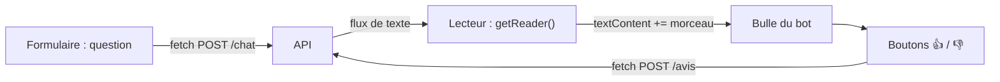
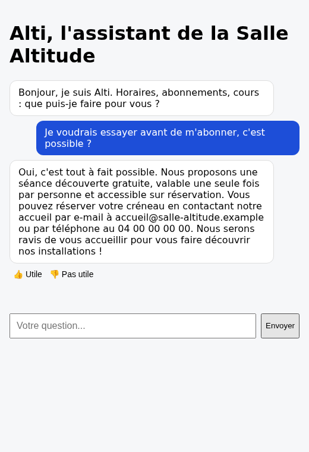

# Une page web minimale, servie par l'API

> [!NOTE]
> Dans cette leçon, vous allez écrire la page de discussion d'Alti : **un seul fichier HTML** de 100 lignes, sans framework ni outil de build, servi par FastAPI, qui affiche la réponse au fur et à mesure et propose 👍 / 👎 après chaque réponse.

## Une page, trois rôles



La page est servie par l'API elle-même (`GET /` renvoie [index.html](../files/index.html)) : même adresse, donc pas de problème de **CORS** (la règle du navigateur qui bloque, par défaut, les appels vers un autre domaine).

```python title="files/app.py (extrait)"
@app.get("/")
def page():
    return FileResponse(Path(__file__).parent / "index.html")
```

## Lire un flux en JavaScript

`fetch` renvoie une réponse dont le corps (`body`) est un **flux lisible** (`ReadableStream`). On le lit morceau par morceau avec un lecteur, et on décode les octets en texte avec `TextDecoder` :

```javascript title="files/index.html (extrait)"
const rep = await fetch("/chat", { method: "POST", headers: { "Content-Type": "application/json" },
  body: JSON.stringify({ session, message }) });
const lecteur = rep.body.getReader();
const decodeur = new TextDecoder();
bot.textContent = "";
for (;;) {                                    // affiche chaque morceau dès qu'il arrive
  const { done, value } = await lecteur.read();
  if (done) break;
  bot.textContent += decodeur.decode(value, { stream: true });
}
boutonsAvis(bot, rep.headers.get("X-Echange-Id"));
```

- `{ stream: true }` évite de couper un caractère accentué (plusieurs octets en UTF-8) entre deux morceaux.
- `session` vaut `crypto.randomUUID()` : une conversation par onglet, sans cookie ni compte.

> [!WARNING]
> On écrit avec `textContent`, **jamais** avec `innerHTML`. Si le modèle (ou un utilisateur malin, par injection de prompt) produit ``, `innerHTML` l'exécuterait dans la page : c'est une faille **XSS** (*cross-site scripting*). `textContent` l'affiche comme du texte.

| Choix | Ici | Quand changer |
| --- | --- | --- |
| HTML + JS sans framework | 1 fichier, rien à compiler | interface riche (historique, pièces jointes, comptes) |
| Texte brut, pas de Markdown | sûr et simple | si vous voulez des listes : une bibliothèque Markdown avec nettoyage du HTML |
| Session en mémoire du navigateur | rien à stocker | reprise de conversation sur un autre appareil |

## Accessibilité de base

- `aria-live="polite"` sur le fil de discussion : un lecteur d'écran annonce les nouvelles réponses.
- Un `<label>` pour le champ de saisie, même masqué visuellement.
- Les boutons d'avis ont un texte (« Utile », « Pas utile »), pas seulement un emoji.

```quiz
question: "Pourquoi la page est-elle servie par FastAPI plutôt que depuis un autre site ?"
options:
  - "Parce qu'un navigateur ne sait pas ouvrir un fichier HTML"
  - "Pour que la page et l'API aient la même origine, ce qui évite de configurer le CORS"
  - "Pour que Gemini puisse lire la page"
answer: 1
explanation: "Même origine (même domaine, même port) : le navigateur autorise les appels fetch sans en-têtes CORS. Gemini ne voit jamais la page."
```

```quiz
question: "La réponse du modèle contient <b>Bonjour</b>. Qu'affiche la page d'Alti ?"
options:
  - "Bonjour en gras"
  - "Le texte <b>Bonjour</b> tel quel, balises comprises"
  - "Rien, le navigateur bloque la réponse"
answer: 1
explanation: "textContent n'interprète jamais le HTML : les balises s'affichent comme du texte. C'est voulu, c'est ce qui protège contre le XSS."
```

## Exercice : un indicateur « Alti écrit… »

Le premier morceau met quelques secondes à arriver (voir le résultat ci-dessous). Désactivez le bouton Envoyer pendant la réponse et affichez « Alti écrit… » jusqu'au premier morceau.

<details>
<summary>Voir la solution</summary>

```javascript title="index.html (modification)"
const bouton = document.querySelector("form button");
bouton.disabled = true;
const bot = bulle("Alti écrit…", "bot");
// ... fetch et getReader inchangés ...
let premier = true;
for (;;) {
  const { done, value } = await lecteur.read();
  if (done) break;
  if (premier) { bot.textContent = ""; premier = false; }
  bot.textContent += decodeur.decode(value, { stream: true });
}
bouton.disabled = false;
```

Supprimez la ligne `bot.textContent = "";` placée avant la boucle, sinon le message d'attente disparaît trop tôt.

</details>

## Résultat obtenu

Test réel dans Chromium (piloté par Playwright), serveur local et `gemini-3.5-flash`, le 2026-10-15. Le script mesure la longueur du texte affiché toutes les 150 ms, clique sur 👍 puis lit `/stats` :

```text title="sortie réelle, 2026-10-15"
affichage progressif : 38 ms : 1 car. | 3480 ms : 0 car. | 3635 ms : 79 car. | 3791 ms : 215 car.
réponse : Oui, c'est tout à fait possible. Nous proposons une séance découverte gratuite,
valable une seule fois par personne et accessible sur réservation. [...]
après clic : Merci pour votre avis.
stats : {"echanges":1,"erreurs":0,"avis":1,"satisfaction":1.0,"taux_avis":1.0,"latence_mediane_ms":3854}
```

On voit le « … » d'attente (1 caractère), puis le texte qui grandit par morceaux à partir d'environ 3,5 s : c'est le streaming.



## Je sais faire

- [ ] Servir une page HTML depuis FastAPI
- [ ] Lire une réponse en streaming avec `getReader()` et `TextDecoder`
- [ ] Expliquer pourquoi `textContent` protège du XSS
- [ ] Ajouter les bases d'accessibilité à une interface de discussion
