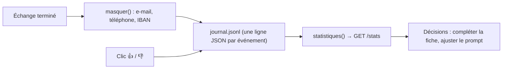

# Journaliser et mesurer la satisfaction

> [!NOTE]
> Dans cette leçon, vous allez faire écrire à Alti un **journal** de chaque échange (sans données personnelles), recueillir l'avis 👍 / 👎 des utilisateurs et calculer quelques **indicateurs** : satisfaction, erreurs, latence.

## Pourquoi journaliser ?

Sans journal, vous ne savez pas ce que les gens demandent, ni où le chatbot se trompe. Le journal sert à trois choses : **comprendre** (quelles questions ?), **corriger** (quelles réponses ont reçu 👎 ?), **surveiller** (erreurs, lenteurs).



Le format **JSONL** (*JSON Lines*) met un objet JSON par ligne : on ajoute à la fin du fichier sans le relire, et n'importe quel outil (Python, `jq`, BigQuery) sait le lire.

## Le code

```python title="files/chatbot.py (extrait)"
EMAIL = re.compile(r"[\w.+-]+@[\w-]+\.[\w.]+")
TELEPHONE = re.compile(r"(?:\+33|0)\s?[1-9](?:[\s.-]?\d{2}){4}")
IBAN = re.compile(r"\bFR\d{2}(?:\s?[0-9A-Z]{4}){5}\s?[0-9A-Z]{3}\b", re.I)


def masquer(texte: str) -> str:
    """Retire les données personnelles évidentes avant d'écrire le journal."""
    texte = IBAN.sub("[IBAN]", texte)
    texte = EMAIL.sub("[EMAIL]", texte)
    return TELEPHONE.sub("[TEL]", texte)


def journaliser(evenement: dict) -> None:
    evenement = {"ts": datetime.now(timezone.utc).isoformat(timespec="seconds"), **evenement}
    ligne = json.dumps(evenement, ensure_ascii=False)
    if os.environ.get("K_SERVICE"):  # variable définie par Cloud Run :
        print(ligne, flush=True)     # stdout y part dans Cloud Logging
    with JOURNAL.open("a", encoding="utf-8") as f:
        f.write(ligne + "\n")
```

Chaque échange produit un événement `echange` (question et réponse masquées, latence, modèle, erreur éventuelle), chaque clic un événement `avis`, relié par l'identifiant `id` reçu dans l'en-tête `X-Echange-Id`.

> [!WARNING]
> Le masquage par expressions régulières attrape les formats **évidents**, pas tout (un nom, une adresse postale passent). Informez les utilisateurs que les échanges sont enregistrés, fixez une durée de conservation, et ne journalisez jamais plus que nécessaire : c'est ce qu'exige le RGPD.

## Les indicateurs

```python title="files/chatbot.py (extrait de statistiques)"
return {
    "echanges": len(echanges),
    "erreurs": sum(1 for e in echanges if e.get("erreur")),
    "avis": len(avis),
    "satisfaction": round(positifs / len(avis), 2) if avis else None,
    "taux_avis": round(len(avis) / len(echanges), 2) if echanges else None,
    "latence_mediane_ms": latences[len(latences) // 2] if latences else None,
}
```

| Indicateur | Ce qu'il dit | Piège |
| --- | --- | --- |
| `satisfaction` | part des avis positifs | calculé sur ceux qui votent seulement |
| `taux_avis` | part des réponses notées | sous quelques pourcents, la satisfaction est peu fiable |
| `erreurs` | pannes du modèle | à surveiller avec une alerte |
| `latence_mediane_ms` | temps typique d'une réponse complète | la **médiane** résiste aux valeurs extrêmes, contrairement à la moyenne |

> [!TIP]
> Un 👎 vaut de l'or : relisez chaque semaine les échanges notés négativement. La plupart du temps, la correction est une ligne à ajouter dans [connaissances.md](../files/connaissances.md), pas du code.

```quiz
question: "Sur 1 000 échanges, 40 avis dont 36 positifs. Que conclure ?"
options:
  - "Le chatbot satisfait 90 % des utilisateurs"
  - "90 % des votants sont satisfaits, mais seuls 4 % ont voté : il faut aussi relire un échantillon d'échanges non notés"
  - "Le chatbot ne satisfait que 3,6 % des utilisateurs"
answer: 1
explanation: "La satisfaction (36/40 = 90 %) ne porte que sur les votants, qui ne sont pas forcément représentatifs. Le taux d'avis (4 %) rappelle de compléter par une relecture d'échantillons."
```

```quiz
question: "Pourquoi la médiane plutôt que la moyenne pour la latence ?"
options:
  - "Elle est plus rapide à calculer"
  - "Une poignée de réponses très lentes (réessais après une erreur 429) ne la déforme pas"
  - "La moyenne n'a pas de sens pour des millisecondes"
answer: 1
explanation: "Une seule réponse à 30 s parmi des réponses à 3 s tire la moyenne vers le haut ; la médiane reste représentative de l'expérience typique. En production, on suit aussi le 95e centile."
```

## Exercice : la part de « je ne sais pas »

Ajoutez à `statistiques()` un indicateur `sans_reponse` : la part des réponses qui renvoient vers l'accueil faute d'information. Indice : le prompt fait donner le contact de l'accueil dans ce cas.

<details>
<summary>Voir la solution</summary>

```python title="chatbot.py (ajout dans statistiques)"
renvois = sum(1 for e in echanges if "accueil@" in e["reponse"] or "[EMAIL]" in e["reponse"])
# ...
"sans_reponse": round(renvois / len(echanges), 2) if echanges else None,
```

Attention : le journal est **masqué**, donc l'e-mail de l'accueil y apparaît comme `[EMAIL]`. C'est une heuristique : certaines réponses donnent le contact même quand elles répondent. Pour un indicateur exact, faites ajouter au modèle un marqueur explicite, ou classez les réponses avec un second appel. Regardez cet indicateur par thème : il dit quoi ajouter à la fiche.

</details>

## Résultat obtenu

Extrait réel de `journal.jsonl` après la session console du 2026-10-15 (l'IBAN, fictif, a été masqué avant écriture) :

```json title="journal.jsonl (extrait réel, 2026-10-15)"
{"ts": "2026-10-15T14:32:16+00:00", "type": "echange", "id": "234a8ba195de", "session": "40cbb89b5c8c4383bff688cc9161c838", "question": "Mon IBAN est [IBAN], vous pouvez le noter ?", "reponse": "Je ne peux pas prendre en note vos coordonnées bancaires sur ce chat. [...]", "latence_ms": 3945, "modele": "gemini-3.5-flash", "erreur": null}
```

Et les statistiques renvoyées par `GET /stats` à la fin du test de bout en bout ([test_http_reel.py](../files/test_http_reel.py)), après 5 échanges et un 👍 :

```text title="sortie réelle, 2026-10-15"
stats : {'echanges': 5, 'erreurs': 0, 'avis': 1, 'satisfaction': 1.0, 'taux_avis': 0.2, 'latence_mediane_ms': 3209}
```

## Je sais faire

- [ ] Écrire un journal JSONL, un événement par ligne
- [ ] Masquer e-mails, téléphones et IBAN avant d'écrire
- [ ] Relier un avis à sa réponse par un identifiant d'échange
- [ ] Lire satisfaction, taux d'avis et latence médiane avec leurs pièges
