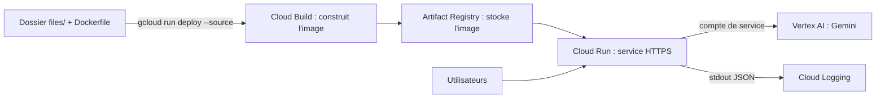

# Passer en production avec Cloud Run

> [!NOTE]
> Dans cette leçon, vous allez comprendre ce que fait **Cloud Run**, empaqueter Alti dans un **conteneur**, le déployer avec une seule commande, le tester, lire ses journaux dans Cloud Logging… puis **tout supprimer**. Chaque commande ci-dessous a été exécutée le 2026-10-15.

## Cloud Run en trois phrases

Cloud Run exécute votre application dans un **conteneur** (un paquet qui contient le code, Python et les dépendances, décrit par un `Dockerfile`). Il lui donne une adresse HTTPS, démarre des copies (**instances**) quand les requêtes arrivent et les arrête quand il n'y en a plus. Vous payez à l'usage : au repos, avec zéro instance, le coût de calcul est nul.



## Le conteneur

```dockerfile title="files/Dockerfile"
FROM python:3.12-slim
WORKDIR /app
COPY requirements.txt .
RUN pip install --no-cache-dir -r requirements.txt
COPY . .
# Cloud Run fournit le port dans la variable PORT (8080 par défaut).
CMD exec uvicorn app:app --host 0.0.0.0 --port ${PORT:-8080}
```

Les fichiers `.dockerignore` et `.gcloudignore` excluent `.env` et `journal.jsonl` : **la clé ne part jamais dans l'image**.

## Quelle identité pour appeler Gemini ?

| Option | Comment | Quand |
| --- | --- | --- |
| Vertex AI + compte de service (testée ici) | `GOOGLE_GENAI_USE_VERTEXAI=TRUE`, aucune clé : le service s'authentifie avec son **compte de service** (l'identité Google Cloud de l'application) | recommandé sur Google Cloud |
| Clé d'API dans Secret Manager | `gcloud secrets create`, puis `--set-secrets GOOGLE_API_KEY=nom-du-secret:latest` | vous restez sur l'API Gemini (non testée dans ce lab) |
| Clé en variable d'environnement en clair | `--set-env-vars GOOGLE_API_KEY=...` | **jamais** : visible par quiconque lit la configuration du service |

Le code ne change pas : `genai.Client()` lit ces variables. Seul le nom du modèle change, car le catalogue diffère entre l'API Gemini et Vertex AI (ici `gemini-2.5-flash`, disponible sur Vertex AI en `europe-west1`).

## Déployer

```bash title="terminal (dans files/)"
gcloud run deploy lab-chatbot-metier --source . \
  --region europe-west1 --project VOTRE_PROJET \
  --labels formation-lab=chatbot-metier \
  --set-env-vars GOOGLE_GENAI_USE_VERTEXAI=TRUE,GOOGLE_CLOUD_PROJECT=VOTRE_PROJET,GOOGLE_CLOUD_LOCATION=europe-west1,MODEL=gemini-2.5-flash \
  --no-allow-unauthenticated --max-instances 1
```

- `--source .` : Cloud Build construit l'image à partir du `Dockerfile`, sans Docker sur votre poste.
- `--no-allow-unauthenticated` : seules les personnes autorisées (avec un jeton) peuvent appeler le service, idéal pour un test. Pour un vrai chatbot public, il faudra `--allow-unauthenticated` **et** une limite de débit.
- `--max-instances 1` : plafonne la dépense en cas d'abus.
- Le compte de service du service doit avoir le rôle **Utilisateur Vertex AI** (`roles/aiplatform.user`).

> [!TIP]
> Cloud Run définit la variable `K_SERVICE` dans le conteneur. `journaliser()` s'en sert pour écrire aussi sur la sortie standard : chaque ligne JSON devient une entrée de Cloud Logging dont les champs (`jsonPayload.erreur`, `jsonPayload.latence_ms`…) sont filtrables. Le fichier `journal.jsonl`, lui, disparaît à chaque arrêt d'instance.

```quiz
question: "Pourquoi ne pas passer la clé d'API avec --set-env-vars ?"
options:
  - "Parce que Cloud Run refuse les variables de plus de 32 caractères"
  - "Parce qu'elle serait lisible en clair dans la configuration du service ; Secret Manager ou un compte de service évitent d'exposer la clé"
  - "Parce que genai.Client() ne lit pas les variables d'environnement sur Cloud Run"
answer: 1
explanation: "Toute personne qui peut décrire le service voit ses variables d'environnement. Un secret est stocké chiffré, avec des droits d'accès séparés ; un compte de service supprime même le besoin d'une clé."
```

```quiz
question: "La mémoire de conversation d'Alti est en RAM. Que se passe-t-il sur Cloud Run avec 3 instances ?"
options:
  - "Rien de spécial, Cloud Run partage la RAM entre instances"
  - "Deux messages d'une même conversation peuvent arriver sur deux instances différentes : la seconde ne connaît pas le début"
  - "Cloud Run refuse de démarrer plus d'une instance"
answer: 1
explanation: "Chaque instance a sa propre RAM. C'est pour cela que ce lab fixe --max-instances 1 ; au-delà, la mémoire doit aller dans une base partagée (Firestore, Memorystore…)."
```

## Nettoyer

Un service Cloud Run au repos ne coûte presque rien, mais l'image stockée, si. Supprimez tout ce que le déploiement a créé :

```bash title="terminal"
gcloud run services delete lab-chatbot-metier --region europe-west1 --project VOTRE_PROJET --quiet
gcloud artifacts docker images delete \
  europe-west1-docker.pkg.dev/VOTRE_PROJET/cloud-run-source-deploy/lab-chatbot-metier \
  --delete-tags --project VOTRE_PROJET --quiet
gcloud storage rm -r gs://run-sources-VOTRE_PROJET-europe-west1/services/lab-chatbot-metier/
# Vérification : ces commandes ne doivent plus rien afficher pour lab-chatbot-metier
gcloud run services list --region europe-west1 --project VOTRE_PROJET | grep chatbot
gcloud artifacts docker images list europe-west1-docker.pkg.dev/VOTRE_PROJET/cloud-run-source-deploy | grep chatbot
```

## Exercice : rendre le service public sans se ruiner

Listez trois protections à ajouter avant de passer en `--allow-unauthenticated`.

<details>
<summary>Voir la solution</summary>

1. **Plafonds** : `--max-instances` bas et une **alerte de budget** sur le projet.
2. **Limite de débit** par adresse IP ou par session (par exemple avec Cloud Armor devant un équilibreur de charge, ou un compteur simple dans l'application) : un robot ne doit pas pouvoir enchaîner des milliers de questions.
3. **Limites d'entrée** déjà en place : `max_length=2000` sur le message, mémoire limitée à 10 messages, journal masqué.

On peut aussi exiger une vérification anti-robot (reCAPTCHA) sur la page.

</details>

## Résultat obtenu

Déploiement réel le 2026-10-15 (projet de test, `europe-west1`), puis appels avec un jeton d'identité :

```text title="sortie réelle, 2026-10-15"
Service [lab-chatbot-metier] revision [lab-chatbot-metier-00001-vnp] has been deployed and is serving 100 percent of traffic.

$ curl -H "Authorization: Bearer $(gcloud auth print-identity-token)" $URL/sante
{"ok":true,"modele":"gemini-2.5-flash"}
$ curl -s -o /dev/null -w "%{http_code}" $URL/sante          # sans jeton
403
$ curl -N -X POST $URL/chat -H "Authorization: Bearer ..." -H 'Content-Type: application/json' -d '{"session":"cloudrun","message":"Combien coûte la carte 10 entrées ?"}'
La carte 10 entrées coûte 120 €. Elle est valable 6 mois et donne accès uniquement au plateau.
```

Les deux événements correspondants, lus dans Cloud Logging. Le premier essai a reçu un **429** (quota Vertex AI partagé, épuisé à ce moment-là) : après deux réessais, l'utilisateur a reçu le message d'excuse ; le second a réussi en moins d'une seconde.

```json title="gcloud logging read ... jsonPayload.type=\"echange\" (réel, 2026-10-15)"
{"jsonPayload": {"erreur": null, "latence_ms": 923, "modele": "gemini-2.5-flash", "question": "Combien coûte la carte 10 entrées ?"}, "timestamp": "2026-10-15T14:35:39.740410Z"}
{"jsonPayload": {"erreur": "429 RESOURCE_EXHAUSTED", "latence_ms": 6985, "modele": "gemini-2.5-flash", "question": "Combien coûte la carte 10 entrées ?"}, "timestamp": "2026-10-15T14:34:43.641351Z"}
```

Puis service, image et sources supprimés ; les deux commandes de vérification n'affichent plus rien.

## Je sais faire

- [ ] Expliquer conteneur, instance et compte de service
- [ ] Déployer avec `gcloud run deploy --source` sans exposer de clé
- [ ] Retrouver les échanges dans Cloud Logging
- [ ] Supprimer service, image et sources, et vérifier la suppression
