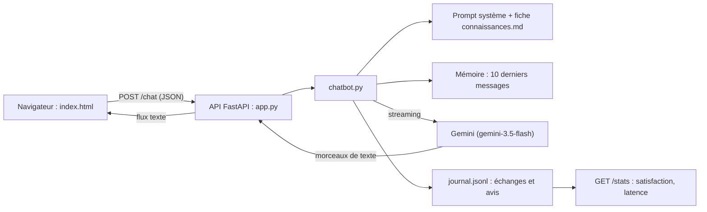

Un chatbot « métier », c'est un assistant qui connaît **une** entreprise, répond à **ses** clients, avec **son** ton, et sait dire « je ne sais pas ». Pas besoin d'agent, de base vectorielle ni de framework : un bon prompt système, une mémoire courte, une fiche de connaissances et une petite API web suffisent pour la grande majorité des cas.

Fil rouge : **Alti**, l'assistant en ligne de la **Salle Altitude**, une salle de sport fictive. Il répond sur les horaires, les tarifs, les cours et le règlement, refuse les conseils médicaux, ne prend jamais d'IBAN, et chaque réponse est journalisée et notée par l'utilisateur.

## Pour qui ?

- Vous débutez avec les LLM (grands modèles de langage, comme Gemini) et vous savez lancer un script Python.
- Vous voulez livrer un assistant concret à une équipe (support client, accueil, assistant interne), pas une démo.
- Aucune connaissance préalable de FastAPI, de JavaScript ou de Google Cloud n'est nécessaire : tout est expliqué.

## Ce que l'on construit



## Prérequis

- Python 3.10 ou plus récent.
- Une clé d'API Gemini gratuite, créée dans Google AI Studio, à placer dans un fichier `.env` (modèle : `files/.env.example`).
- Pour le module 4 seulement : un projet Google Cloud avec la facturation activée (la lecture suffit sinon).

## Programme

| Module | Leçons | Durée indicative |
| --- | --- | --- |
| 1. Cadrer et écrire le prompt | Fiche de cadrage (périmètre, ton, refus) ; prompt système et premier échange | 1h |
| 2. Mémoire et connaissances | Mémoire de conversation ; connaissances métier dans le contexte | 50 min |
| 3. Interface et mesure | API FastAPI en streaming ; page HTML/JS ; journal et satisfaction | 1h20 |
| 4. Production et projet final | Cloud Run expliqué (et testé) ; projet final : votre propre chatbot | 50 min |

## Le code du lab

Tout est dans [files/](./files/) : [chatbot.py](./files/chatbot.py) (la logique), [app.py](./files/app.py) (l'API), [index.html](./files/index.html) (la page), [connaissances.md](./files/connaissances.md) (la fiche métier), [console.py](./files/console.py) (discuter dans le terminal), [test_chatbot.py](./files/test_chatbot.py) (8 tests sans clé), [test_http_reel.py](./files/test_http_reel.py) (vrai serveur, vrai modèle) et un [Dockerfile](./files/Dockerfile).

```bash title="terminal"
cd files
python -m venv .venv && source .venv/bin/activate
pip install -r requirements.txt
cp .env.example .env            # puis mettez votre vraie clé dans .env
pytest -q test_chatbot.py       # sans clé, en moins d'une seconde
uvicorn app:app --reload        # puis ouvrez http://localhost:8000
```

## En local ou sur GCP ?

| | En local | Sur Google Cloud (module 4) |
| --- | --- | --- |
| Modèle | API Gemini avec `GOOGLE_API_KEY` | API Gemini, ou Vertex AI sans clé (compte de service) |
| Serveur | `uvicorn` sur votre machine | Cloud Run : conteneur, HTTPS, mise à l'échelle automatique |
| Journal | fichier `journal.jsonl` | Cloud Logging (sortie standard en JSON) |
| Coût | gratuit dans les limites du palier gratuit | facturé à l'usage, proche de zéro au repos |

Le code a été exécuté et testé le 2026-10-15 : tests sans clé, conversation réelle par HTTP, conteneur Docker et déploiement Cloud Run (puis suppression).
