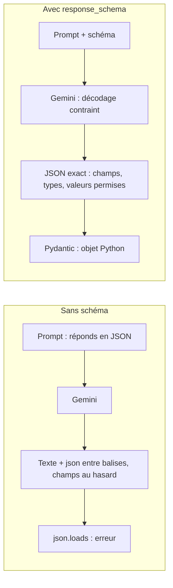

# Du texte libre au JSON garanti

> [!NOTE]
> Dans cette leçon, vous allez voir pourquoi « réponds en JSON » ne suffit pas, puis obtenir un JSON **conforme à un schéma** avec deux paramètres de l'API Gemini : `response_mime_type` et `response_schema`.

## Le problème : un JSON « à peu près »

Demandez à un LLM « donne-moi en JSON… » : il répond souvent bien, mais pas toujours **pareil**. Il ajoute une phrase d'introduction, entoure le JSON de balises Markdown, choisit lui-même les noms de champs, met `"urgence": true` une fois et `"urgence": "oui"` la suivante. Pour un programme qui doit lire ce JSON, chacun de ces écarts est une panne.



## Les deux paramètres

- `response_mime_type="application/json"` : le modèle ne produit **que** du JSON, sans texte autour.
- `response_schema=MonModele` : la **forme** du JSON est imposée (noms des champs, types, champs obligatoires, valeurs permises). On parle de **décodage contraint** : à chaque mot généré, le modèle ne peut choisir que des suites compatibles avec le schéma.

```python title="exemple (utilise files/schemas.py)"
from google import genai
from google.genai import types
from schemas import Commande

client = genai.Client()
r = client.models.generate_content(
    model="gemini-3.5-flash",
    contents="Extrais la commande de cet e-mail :\n" + texte_email,
    config=types.GenerateContentConfig(
        response_mime_type="application/json",
        response_schema=Commande,      # une classe Pydantic
        temperature=0))
print(r.text)        # le JSON brut
print(r.parsed)      # un objet Commande, déjà construit par le SDK
```

`temperature=0` rend la sortie aussi constante que possible : en extraction, on ne veut pas de créativité.

| Approche | JSON valide ? | Champs prévisibles ? | Valeurs contrôlées ? |
| --- | --- | --- | --- |
| « Réponds en JSON » dans le prompt | souvent | non | non |
| `response_mime_type` seul | oui | non | non |
| `response_mime_type` + `response_schema` | oui | oui | oui (types, énumérations) |
| … + validation Pydantic (module 2) | oui | oui | oui, plus vos règles métier |

> [!WARNING]
> Le schéma accepté par Gemini est un **sous-ensemble** de JSON Schema. En écrivant ce lab, `quantite: int = Field(gt=0)` (strictement positif) a été refusé par le SDK avant même l'appel : `properties.lignes.items.properties.quantite.exclusiveMinimum  Extra inputs are not permitted`. La forme `Field(ge=1)` (supérieur ou égal) est acceptée. Gardez les schémas simples et mettez les règles fines dans la validation Pydantic.

> [!TIP]
> Il existe aussi `response_json_schema`, qui accepte un JSON Schema brut. Dans nos essais, `response_schema` avec une classe Pydantic a donné `r.parsed` directement sous forme d'objet ; c'est l'option la plus simple.

```quiz
question: "Avec response_mime_type=\"application/json\" mais SANS response_schema, qu'est-ce qui est garanti ?"
options:
  - "Que la sortie est du JSON, sans texte autour"
  - "Que les champs s'appellent comme dans votre base de données"
  - "Que les dates sont au format AAAA-MM-JJ"
answer: 0
explanation: "Le type MIME impose du JSON, mais c'est le schéma qui impose les noms de champs et les types. Le format des dates, lui, se demande dans la description du champ et se vérifie à la validation."
```

```quiz
question: "Pourquoi temperature=0 en extraction ?"
options:
  - "Pour que deux exécutions sur le même document donnent, autant que possible, le même résultat"
  - "Pour que le modèle réponde plus vite"
  - "Parce que response_schema l'exige"
answer: 0
explanation: "La température règle la part de hasard. En extraction, la variabilité n'apporte rien et rend les erreurs difficiles à reproduire. Le schéma fonctionne à toute température."
```

## Exercice : un schéma pour une facture

Écrivez une classe Pydantic `Facture` avec : `fournisseur` (texte), `numero` (texte), `montant_ttc` (nombre décimal positif ou nul), `devise` limitée à `EUR` ou `USD`, et `date_echeance` facultative. Appelez Gemini sur un texte de facture inventé.

<details>
<summary>Voir la solution</summary>

```python title="facture.py"
from datetime import date
from typing import Literal, Optional

from google import genai
from google.genai import types
from pydantic import BaseModel, Field


class Facture(BaseModel):
    fournisseur: str
    numero: str
    montant_ttc: float = Field(ge=0)
    devise: Literal["EUR", "USD"]
    date_echeance: Optional[date] = Field(None, description="AAAA-MM-JJ, null si absente")


texte = "Facture F-2026-118 de Papeterie Durand, total TTC 241,80 €, à régler avant le 30/11/2026."
client = genai.Client()  # gardez le client dans une variable (voir plus bas)
r = client.models.generate_content(
    model="gemini-3.5-flash", contents="Extrais cette facture :\n" + texte,
    config=types.GenerateContentConfig(response_mime_type="application/json",
                                       response_schema=Facture, temperature=0))
print(r.parsed)
```

`ge=0` plutôt que `gt=0`, pour la raison vue plus haut. Et piège vérifié en testant cette solution : écrire `genai.Client().models.generate_content(...)` d'une traite échoue avec `RuntimeError: Cannot send a request, as the client has been closed.` Le client temporaire est fermé dès qu'il n'est plus référencé ; gardez-le dans une variable. `Literal["EUR", "USD"]` devient une liste de valeurs permises dans le schéma.

</details>

## Résultat obtenu

Le même e-mail de commande (`cmd-02` du jeu annoté), avec et sans schéma, `gemini-3.5-flash`, le 2026-10-15 :

````text title="sortie réelle, 2026-10-15 (tableau lignes condensé)"
--- SANS SCHÉMA ---
Voici le résultat au format JSON :

```json
{
  "client": {
    "nom": "Paul Girard",
    "entreprise": "Salon de thé Les Glycines"
  },
  "lignes": [ { "reference": "THE-200", "quantite": 6 }, { "reference": "TIS-100", "quantite": 1 } ],
  "urgence": true
}
```
json.loads : JSONDecodeError Expecting value: line 1 column 1 (char 0)
--- AVEC response_schema ---
{"confiance":1,"champs_incertains":[],"client":"Salon de thé Les Glycines","contact":"Paul Girard","lignes":[{"reference":"THE-200","quantite":6},{"reference":"TIS-100","quantite":1}],"date_livraison":"2026-10-14","urgence":"urgente","mode":"retrait"}
type de r.parsed : Commande | lignes : [Ligne(reference='THE-200', quantite=6), Ligne(reference='TIS-100', quantite=1)]
````

Sans schéma, le contenu est juste mais inexploitable : phrase d'introduction, balises Markdown, structure inventée, `urgence` booléenne. Avec le schéma, le JSON est directement lisible, la correction « finalement mettez-en 6 » est prise en compte, et la date relative « demain » est convertie en `2026-10-14`.

## Je sais faire

- [ ] Expliquer pourquoi « réponds en JSON » ne suffit pas
- [ ] Utiliser `response_mime_type` et `response_schema` avec une classe Pydantic
- [ ] Lire `r.text` et `r.parsed`
- [ ] Reconnaître une contrainte refusée par le schéma Gemini et la reformuler
