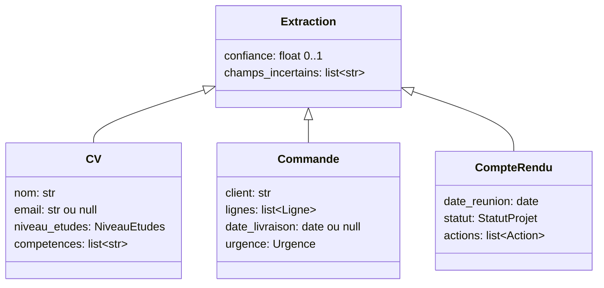

# Modéliser avec Pydantic : énumérations, optionnels, descriptions

> [!NOTE]
> Dans cette leçon, vous allez écrire les trois schémas du lab (CV, commande, compte rendu) avec **Pydantic**, en choisissant pour chaque champ le bon type : texte, nombre, date, **énumération**, liste, objet imbriqué, champ **optionnel**. Et vous verrez que la **description** d'un champ est un prompt.

## Pydantic en deux phrases

**Pydantic** est une bibliothèque Python qui décrit des données avec des classes : chaque attribut a un type, et Pydantic **vérifie** et **convertit** les données à la création de l'objet (une chaîne `"2026-10-15"` devient une `date`, `"abc"` pour un entier lève une erreur). Le SDK `google-genai` sait convertir ces classes en schéma pour Gemini : une seule définition sert à **demander** et à **vérifier**.



## Les choix de types, champ par champ

```python title="files/schemas.py (extrait)"
class NiveauEtudes(str, Enum):
    BAC = "bac"
    BAC2 = "bac+2"
    BAC3 = "bac+3"
    BAC5 = "bac+5"
    DOCTORAT = "doctorat"


class CV(Extraction):
    nom: str = Field(description="Prénom et nom de la personne.")
    email: Optional[str] = Field(None, description="Adresse e-mail, null si absente.")
    ville: Optional[str] = Field(None, description="Ville de résidence, null si absente.")
    annees_experience: int = Field(ge=0, le=50, description="Années d'expérience professionnelle, arrondi à l'entier.")
    niveau_etudes: NiveauEtudes = Field(description="Plus haut diplôme obtenu (master ou ingénieur = bac+5, licence = bac+3, BTS/DUT = bac+2).")
    competences: list[str] = Field(description="Compétences techniques citées, une par élément, telles qu'écrites.")
```

| Besoin | Type Pydantic | Exemple du lab | Pourquoi |
| --- | --- | --- | --- |
| Liste fermée de valeurs | `Enum` | `niveau_etudes`, `urgence`, `statut` | impossible d'obtenir « Master » ici et « bac+5 » là |
| Information parfois absente | `Optional[...] = None` | `email`, `date_livraison` | autorise `null` au lieu d'une invention |
| Nombre borné | `int = Field(ge=0, le=50)` | `annees_experience` | écarte les valeurs absurdes |
| Date | `date` | `date_reunion` | format AAAA-MM-JJ, converti en vraie date |
| Plusieurs éléments structurés | `list[Ligne]` | `lignes`, `actions` | une ligne = une référence + une quantité |
| Champs communs | héritage | `Extraction` | confiance et champs incertains partout |

> [!TIP]
> Un champ **obligatoire** pousse le modèle à remplir, quitte à deviner. Si l'information peut manquer dans le document (téléphone d'un CV, date de livraison), rendez le champ **optionnel** : `null` est une réponse honnête, et vérifiable.

## La description est un prompt

Le modèle lit le nom **et** la description de chaque champ. C'est là qu'on met les règles de conversion : « une douzaine = 12 », « master = bac+5 », « garder la version finale si le client corrige ». Le schéma vu par Gemini contient ces descriptions :

```python title="vérifier ce que reçoit le modèle"
CV.model_json_schema()["properties"]["niveau_etudes"]
```

> [!WARNING]
> L'ordre des champs compte : le modèle génère le JSON dans l'ordre du schéma. Dans ce lab, `confiance` et `champs_incertains` viennent de la classe parente, donc **en premier**. Le modèle s'auto-évalue avant d'avoir extrait : c'est un choix discutable, que vous pourrez tester à l'exercice de la leçon sur la revue humaine.

```quiz
question: "Un CV ne mentionne pas de téléphone. Le champ telephone est déclaré str (obligatoire). Quel risque ?"
options:
  - "Aucun, Gemini renverra une chaîne vide"
  - "Le modèle est poussé à remplir le champ : chaîne vide, valeur inventée, ou un autre numéro du document"
  - "L'appel échoue toujours"
answer: 1
explanation: "Un champ obligatoire doit être rempli. Sans information, le modèle produit quelque chose. Optional[str] = None lui permet de répondre null, ce que l'évaluation peut ensuite vérifier."
```

```quiz
question: "Pour le statut d'un projet (dans les temps, en retard, bloqué), quel type choisir ?"
options:
  - "str, avec une description qui liste les valeurs"
  - "Une énumération (Enum) avec les trois valeurs"
  - "bool : en retard ou non"
answer: 1
explanation: "L'énumération est imposée par le décodage contraint : seules ces trois valeurs sont possibles. Une simple description laisse passer des variantes (« retard », « en retard léger »), et un booléen perd l'état bloqué."
```

## Exercice : un schéma pour les tickets de support

Écrivez `Ticket` : `categorie` parmi facturation, technique, livraison, autre ; `priorite` parmi basse, normale, haute ; `numero_commande` facultatif ; `produits` (liste de textes) ; `resume` (texte, 20 mots au plus). Où mettre la règle « 20 mots au plus » ?

<details>
<summary>Voir la solution</summary>

```python title="ticket.py"
from enum import Enum
from typing import Optional

from pydantic import BaseModel, Field, field_validator


class Categorie(str, Enum):
    FACTURATION = "facturation"
    TECHNIQUE = "technique"
    LIVRAISON = "livraison"
    AUTRE = "autre"


class Priorite(str, Enum):
    BASSE = "basse"
    NORMALE = "normale"
    HAUTE = "haute"


class Ticket(BaseModel):
    categorie: Categorie
    priorite: Priorite = Field(description="haute si le client ne peut plus travailler ou menace de partir.")
    numero_commande: Optional[str] = Field(None, description="Numéro de commande cité, null sinon.")
    produits: list[str]
    resume: str = Field(description="Résumé en 20 mots au plus.")

    @field_validator("resume")
    @classmethod
    def court(cls, v):
        if len(v.split()) > 20:
            raise ValueError("résumé de plus de 20 mots")
        return v
```

La règle va **aux deux endroits** : dans la description (pour que le modèle la suive) et dans un validateur (pour la vérifier). Le schéma Gemini ne sait pas compter les mots.

</details>

## Résultat obtenu

Ce que le schéma Pydantic transmet pour deux champs (sortie réelle de `CV.model_json_schema()`, le 2026-10-15) :

```json title="sortie réelle, 2026-10-15"
{"$ref": "#/$defs/NiveauEtudes", "description": "Plus haut diplôme obtenu (master ou ingénieur = bac+5, licence = bac+3, BTS/DUT = bac+2)."}
{"enum": ["bac", "bac+2", "bac+3", "bac+5", "doctorat"], "title": "NiveauEtudes", "type": "string"}
{"anyOf": [{"type": "string"}, {"type": "null"}], "default": null, "description": "Adresse e-mail, null si absente.", "title": "Email"}
```

Et deux extractions réelles de `gemini-3.5-flash` sur le jeu du lab :

```json title="sortie réelle, 2026-10-15 (cv-04 et cv-05)"
{"nom": "Lucas Petit", "email": "lucas.petit@exemple.fr", "telephone": "07 12 12 12 12", "ville": null, "annees_experience": 1, "niveau_etudes": "bac+3", "competences": ["vente", "encaissement", "merchandising"]}
{"nom": "Amina Diallo", "email": "amina.diallo@exemple.net", "telephone": "+33 7 55 44 33 22", "ville": "Marseille", "annees_experience": 8, "niveau_etudes": "bac", "competences": ["gestion des stocks", "ERP", "CACES R489"]}
```

`ville` vaut `null` (absente du CV : rien d'inventé) ; `lucas.petit[at]exemple.fr` est remis au format e-mail ; la licence « en cours » d'Amina n'est pas comptée, son plus haut diplôme **obtenu** est le bac. Ce dernier cas est un piège : la version `flash-lite` s'y trompera (module 4).

## Je sais faire

- [ ] Choisir entre texte, énumération, optionnel, liste et objet imbriqué
- [ ] Écrire des descriptions de champs qui guident le modèle
- [ ] Partager des champs communs par héritage
- [ ] Inspecter le schéma envoyé avec `model_json_schema()`
