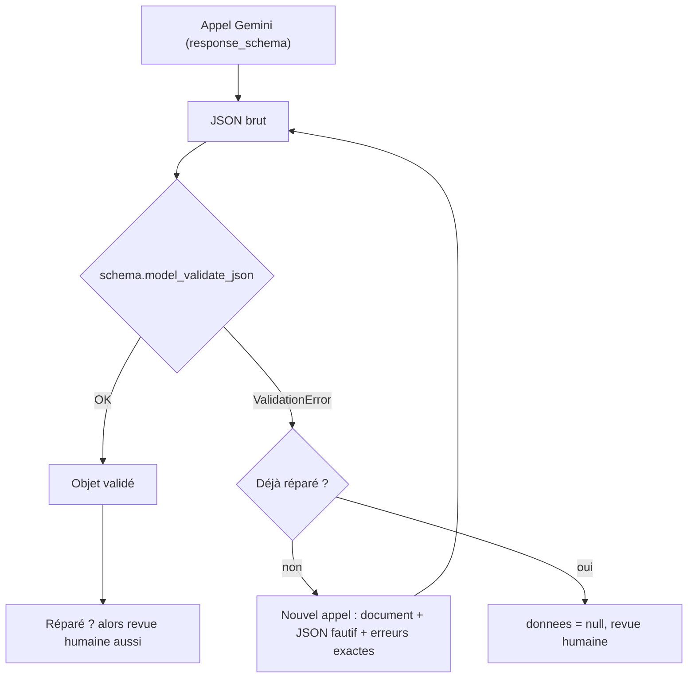

# Valider et réparer

> [!NOTE]
> Dans cette leçon, vous allez ajouter des **règles métier** que le schéma Gemini ne sait pas exprimer (référence connue du catalogue, échéance après la réunion, format d'e-mail), valider chaque réponse avec Pydantic, et **réparer** automatiquement une réponse invalide en renvoyant l'erreur exacte au modèle.

## Valide n'est pas juste

Le décodage contraint garantit la **forme** : des champs présents, des types corrects, des valeurs d'énumération permises. Il ne garantit pas que `CAF-500` existe dans votre catalogue, ni qu'une échéance ne tombe pas avant la réunion. Ces règles-là, on les écrit en Python, dans des **validateurs** Pydantic.



## Les validateurs du lab

```python title="files/schemas.py (extraits)"
class Ligne(BaseModel):
    reference: str = Field(description="Référence produit du catalogue, par exemple CAF-1KG.")
    quantite: int = Field(ge=1, description="Quantité commandée (une douzaine = 12).")

    @field_validator("reference")
    @classmethod
    def reference_connue(cls, v):
        if v not in CATALOGUE:
            raise ValueError(f"référence {v!r} absente du catalogue {sorted(CATALOGUE)}")
        return v


class CompteRendu(Extraction):
    # ...
    @model_validator(mode="after")
    def echeances_apres_reunion(self):
        for a in self.actions:
            if a.echeance and a.echeance < self.date_reunion:
                raise ValueError(f"échéance {a.echeance} antérieure à la réunion du {self.date_reunion}")
        return self
```

- `field_validator` vérifie **un** champ ; `model_validator(mode="after")` vérifie une règle **entre** champs, une fois l'objet construit.
- Le message d'erreur est écrit pour être **relu par le modèle** : il dit ce qui ne va pas et liste les valeurs permises.

## La boucle de réparation

```python title="files/extraction.py (extrait)"
brut = appeler(prompt, schema)
reparations = 0
while True:
    try:
        objet = schema.model_validate_json(brut)
        break
    except ValidationError as e:
        if reparations >= MAX_REPARATIONS:
            return {"donnees": None, "reparations": reparations, "a_revoir": True,
                    "raisons": [f"invalide après réparation : {e.errors()[0]['msg']}"]}
        reparations += 1
        brut = appeler(f"{prompt}\n\nTa réponse précédente :\n{brut}\n\n"
                       f"Elle viole ces règles de validation :\n{e}\n"
                       "Corrige-la en t'appuyant uniquement sur le document.", schema)
```

| Choix | Valeur | Raison |
| --- | --- | --- |
| Nombre de réparations | 1 (`MAX_REPARATIONS`) | au-delà, le modèle insiste rarement mieux et le coût double |
| Contenu renvoyé | document + JSON fautif + erreurs Pydantic | le modèle voit exactement quoi corriger |
| Après échec | `donnees = null`, revue humaine | jamais de donnée invalide en aval |
| Après réussite | revue humaine quand même | une réparation peut « valider » en supprimant de l'information (voir le résultat) |

> [!WARNING]
> Ne « réparez » pas en silence dans le code (par exemple remplacer une référence inconnue par la plus proche). C'est une décision métier : un `CAF-500` corrigé en `CAF-1KG` envoie le mauvais produit au client.

```quiz
question: "Quelle règle ne peut PAS être garantie par response_schema et demande un validateur Pydantic ?"
options:
  - "urgence vaut normale ou urgente"
  - "la référence produit existe dans le catalogue du jour"
  - "quantite est un entier"
answer: 1
explanation: "Énumération et type entier font partie du schéma envoyé à Gemini. L'appartenance à un catalogue qui change, ou une règle entre deux champs, se vérifie en Python après la réponse."
```

```quiz
question: "La réparation réussit : le JSON corrigé est valide. Pourquoi l'envoyer quand même en revue humaine ?"
options:
  - "Parce que Pydantic peut se tromper"
  - "Parce que le modèle a pu rendre la réponse valide en retirant ou en modifiant une information du document"
  - "Parce qu'une réparation coûte un appel de plus"
answer: 1
explanation: "Dans l'essai réel ci-dessous, la réparation a supprimé la ligne CAF-500 au lieu de la signaler : valide, mais la commande est incomplète. Valide ne veut pas dire juste."
```

## Tester la réparation sans clé

[test_extraction.py](../files/test_extraction.py) remplace l'appel au modèle par une file de réponses préparées : d'abord un JSON avec `CAF-1K`, puis le bon. Il vérifie que l'erreur exacte a été renvoyée au modèle :

```python title="files/test_extraction.py (extrait)"
def test_reparation_reussie(monkeypatch):
    mauvais = {**COMMANDE_OK, "lignes": [{"reference": "CAF-1K", "quantite": 2}]}
    prompts = faux_modele(monkeypatch, mauvais, COMMANDE_OK)
    r = extraction.extraire("commande", "2 CAF-1K svp")
    assert r["reparations"] == 1 and r["donnees"]["lignes"][0]["reference"] == "CAF-1KG"
    assert "absente du catalogue" in prompts[1]  # l'erreur exacte est renvoyée au modèle
    assert r["raisons"] == ["réparé 1 fois"]  # valide, mais à faire relire
```

## Exercice : une règle sur les CV

Ajoutez au schéma `CV` une règle **vérifiable** : le téléphone, s'il est présent, doit contenir 10 chiffres (ou 11 avec l'indicatif +33). Écrivez le validateur et un test.

<details>
<summary>Voir la solution</summary>

```python title="schemas.py (ajout dans CV)"
    @field_validator("telephone")
    @classmethod
    def telephone_valide(cls, v):
        if v is not None:
            chiffres = re.sub(r"\D", "", v)
            if len(chiffres) not in (10, 11):
                raise ValueError(f"téléphone invalide : {v!r} (10 chiffres attendus, ou +33 suivi de 9)")
        return v
```

```python title="test_extraction.py (ajout)"
def test_telephone_invalide():
    with pytest.raises(ValidationError, match="téléphone invalide"):
        CV(nom="A", telephone="06 12", annees_experience=1, niveau_etudes="bac",
           competences=[], confiance=1, champs_incertains=[])
```

`+33 7 55 44 33 22` donne 11 chiffres, `06 11 22 33 44` en donne 10 : les deux passent.

</details>

## Résultat obtenu

Essai réel le 2026-10-15 avec `gemini-3.5-flash-lite`, sur un e-mail inventé qui demande `CAF-500`, une référence **absente** du catalogue. Pour provoquer la réparation, la liste des références a été retirée de la consigne :

```text title="sortie réelle, 2026-10-15 (premier essai)"
APPEL initial -> [{"reference": "CAF-500", "quantite": 3}, {"reference": "TIS-100", "quantite": 2}]
APPEL réparation -> [{"reference": "TIS-100", "quantite": 2}]
   (extrait du prompt de réparation) Elle viole ces règles de validation : | 1 validation error for Commande |
   lignes.0.reference |   Value error, référence 'CAF-500' absente du catalogue ['CAF-1KG', 'CAF-250', 'GOB-50', 'SUC-1KG', 'THE-200', 'TIS-100'] ...
{"reparations": 1, "a_revoir": true, "raisons": ["champs incertains : date_livraison, mode, lignes"]}
```

La réparation a rendu le JSON valide… en **supprimant** la ligne demandée. D'où la règle « réparé ⇒ revue humaine », ajoutée au lab après cet essai. Second essai, avec cette règle :

```text title="sortie réelle, 2026-10-15 (second essai)"
APPEL initial -> [{"reference": "CAF-500", "quantite": 3}, {"reference": "TIS-100", "quantite": 2}]
APPEL réparation -> [{"reference": "TIS-100", "quantite": 2}]
{"reparations": 1, "a_revoir": true, "raisons": ["réparé 1 fois", "confiance 0.5 < 0.8", "champs incertains : lignes"]}
```

Avec la liste du catalogue dans la consigne (la version du lab), le même modèle a fait pire : il a directement remplacé `CAF-500` par `CAF-1KG`, en signalant seulement `lignes` comme incertain. Dans tous les cas, seule la revue humaine évite une mauvaise livraison : c'est le sujet de la leçon suivante.

## Je sais faire

- [ ] Écrire un `field_validator` et un `model_validator`
- [ ] Rédiger des messages d'erreur que le modèle peut exploiter
- [ ] Coder une boucle de réparation bornée
- [ ] Expliquer pourquoi une réponse réparée doit être relue
