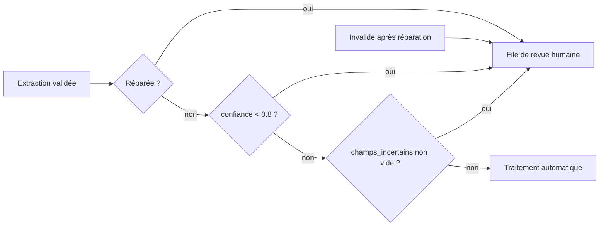

# Confiance et revue humaine

> [!NOTE]
> Dans cette leçon, vous allez décider **quels documents un humain doit relire**, à partir de plusieurs signaux (confiance déclarée, champs incertains, réparation), puis **vérifier sur des données réelles** si ces signaux attrapent vraiment les erreurs.

## Le principe : automatiser le sûr, relire le douteux

Aucune extraction n'est juste à 100 % sur la durée. L'objectif n'est donc pas « zéro erreur », mais **zéro erreur non vue** : les cas douteux partent dans une file de **revue humaine** (une personne valide ou corrige), les autres passent directement.



## Les signaux du lab

```python title="files/extraction.py (extrait)"
raisons = []
if reparations:  # une réparation peut rendre valide en supprimant de l'information
    raisons.append(f"réparé {reparations} fois")
if objet.confiance < SEUIL_CONFIANCE:
    raisons.append(f"confiance {objet.confiance} < {SEUIL_CONFIANCE}")
if objet.champs_incertains:
    raisons.append("champs incertains : " + ", ".join(objet.champs_incertains))
return {"donnees": donnees, "reparations": reparations, "a_revoir": bool(raisons), "raisons": raisons}
```

| Signal | D'où il vient | Fiabilité observée dans le lab |
| --- | --- | --- |
| `confiance` (0 à 1) | le modèle s'auto-évalue | faible : 0.95 ou 1.0 sur la plupart des documents, **y compris faux** |
| `champs_incertains` | le modèle nomme ce qu'il a deviné | meilleure : désigne souvent le bon champ |
| Réparation | votre validation | fiable : la réponse initiale violait une règle |
| Règle métier non vérifiable par schéma | votre code | fiable, à ajouter selon le métier (montant élevé, client inconnu…) |

> [!WARNING]
> La **confiance déclarée** par un LLM n'est pas une probabilité calibrée : c'est un nombre que le modèle génère, comme le reste. Ne l'utilisez jamais seule. Gardez les **raisons** de chaque mise en revue : elles disent à la personne qui relit **où** regarder.

> [!TIP]
> Les champs incertains sont nommés librement par le modèle : `lignes[0].reference`, `lignes.0.reference` ou `actions.echeance` selon les cas. C'est suffisant pour un humain ; pour un traitement automatique, ne gardez que la partie avant le premier `.` ou `[`.

## Mesurer l'utilité de la revue

Une file de revue se juge sur deux chiffres : **combien d'erreurs elle attrape** (rappel) et **combien de documents elle envoie** (charge de travail). [evaluer.py](../files/evaluer.py) les calcule en croisant les décisions avec le jeu annoté :

```python title="files/evaluer.py (extrait)"
def revue_utile(annotes, resultats):
    _, erreurs = evaluer(annotes, resultats)
    faux = {e[0] for e in erreurs}
    revue = {i for i, r in resultats.items() if r.get("a_revoir")}
    return {"docs_avec_erreur": len(faux), "envoyes_en_revue": len(revue),
            "erreurs_attrapees": len(faux & revue), "erreurs_manquees": sorted(faux - revue)}
```

```quiz
question: "Un modèle renvoie confiance = 0.95 et aucun champ incertain, mais la date d'échéance est fausse. Que montre ce cas ?"
options:
  - "Que le seuil de 0.8 est trop bas"
  - "Que l'auto-évaluation du modèle ne suffit pas : il faut mesurer sur un jeu annoté et ajouter des règles métier"
  - "Que la revue humaine est inutile"
answer: 1
explanation: "C'est exactement le cas de cr-02 avec gemini-3.5-flash-lite : faux, mais sûr de lui. Seule une évaluation sur données annotées révèle ce type d'erreur, et une règle (par exemple : toute action citant un jour de la semaine doit avoir une échéance) peut l'attraper."
```

```quiz
question: "Votre file de revue reçoit 100 % des documents. Quel est le problème ?"
options:
  - "Aucun, c'est le plus sûr"
  - "L'automatisation ne sert plus à rien : tout le monde relit tout, et la vigilance baisse"
  - "Le modèle est forcément mauvais"
answer: 1
explanation: "Une revue systématique coûte autant que le travail manuel, et une personne qui valide 200 fiches justes d'affilée finit par valider sans lire. Le but est d'envoyer peu de documents, mais les bons."
```

## Exercice : une règle qui attrape cr-02

Dans le compte rendu `cr-02`, « Léa relance le prestataire vendredi » a donné une échéance `null` avec `flash-lite`. Écrivez une règle, dans `extraire`, qui envoie en revue tout compte rendu dont une action a une échéance `null` alors que le texte contient un jour de la semaine.

<details>
<summary>Voir la solution</summary>

```python title="extraction.py (ajout dans extraire, avant le return)"
JOURS = ("lundi", "mardi", "mercredi", "jeudi", "vendredi", "samedi", "dimanche")

if type_doc == "compte_rendu":
    sans_date = [a["responsable"] for a in donnees["actions"] if a["echeance"] is None]
    if sans_date and any(j in texte.lower() for j in JOURS):
        raisons.append("action sans échéance alors que le texte cite un jour : " + ", ".join(sans_date))
```

Elle attrape `cr-02`, mais enverra aussi en revue des comptes rendus justes (Hugo n'a vraiment pas d'échéance) : c'est le compromis rappel / charge de travail. Relancez `evaluer.py` pour mesurer l'effet : `erreurs_manquees` ne doit plus contenir `cr-02`.

</details>

## Résultat obtenu

Décisions de revue réelles sur les 15 documents, le 2026-10-15, pour trois modèles (extrait de [evaluer.py](../files/evaluer.py)) :

```text title="sortie réelle, 2026-10-15"
gemini-3.5-flash (API)      Revue humaine : {'docs_avec_erreur': 0, 'envoyes_en_revue': 2, 'erreurs_attrapees': 0, 'erreurs_manquees': []}
gemini-3.5-flash-lite (API) Revue humaine : {'docs_avec_erreur': 3, 'envoyes_en_revue': 5, 'erreurs_attrapees': 1, 'erreurs_manquees': ['cr-02', 'cr-04']}
gemini-2.5-flash (Vertex)   Revue humaine : {'docs_avec_erreur': 3, 'envoyes_en_revue': 7, 'erreurs_attrapees': 3, 'erreurs_manquees': []}
```

Confiances déclarées (nombre de documents par valeur) :

```text title="sortie réelle, 2026-10-15"
gemini-3.5-flash       [(0.85, 1), (0.95, 6), (1.0, 8)]
gemini-3.5-flash-lite  [(0.9, 1), (0.95, 6), (1.0, 8)]
gemini-2.5-flash       [(0.7, 1), (0.8, 1), (0.9, 4), (0.95, 2), (0.98, 2), (1.0, 5)]
```

Avec `flash-lite`, `cr-02` est faux mais déclaré à 0.95 sans champ incertain : la revue le manque. Avec `gemini-2.5-flash` sur Vertex AI, les trois documents faux sont tous partis en revue, au prix de 4 documents justes relus en plus. Le seuil de 0.8 n'a déclenché qu'une fois sur 45 extractions : ce sont les champs incertains et la réparation qui font le travail.

## Je sais faire

- [ ] Combiner plusieurs signaux pour décider d'une revue humaine
- [ ] Expliquer pourquoi la confiance déclarée par un LLM ne suffit pas
- [ ] Mesurer erreurs attrapées, erreurs manquées et charge de revue
- [ ] Ajouter une règle métier ciblée sur une erreur observée
