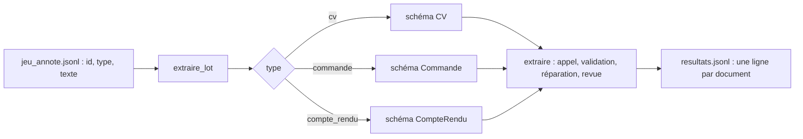

# Extraction en lot, avec l'API Gemini ou Vertex AI

> [!NOTE]
> Dans cette leçon, vous allez traiter un **lot** de documents de trois types différents avec un seul script, rendre ce traitement robuste (réessais, échec isolé, fichier de sortie ligne à ligne), et l'exécuter **sans changer une ligne de code** sur l'API Gemini puis sur Vertex AI.

## Le pipeline de lot



Le type du document choisit le schéma et la consigne : un dictionnaire suffit, pas besoin d'une classe par type.

```python title="files/schemas.py et files/extraction.py (extraits)"
SCHEMAS = {"cv": CV, "commande": Commande, "compte_rendu": CompteRendu}

CONSIGNES = {
    "cv": "Extrais les informations de ce CV.",
    "commande": ("Extrais la commande de cet e-mail. Références valides : "
                 f"{', '.join(sorted(CATALOGUE))}. Si le client corrige sa commande, garde la version finale."),
    "compte_rendu": "Extrais les informations de ce compte rendu de réunion.",
}
```

## Robustesse : trois règles

```python title="files/extraction.py (extraits)"
def appeler(prompt: str, schema) -> str:
    """Un appel Gemini en mode JSON contraint, avec réessai sur 429/503."""
    config = types.GenerateContentConfig(
        response_mime_type="application/json", response_schema=schema, temperature=0)
    for essai in range(4):
        try:
            return get_client().models.generate_content(model=MODEL, contents=prompt, config=config).text
        except errors.APIError as e:
            if e.code not in (429, 500, 503) or essai == 3:
                raise
            time.sleep(5 * 2 ** essai)

# dans extraire_lot :
try:
    res = extraire(doc["type"], doc["texte"])
except Exception as e:  # un document en échec ne bloque pas le lot
    res = {"donnees": None, "reparations": 0, "a_revoir": True, "raisons": [f"erreur : {e}"]}
```

1. **Réessayer** les erreurs passagères (429 quota, 500/503 surcharge) avec une attente croissante (5, 10, 20 s) : c'est l'**attente exponentielle**.
2. **Isoler** les échecs : un document qui plante part en revue, le lot continue.
3. **Écrire au fil de l'eau** une ligne JSONL par document : si le script s'arrête au 900e document, les 899 premiers sont sauvés.

## Même code, deux plateformes

`genai.Client()` choisit sa cible d'après l'environnement :

```bash title="terminal"
# Sans GCP : API Gemini, clé dans .env (GOOGLE_API_KEY=...)
python extraction.py jeu_annote.jsonl resultats.jsonl

# Avec GCP : Vertex AI, identifiants Google Cloud, aucune clé
gcloud auth application-default login
GOOGLE_GENAI_USE_VERTEXAI=TRUE GOOGLE_CLOUD_PROJECT=mon-projet GOOGLE_CLOUD_LOCATION=europe-west1 \
MODEL=gemini-2.5-flash python extraction.py jeu_annote.jsonl resultats_vertex.jsonl
```

| | API Gemini | Vertex AI |
| --- | --- | --- |
| Pour qui | prototypes, petites équipes | entreprise déjà sur Google Cloud |
| Authentification | clé d'API | IAM : comptes utilisateur ou de service |
| Région des traitements | gérée par Google | choisie (`europe-west1` ici) |
| Catalogue de modèles | le plus récent | peut différer : testez le nom du modèle avant de l'utiliser |
| Ressources à créer | aucune | aucune (simples appels au modèle) |

> [!TIP]
> Pour des milliers de documents sans contrainte de délai, regardez le **mode batch** de l'API Gemini (et la prédiction par lot de Vertex AI) : vous déposez toutes les requêtes d'un coup et récupérez les résultats plus tard, à un tarif réduit. Le code de validation et d'évaluation de ce lab reste identique.

> [!WARNING]
> Les documents réels (CV, e-mails) contiennent des **données personnelles**. Avant d'envoyer un lot, vérifiez les conditions d'utilisation des données de la plateforme choisie, la région de traitement, et ne gardez dans `resultats.jsonl` que les champs utiles.

```quiz
question: "Le lot s'arrête au document 640 sur 1 000 à cause d'une coupure réseau. Grâce à quelle règle ne perdez-vous pas les 639 premiers ?"
options:
  - "Les réessais avec attente exponentielle"
  - "L'écriture d'une ligne JSONL par document, au fil de l'eau"
  - "La température à 0"
answer: 1
explanation: "Chaque résultat est écrit dès qu'il est obtenu. Il suffit de relancer sur les documents absents du fichier de sortie. Les réessais aident contre les erreurs passagères, pas contre un arrêt du script."
```

```quiz
question: "Que faut-il changer dans le code pour passer de l'API Gemini à Vertex AI ?"
options:
  - "Rien : des variables d'environnement (GOOGLE_GENAI_USE_VERTEXAI, projet, région) et éventuellement MODEL"
  - "Remplacer google-genai par une autre bibliothèque"
  - "Réécrire les schémas Pydantic au format Vertex AI"
answer: 0
explanation: "Le SDK google-genai parle aux deux plateformes. Les schémas, la validation et l'évaluation sont identiques ; seul le nom du modèle peut différer selon le catalogue de la région."
```

## Exercice : reprendre un lot interrompu

Modifiez `extraire_lot` pour qu'une relance **ignore** les documents déjà présents dans le fichier de sortie et **ajoute** les nouveaux résultats à la fin.

<details>
<summary>Voir la solution</summary>

```python title="extraction.py (modification de extraire_lot)"
import os

deja = set()
if os.path.exists(chemin_sortie):
    with open(chemin_sortie, encoding="utf-8") as f:
        deja = {json.loads(l)["id"] for l in f if l.strip()}
with open(chemin_sortie, "a", encoding="utf-8") as sortie:   # "a" : ajout, pas écrasement
    for doc in docs:
        if doc["id"] in deja:
            continue
        # ... traitement inchangé ...
```

Pour retraiter volontairement un document (après une correction du prompt), supprimez sa ligne du fichier de sortie, ou écrivez dans un nouveau fichier.

</details>

## Résultat obtenu

Lot réel sur Vertex AI (`gemini-2.5-flash`, `europe-west1`), le 2026-10-15 :

```text title="python extraction.py (sortie réelle, Vertex AI, 2026-10-15)"
cv-01  cv            réparations=0 revue=non
cv-04  cv            réparations=0 revue=OUI champs incertains : email, niveau_etudes
cmd-01 commande      réparations=0 revue=OUI champs incertains : date_livraison, urgence
cmd-05 commande      réparations=0 revue=OUI champs incertains : lignes.0.reference, mode
cr-02  compte_rendu  réparations=0 revue=OUI champs incertains : actions.echeance
cr-05  compte_rendu  réparations=1 revue=OUI réparé 1 fois; confiance 0.7 < 0.8; champs incertains : actions, prochaine_reunion
[... 15 lignes au total]
```

Durées mesurées sur les 15 documents (ordre de grandeur, dépend de la charge du moment) :

| Modèle | Plateforme | Total | Médiane par document | Maximum |
| --- | --- | --- | --- | --- |
| `gemini-3.5-flash` | API Gemini | 93,9 s | 5,8 s | 9,1 s |
| `gemini-3.5-flash-lite` | API Gemini | 16,6 s | 1,1 s | 1,4 s |
| `gemini-2.5-flash` | Vertex AI | 117,5 s | 6,5 s | 25,0 s (avec réparation) |

Le document `cr-05` a déclenché la seule réparation des 45 extractions : sa réponse initiale violait une règle de validation, la seconde était valide… mais fausse, comme on le verra à la leçon sur la précision.

## Je sais faire

- [ ] Router chaque document vers son schéma et sa consigne
- [ ] Rendre un lot robuste : réessais, échec isolé, écriture au fil de l'eau
- [ ] Basculer entre API Gemini et Vertex AI par l'environnement
- [ ] Savoir quand passer au mode batch
