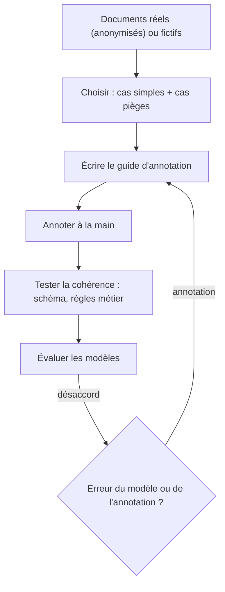

# Construire un jeu annoté

> [!NOTE]
> Dans cette leçon, vous allez comprendre comment est construit [jeu_annote.jsonl](../files/jeu_annote.jsonl) : 15 documents fictifs, chacun avec la réponse attendue écrite à la main. C'est la **référence** sans laquelle aucune précision ne peut être mesurée.

## Pourquoi annoter ?

Un **jeu annoté** (ou jeu de référence, *gold set* en anglais) est un ensemble de documents dont on connaît la bonne extraction. On compare ce que produit le modèle à cette référence, champ par champ. Sans lui, « ça a l'air de marcher » sur trois exemples relus à l'œil est tout ce que vous pouvez dire.



## Le format

Une ligne JSON par document : un identifiant, le type, le texte, et `attendu`, la réponse de référence.

```json title="files/jeu_annote.jsonl (une ligne, mise en forme)"
{"id": "cmd-02", "type": "commande",
 "texte": "Date : mardi 13 octobre 2026\nDe : Paul Girard, Salon de thé Les Glycines\n\nBonjour, il me faudrait 4 THE-200.\nAh, et finalement mettez-en 6, et ajoutez 1 TIS-100. ...",
 "attendu": {"client": "Salon de thé Les Glycines", "contact": "Paul Girard",
             "lignes": [{"reference": "THE-200", "quantite": 6}, {"reference": "TIS-100", "quantite": 1}],
             "date_livraison": "2026-10-14", "urgence": "urgente", "mode": "retrait"}}
```

- `attendu` ne contient **que** les champs évalués : pas `confiance`, pas le texte libre `tache` des actions (impossible à comparer exactement).
- Une valeur absente s'annote `null`, explicitement : c'est une réponse à vérifier comme une autre.

## Couvrir les cas pièges

Un jeu fait uniquement de documents propres mesure un 100 % trompeur. Celui du lab mélange cas simples et pièges :

| Document | Piège |
| --- | --- |
| `cv-03` | CV en anglais, « PhD » à traduire en `doctorat` |
| `cv-04` | e-mail écrit `[at]`, ville absente |
| `cv-05` | licence « en cours » : le plus haut diplôme **obtenu** est le bac |
| `cmd-02` | le client corrige sa quantité ; « demain » à convertir en date ; retrait sur place |
| `cmd-03` | « une douzaine », et 50 gobelets = **1** lot `GOB-50` |
| `cmd-05` | référence mal tapée `CAF-1K` ; « dès que possible » = pas de date |
| `cr-02` | « vendredi » à convertir depuis la date de réunion ; une action sans échéance |
| `cr-03` | participant arrivé en retard (présent) ; « jeudi prochain » |
| `cr-05` | notes en style télégraphique, date `14/10/26` |

> [!TIP]
> Les meilleurs pièges viennent de la production : à chaque erreur corrigée en revue humaine, ajoutez le document (anonymisé) au jeu annoté. Le jeu grandit avec les vrais problèmes.

## Le guide d'annotation

Deux personnes qui annotent le même document doivent écrire la même chose. D'où un **guide**, court, qui tranche les cas ambigus. Celui du lab :

| Question | Règle |
| --- | --- |
| Nom du projet | sans le mot « Projet » : `Entrepôt Nord` |
| Participants | présents uniquement, prénoms seuls, y compris arrivés en retard |
| Téléphone | tel qu'écrit dans le document |
| Dates relatives | calculées depuis la date du document |
| Compétences | telles qu'écrites, une par élément |

> [!WARNING]
> Une règle du guide qui n'est **pas** aussi dans la description du champ est une règle que le modèle ne peut pas connaître. Le modèle `flash-lite` a écrit `Projet Entrepôt Nord` (voir le résultat) : est-ce une erreur du modèle, ou une règle manquante dans le schéma ? Les deux corrections sont possibles ; l'important est de **décider** et d'aligner guide et schéma.

```quiz
question: "Pourquoi le champ libre tache des actions n'est-il pas annoté ?"
options:
  - "Parce qu'il n'est pas important"
  - "Parce qu'une comparaison exacte d'un texte reformulé (« Relancer le prestataire » contre « relance du prestataire ») compterait faux une réponse juste"
  - "Parce que Gemini ne le remplit jamais"
answer: 1
explanation: "Les textes libres se reformulent. On évalue ce qui se compare exactement (responsable, échéance). Pour un texte libre, il faudrait une autre méthode, comme un juge humain ou un LLM-juge."
```

```quiz
question: "Le jeu compte 5 documents par type. Un modèle se trompe sur un seul niveau d'études. Quelle précision pour ce champ ?"
options:
  - "99 %"
  - "80 %"
  - "95 %"
answer: 1
explanation: "4 bonnes réponses sur 5 = 80 %. Sur un si petit jeu, chaque erreur pèse 20 points : utile pour repérer des problèmes, pas pour comparer finement deux modèles. Visez des dizaines de documents par type avant de conclure."
```

## Tester l'annotation elle-même

Une annotation peut être fausse. [test_extraction.py](../files/test_extraction.py) vérifie, sans clé, que chaque `attendu` n'utilise que des champs du schéma et respecte les règles métier :

```python title="files/test_extraction.py (extrait)"
def test_jeu_annote_coherent_avec_les_schemas():
    docs = [json.loads(l) for l in (ICI / "jeu_annote.jsonl").read_text(encoding="utf-8").splitlines()]
    assert len(docs) == 15 and len({d["id"] for d in docs}) == 15
    for d in docs:
        assert set(d["attendu"]) <= set(SCHEMAS[d["type"]].model_fields), d["id"]
        if d["type"] != "compte_rendu":  # les annotations respectent elles-mêmes les règles métier
            SCHEMAS[d["type"]].model_validate({**d["attendu"], "confiance": 1, "champs_incertains": []})
```

## Exercice : annoter deux documents de plus

Écrivez deux nouvelles lignes pour le jeu : un CV **sans** e-mail ni téléphone, et un e-mail de commande qui demande une livraison « lundi prochain ». Ajoutez-les à `jeu_annote.jsonl`, adaptez le compte dans le test, puis relancez extraction et évaluation.

<details>
<summary>Voir la solution</summary>

```json title="jeu_annote.jsonl (deux lignes ajoutées)"
{"id": "cv-06", "type": "cv", "texte": "Nora Haddad, Lille. Comptable, 3 ans d'expérience. DCG (bac+3). Compétences : paie, fiscalité.", "attendu": {"nom": "Nora Haddad", "email": null, "telephone": null, "ville": "Lille", "annees_experience": 3, "niveau_etudes": "bac+3", "competences": ["paie", "fiscalité"]}}
{"id": "cmd-06", "type": "commande", "texte": "Date : jeudi 15 octobre 2026\nDe : Léo Martin, Café des Arts\n4 CAF-1KG à livrer lundi prochain, merci.", "attendu": {"client": "Café des Arts", "contact": "Léo Martin", "lignes": [{"reference": "CAF-1KG", "quantite": 4}], "date_livraison": "2026-10-19", "urgence": "normale", "mode": "livraison"}}
```

Le 15 octobre 2026 est un jeudi : « lundi prochain » est le 19. Dans le test, remplacez `15` par `17`. Vérifiez chaque date calculée avec Python (`date(2026, 10, 15).strftime("%A")`) : l'annotateur aussi peut se tromper de jour.

</details>

## Résultat obtenu

Test de cohérence du jeu, le 2026-10-15 :

```text title="pytest -v (sortie réelle, 2026-10-15)"
test_extraction.py::test_jeu_annote_coherent_avec_les_schemas PASSED     [100%]
```

Et le désaccord révélé par l'évaluation de `gemini-3.5-flash-lite`, qui pose une question au **guide d'annotation** plutôt qu'au modèle :

```text title="python evaluer.py (extrait réel, 2026-10-15)"
  cr-04 projet: attendu='Entrepôt Nord' obtenu='Projet Entrepôt Nord'
```

## Je sais faire

- [ ] Expliquer à quoi sert un jeu annoté
- [ ] Choisir des documents qui couvrent les cas pièges
- [ ] Écrire un guide d'annotation et l'aligner avec les descriptions du schéma
- [ ] Tester automatiquement la cohérence des annotations
