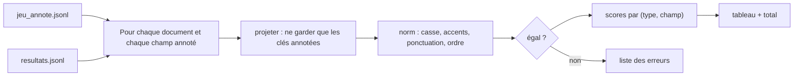

# Mesurer la précision par champ

> [!NOTE]
> Dans cette leçon, vous allez écrire le script d'évaluation [evaluer.py](../files/evaluer.py) : normaliser les valeurs pour comparer ce qui doit l'être, calculer la **précision par champ** et lister chaque erreur. Puis vous l'exécuterez sur une vraie extraction.

## Ce que l'on mesure

Pour chaque champ annoté de chaque document : la valeur extraite est-elle **égale** à la valeur attendue ? La **précision par champ** est la part de réponses justes pour ce champ (par exemple `date_reunion` : 4 justes sur 5 = 80 %).

> [!NOTE]
> En statistique, ce taux de bonnes réponses s'appelle l'**exactitude** (*accuracy*). Le mot « précision » a aussi un sens technique distinct (part des réponses positives qui sont justes, avec le **rappel**). Ici, « précision par champ » veut dire « taux de champs corrects ».

Une moyenne globale cache tout ; le détail par champ dit **quoi corriger** :



## Comparer ce qui doit l'être

`"Électrotechnique"` et `"electrotechnique"` sont la même compétence ; `["SQL", "Python"]` et `["Python", "SQL"]` la même liste. Sans normalisation, l'évaluation compterait faux des réponses justes.

```python title="files/evaluer.py (extrait)"
def norm(v):
    """Rend deux valeurs comparables : casse, accents, ponctuation, ordre des listes."""
    if isinstance(v, str):
        v = unicodedata.normalize("NFKD", v).encode("ascii", "ignore").decode()
        return re.sub(r"[^a-z0-9]", "", v.lower())
    if isinstance(v, list):
        return sorted((norm(x) for x in v), key=repr)
    if isinstance(v, dict):
        return tuple(sorted((k, norm(x)) for k, x in v.items()))
    return v


def projeter(predit, attendu):
    """Ne garde dans les objets prédits que les clés annotées (ex. pas le texte libre `tache`)."""
    if isinstance(attendu, list) and attendu and isinstance(attendu[0], dict) and isinstance(predit, list):
        cles = attendu[0].keys()
        return [{k: p.get(k) for k in cles} for p in predit if isinstance(p, dict)]
    return predit
```

| Normalisation | Rend égaux | Ne rend PAS égaux (voulu) |
| --- | --- | --- |
| Casse, accents | `Électrotechnique` / `electrotechnique` | |
| Ponctuation, espaces | `06 11 22 33 44` / `06.11.22.33.44` | `+33 6…` / `06…` (format différent) |
| Ordre des listes | `[SQL, Python]` / `[Python, SQL]` | `[SQL]` / `[SQL, Python]` |
| `None` reste `None` | | `null` / `[]` / `""` |

> [!WARNING]
> Ne normalisez pas trop : une normalisation qui rend égaux `2026-10-14` et `2014-10-26` (par exemple en ne gardant que les chiffres triés) masquerait une vraie erreur. Chaque règle de `norm` doit correspondre à une équivalence **métier**.

## Le calcul

```python title="files/evaluer.py (extrait)"
def evaluer(annotes: list[dict], resultats: dict[str, dict]):
    """Renvoie {(type, champ): [corrects, total]} et la liste des erreurs."""
    scores, erreurs = defaultdict(lambda: [0, 0]), []
    for doc in annotes:
        donnees = (resultats.get(doc["id"]) or {}).get("donnees") or {}
        for champ, attendu in doc["attendu"].items():
            predit = projeter(donnees.get(champ), attendu)
            ok = norm(predit) == norm(attendu)
            s = scores[(doc["type"], champ)]
            s[0] += ok
            s[1] += 1
            if not ok:
                erreurs.append((doc["id"], champ, attendu, predit))
    return scores, erreurs
```

Un document absent ou invalide (`donnees = null`) compte **faux** sur tous ses champs : un pipeline qui abandonne ne doit pas améliorer son score.

```quiz
question: "Pourquoi un document dont l'extraction a échoué compte-t-il faux sur tous ses champs, au lieu d'être exclu du calcul ?"
options:
  - "Pour punir le modèle"
  - "Parce que l'exclure ferait monter artificiellement la précision d'un pipeline qui échoue sur les cas difficiles"
  - "Parce que Python ne sait pas diviser par zéro"
answer: 1
explanation: "Si les échecs sortaient du calcul, un pipeline qui renonce sur tous les documents difficiles afficherait un excellent score. On mesure ce que reçoit réellement la suite du processus."
```

```quiz
question: "Quelle normalisation serait une erreur pour le champ telephone ?"
options:
  - "Retirer les espaces et les points"
  - "Ne garder que les 4 derniers chiffres"
  - "Mettre en minuscules"
answer: 1
explanation: "Retirer espaces et points (ce que fait norm) est une équivalence réelle. Ne garder que 4 chiffres rendrait égaux deux numéros différents, et masquerait des erreurs."
```

## Exercice : une précision par type de document

Ajoutez à `main` un récapitulatif **par type** (cv, commande, compte_rendu) : nombre de champs corrects sur le total.

<details>
<summary>Voir la solution</summary>

```python title="evaluer.py (ajout dans main, après le tableau)"
par_type = defaultdict(lambda: [0, 0])
for (t, _), (ok, n) in scores.items():
    par_type[t][0] += ok
    par_type[t][1] += n
for t, (ok, n) in sorted(par_type.items()):
    print(f"{t:13} {ok}/{n}  {ok / n:.0%}")
```

Sur l'exécution Vertex AI ci-dessous : `compte_rendu 26/30 87%`, `commande 29/30 97%`, `cv 35/35 100%`. Les comptes rendus, avec leurs dates relatives, sont le point faible.

</details>

## Résultat obtenu

`python evaluer.py jeu_annote.jsonl resultats_vertex.jsonl`, extraction par `gemini-2.5-flash` sur Vertex AI, le 2026-10-15 :

```text title="sortie réelle, 2026-10-15"
type          champ              précision
commande      client             5/5  100%
commande      contact            5/5  100%
commande      date_livraison     5/5  100%
commande      lignes             5/5  100%
commande      mode               5/5  100%
commande      urgence            4/5  80%
compte_rendu  actions            3/5  60%
compte_rendu  date_reunion       4/5  80%
compte_rendu  participants       5/5  100%
compte_rendu  prochaine_reunion  4/5  80%
compte_rendu  projet             5/5  100%
compte_rendu  statut             5/5  100%
cv            annees_experience  5/5  100%
[... 6 lignes cv à 5/5]

TOTAL : 90/95 champs corrects (94.7%)

Erreurs :
  cmd-01 urgence: attendu='normale' obtenu='urgente'
  cr-02 actions: attendu=[{'responsable': 'Léa', 'echeance': '2026-10-02'}, {'responsable': 'Hugo', 'echeance': None}] obtenu=[{'responsable': 'Léa', 'echeance': None}, {'responsable': 'Hugo', 'echeance': None}]
  cr-05 date_reunion: attendu='2026-10-14' obtenu='2014-10-26'
  cr-05 actions: attendu=[{'responsable': 'Max', 'echeance': '2026-10-19'}, {'responsable': 'Zoé', 'echeance': '2026-10-23'}] obtenu=[{'responsable': 'Max', 'echeance': '2014-10-27'}, {'responsable': 'Zoé', 'echeance': None}]
  cr-05 prochaine_reunion: attendu='2026-10-28' obtenu='2014-10-28'
```

Le total de 94,7 % semble bon ; le détail montre que **toutes** les erreurs sauf une portent sur des **dates** dans des comptes rendus. `14/10/26` a été lu « 26 octobre 2014 », et la réparation a seulement rendu les échéances cohérentes avec cette mauvaise date. Une action précise s'en déduit : donner l'année courante dans la consigne, ou exiger des dates absolues dans les comptes rendus.

## Je sais faire

- [ ] Calculer une précision par champ à partir d'un jeu annoté
- [ ] Normaliser sans masquer de vraies erreurs
- [ ] Évaluer des listes d'objets en ne comparant que les clés annotées
- [ ] Lire une liste d'erreurs pour en déduire une correction
