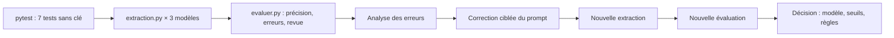

# Projet final : comparer trois modèles, corriger, décider

> [!NOTE]
> Dans ce projet, vous allez faire tourner le pipeline complet sur trois modèles, comparer précision, vitesse et charge de revue humaine, tenter une correction ciblée du prompt, **mesurer son effet réel**, puis rédiger une recommandation argumentée. Toutes les valeurs ci-dessous viennent d'exécutions du 2026-10-15.

## La démarche



```bash title="terminal"
pytest -q
MODEL=gemini-3.5-flash      python extraction.py jeu_annote.jsonl res_flash.jsonl
MODEL=gemini-3.5-flash-lite python extraction.py jeu_annote.jsonl res_lite.jsonl
GOOGLE_GENAI_USE_VERTEXAI=TRUE GOOGLE_CLOUD_PROJECT=mon-projet GOOGLE_CLOUD_LOCATION=europe-west1 \
  MODEL=gemini-2.5-flash    python extraction.py jeu_annote.jsonl res_vertex.jsonl
for f in res_*.jsonl; do python evaluer.py jeu_annote.jsonl $f; done
```

## Étape 1 : la comparaison

| Modèle (plateforme) | Champs corrects | Docs faux | Envoyés en revue | Erreurs manquées | Médiane / doc |
| --- | --- | --- | --- | --- | --- |
| `gemini-3.5-flash` (API) | 95/95 (100 %) | 0 | 2 | aucune | 5,8 s |
| `gemini-3.5-flash-lite` (API) | 92/95 (96,8 %) | 3 | 5 | `cr-02`, `cr-04` | 1,1 s |
| `gemini-2.5-flash` (Vertex AI) | 90/95 (94,7 %) | 3 | 7 | aucune | 6,5 s |

Les erreurs de `flash-lite` : le niveau d'études d'Amina (licence **en cours** comptée), l'échéance « vendredi » oubliée dans `cr-02`, et `Projet Entrepôt Nord` (question d'annotation, vue au module 3). Celles de `gemini-2.5-flash` : une urgence inventée (`cmd-01`), la même échéance oubliée, et la date `14/10/26` lue « 26 octobre 2014 ».

## Étape 2 : une correction ciblée

Les erreurs de Vertex AI portent surtout sur des dates. Essai : compléter les règles du prompt, **sans toucher au code**, en surchargeant `REGLES` dans un petit script :

```python title="essai_regles.py"
import sys
import extraction

extraction.REGLES += (" Les dates abrégées JJ/MM/AA se lisent jour/mois/année, avec l'année 20AA."
                      " Un jour de la semaine cité sans date (« vendredi ») désigne le prochain jour de ce nom"
                      " après la date du document.")
extraction.extraire_lot(sys.argv[1], sys.argv[2])
```

Résultat réel sur Vertex AI (`gemini-2.5-flash`) :

| | Avant | Après |
| --- | --- | --- |
| Champs corrects | 90/95 (94,7 %) | 92/95 (96,8 %) |
| Erreurs de dates (`cr-02`, `cr-05`) | 4 champs | 1 champ (lundi 19 → 20 octobre) |
| Nouvelles erreurs | | `cv-05` niveau d'études, `cmd-03` 50 gobelets au lieu d'**1** lot de 50 |
| Envoyés en revue / erreurs manquées | 7 / aucune | 6 / aucune |

> [!WARNING]
> La correction a réglé le problème visé… et deux erreurs sont apparues **sur des documents qu'elle ne concernait pas**. Même à `temperature=0`, deux exécutions ne sont pas strictement identiques, et tout changement de prompt peut déplacer les erreurs. C'est pourquoi on réévalue **tout** le jeu à chaque modification, jamais seulement les documents visés. Sur 15 documents, une différence de 2 champs reste dans le bruit : il faut un jeu plus grand pour conclure.

```quiz
question: "Après la correction, la précision globale passe de 94,7 % à 96,8 %. Quelle conclusion est la plus juste ?"
options:
  - "La correction est validée, on la met en production"
  - "La correction règle les dates visées, mais elle déplace des erreurs ailleurs ; avec 15 documents, l'écart n'est pas concluant : agrandir le jeu, puis réévaluer"
  - "La correction ne sert à rien puisqu'il reste des erreurs"
answer: 1
explanation: "Le gain sur les dates est réel et explicable, mais deux nouvelles erreurs sont apparues et l'échantillon est minuscule. Une décision de mise en production se prend sur un jeu plus large, avec la même évaluation."
```

```quiz
question: "Pour un flux de 50 000 e-mails de commande par mois, quels critères comptent pour choisir le modèle ?"
options:
  - "La précision sur les champs qui coûtent cher en cas d'erreur (lignes, dates)"
  - "La charge de revue humaine générée"
  - "La part d'erreurs manquées par la revue"
  - "Le coût et la durée par document"
answer: [0, 1, 2, 3]
explanation: "Tous comptent. Une erreur de ligne de commande coûte plus qu'une erreur de nom de contact ; une revue trop chargée annule le gain ; une erreur manquée part chez le client ; et à ce volume, coût et durée par document pèsent dans le choix."
```

## Exercice final : votre recommandation

Rédigez en 10 lignes une recommandation pour l'entreprise fictive : quel modèle pour quel type de document, quels seuils et règles de revue, et quelles actions avant la mise en production. Appuyez chaque point sur un chiffre ci-dessus.

<details>
<summary>Voir la solution</summary>

Une recommandation possible :

1. **Commandes et CV** : `gemini-3.5-flash-lite` est 5 fois plus rapide ; sur ces deux types, une seule erreur (`cv-05`) sur 65 champs, signalée par un champ incertain. Le garder, avec revue sur champ incertain.
2. **Comptes rendus** : `gemini-3.5-flash` (aucune erreur), car les dates relatives piègent les deux autres modèles et `flash-lite` en a manqué une en revue (`cr-02`).
3. **Règle métier à ajouter** : action sans échéance alors que le texte cite un jour de la semaine ⇒ revue (attrape `cr-02`).
4. **Prompt** : garder les règles sur les dates (gain mesuré), mais seulement après réévaluation sur un jeu plus grand.
5. **Avant production** : porter le jeu annoté à au moins 50 documents par type, en y ajoutant les cas corrigés en revue ; aligner guide d'annotation et descriptions de champs (nom du projet) ; relancer l'évaluation à chaque changement de modèle ou de prompt.
6. **Suivi** : chaque semaine, part des documents en revue et erreurs trouvées par les relecteurs.

</details>

## Résultat obtenu

Les tests sans clé, puis l'évaluation réelle du meilleur modèle, le 2026-10-15 :

```text title="pytest -v (sortie réelle, 2026-10-15)"
test_extraction.py::test_regles_metier_des_schemas PASSED                [ 14%]
test_extraction.py::test_reparation_reussie PASSED                       [ 28%]
test_extraction.py::test_echec_apres_reparation_part_en_revue PASSED     [ 42%]
test_extraction.py::test_confiance_basse_ou_champ_incertain_part_en_revue PASSED [ 57%]
test_extraction.py::test_normalisation PASSED                            [ 71%]
test_extraction.py::test_evaluation_par_champ PASSED                     [ 85%]
test_extraction.py::test_jeu_annote_coherent_avec_les_schemas PASSED     [100%]
============================== 7 passed in 0.28s ===============================
```

```text title="python evaluer.py, gemini-3.5-flash (sortie réelle, 2026-10-15)"
TOTAL : 95/95 champs corrects (100.0%)

Erreurs :

Revue humaine : {'docs_avec_erreur': 0, 'envoyes_en_revue': 2, 'erreurs_attrapees': 0, 'erreurs_manquees': []}
```

100 % sur 15 documents ne prouve pas que le modèle ne se trompe jamais : cela prouve que ces 15 pièges ne le piègent plus. Ajoutez-en d'autres.

## Je sais faire

- [ ] Comparer plusieurs modèles sur le même jeu annoté
- [ ] Analyser les erreurs pour proposer une correction ciblée
- [ ] Vérifier qu'une correction n'a pas déplacé les erreurs ailleurs
- [ ] Rédiger une recommandation chiffrée : modèle, règles de revue, prochaines étapes
