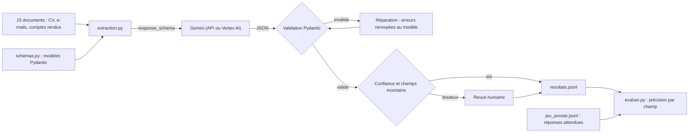

Un LLM lit très bien un e-mail de commande. Mais votre logiciel de gestion, lui, ne lit pas « deux sacs de café pour jeudi » : il veut `{"reference": "CAF-1KG", "quantite": 2, "date_livraison": "2026-10-15"}`, **à chaque fois**, au bon format, sans invention. Cette formation vous apprend à obtenir ce JSON, à le vérifier, à le réparer quand il est faux, à envoyer les cas douteux à un humain, et surtout à **mesurer** combien de champs sont justes.

Fil rouge : une petite entreprise fictive reçoit des **CV**, des **e-mails de commande** et des **comptes rendus de réunion**. Un pipeline Python les transforme en données structurées, et un script d'évaluation compare le résultat à un jeu de 15 documents annotés à la main.

## Pour qui ?

- Vous savez appeler Gemini en Python (par exemple après [Premiers pas avec l'API Gemini en Python](../../01-debuter/02-premiers-pas-api-gemini-python/index.md)).
- Vous êtes à l'aise avec les classes Python, les dictionnaires et JSON.
- Pydantic n'est pas un prérequis : il est expliqué dès la première utilisation.

## Ce que l'on construit



## Prérequis

- Python 3.10 ou plus récent.
- **Sans GCP** : une clé d'API Gemini (Google AI Studio) dans `.env`.
- **Avec GCP** : un projet Google Cloud avec l'API Vertex AI activée et `gcloud auth application-default login`. Aucune ressource n'est créée : on ne fait que des appels au modèle.

## Programme

| Module | Leçons | Durée indicative |
| --- | --- | --- |
| 1. Sorties structurées | Du texte libre au JSON garanti ; modéliser avec Pydantic (énumérations, optionnels) | 1h |
| 2. Fiabiliser | Valider et réparer ; confiance et revue humaine | 1h |
| 3. À l'échelle | Extraction en lot (API Gemini et Vertex AI) ; construire un jeu annoté ; mesurer la précision par champ | 1h20 |
| 4. Projet final | Comparer trois modèles, analyser les erreurs, décider | 40 min |

## Le code du lab

Dans [files/](./files/) : [schemas.py](./files/schemas.py) (les 3 schémas), [extraction.py](./files/extraction.py) (le pipeline), [evaluer.py](./files/evaluer.py) (la précision par champ), [jeu_annote.jsonl](./files/jeu_annote.jsonl) (15 documents fictifs annotés), [test_extraction.py](./files/test_extraction.py) (7 tests sans clé).

```bash title="terminal"
cd files
python -m venv .venv && source .venv/bin/activate
pip install -r requirements.txt
cp .env.example .env                                 # puis votre clé, ou la config Vertex AI
pytest -q                                            # sans clé
python extraction.py jeu_annote.jsonl resultats.jsonl   # 15 appels au modèle
python evaluer.py jeu_annote.jsonl resultats.jsonl
```

## Sans GCP ou avec GCP ?

| | Sans GCP (API Gemini) | Avec GCP (Vertex AI) |
| --- | --- | --- |
| Authentification | `GOOGLE_API_KEY` | identifiants Google Cloud (ADC), pas de clé |
| Configuration | `.env` avec la clé | `GOOGLE_GENAI_USE_VERTEXAI=TRUE`, projet, région |
| Modèle testé | `gemini-3.5-flash`, `gemini-3.5-flash-lite` | `gemini-2.5-flash` en `europe-west1` |
| Données | traitées par l'API Gemini | restent dans la région choisie de votre projet |
| Code | identique | identique |

Tout le code a été exécuté le 2026-10-15 sur les deux plateformes ; les chiffres cités dans les leçons viennent de ces exécutions.
