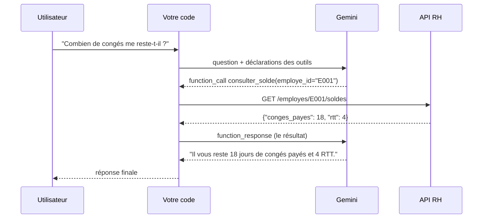

# Le cycle du function calling et les déclarations

> [!NOTE]
> Dans cette leçon, vous allez comprendre ce qui se passe réellement lors d'un appel de fonction, puis écrire la **déclaration** (nom, description, schéma des paramètres) d'un outil RH que Gemini saura utiliser.

## Le modèle n'exécute rien

Premier point, le plus important : **le modèle n'appelle jamais votre API**. Il renvoie une *intention* structurée (« j'aimerais appeler `consulter_solde` avec `{"employe_id": "E001"}` »). C'est **votre code** qui décide de l'exécuter, l'exécute, puis renvoie le résultat au modèle.



Deux allers-retours avec le modèle pour une seule question : c'est normal, et c'est ce qui coûte (en latence et en jetons). Un **jeton** (token) est un morceau de mot, l'unité de facturation des LLM.

## Ce que voit le modèle : la déclaration

Le modèle ne lit pas votre code Python. Il lit une **déclaration de fonction** (`FunctionDeclaration`) : un nom, une description et un **schéma JSON** des paramètres. JSON Schema est un format standard pour décrire la forme d'un objet JSON (types, champs obligatoires, valeurs permises).

```python title="files/outils_rh.py (extrait)"
from google.genai import types

types.FunctionDeclaration(
    name="consulter_solde",
    description="Donne le solde de congés payés et de RTT (en jours) d'un employé.",
    parameters_json_schema={
        "type": "object",
        "properties": {"employe_id": {"type": "string", "description": "Ex. E001"}},
        "required": ["employe_id"]}),

types.FunctionDeclaration(
    name="chercher_employe",
    description="Cherche un employé dans l'annuaire par son nom ou une partie du nom. "
                "Renvoie son identifiant (ex. E002). À appeler AVANT tout autre outil "
                "quand l'utilisateur donne un nom au lieu d'un identifiant.",
    parameters_json_schema={
        "type": "object",
        "properties": {"nom": {"type": "string", "description": "Ex. « Benali »"}},
        "required": ["nom"]}),
```

Les cinq déclarations complètes sont dans [outils_rh.py](../files/outils_rh.py).

| Champ | Rôle pour le modèle | Bonne pratique |
| --- | --- | --- |
| `name` | identifiant renvoyé dans `function_call` | verbe + objet en snake_case : `consulter_solde` |
| `description` | **le prompt de l'outil** : quand et pourquoi l'appeler | dire l'ordre d'appel, donner un exemple de valeur |
| `properties` | les paramètres et leur type | `enum` pour une liste fermée (`["conges_payes", "rtt"]`) |
| `required` | les paramètres sans lesquels l'appel n'a pas de sens | tout ce que la fonction exige |

> [!TIP]
> La phrase « À appeler AVANT tout autre outil quand l'utilisateur donne un nom » suffit à obtenir l'enchaînement `chercher_employe` → `consulter_solde`. La description est l'endroit le plus rentable pour guider le modèle.

## Deux façons d'écrire une déclaration

Le SDK `google-genai` peut aussi **déduire** la déclaration d'une fonction Python typée et documentée :

```python title="files/auto.py (extrait)"
def consulter_solde(employe_id: str) -> dict:
    """Donne le solde de congés payés et de RTT (en jours) d'un employé, ex. E001."""
    return outils_rh.consulter_solde(UTILISATEUR, employe_id)
```

`types.FunctionDeclaration.from_callable(client=client, callable=consulter_solde)` produit alors la même chose que le schéma écrit à la main (sortie réelle plus bas). La signature donne les types, la docstring donne la description.

| | Schéma écrit à la main | Déduit d'une fonction Python |
| --- | --- | --- |
| Contrôle fin (`enum`, descriptions par paramètre) | oui | limité |
| Une seule source de vérité | non : schéma et code à garder alignés | oui |
| Lisible dans une revue de code | très | oui |
| Utilisé dans ce lab pour | la boucle manuelle | le mode automatique |

> [!WARNING]
> Si vous renommez un paramètre Python sans mettre à jour le schéma, le modèle continuera d'envoyer l'ancien nom. C'est pourquoi le lab **valide** les arguments reçus avant d'appeler la fonction (module 3).

```quiz
question: "Lors d'un function calling, qui envoie la requête HTTP à l'API RH ?"
options:
  - "Le modèle Gemini, directement depuis les serveurs de Google"
  - "Votre code, après avoir reçu un function_call du modèle"
  - "Le SDK, toujours, sans que vous puissiez l'en empêcher"
answer: 1
explanation: "Le modèle ne renvoie qu'une intention structurée (nom + arguments). C'est votre code qui exécute l'appel ; même en mode automatique, c'est le SDK sur VOTRE machine qui appelle votre fonction Python."
```

```quiz
question: "Quel champ de la déclaration influence le plus le moment où le modèle choisit un outil ?"
options:
  - "name"
  - "description"
  - "required"
answer: 1
explanation: "La description est lue comme un prompt : elle dit à quoi sert l'outil et quand l'appeler. Le nom aide un peu, required ne dit rien du moment opportun."
```

## Exercice : déclarer `lister_demandes`

Écrivez la déclaration de l'outil `lister_demandes`, qui liste les demandes de congés d'un employé avec leur statut. Ajoutez une indication qui évite au modèle de l'appeler avec un nom de personne.

<details>
<summary>Voir la solution</summary>

```python
types.FunctionDeclaration(
    name="lister_demandes",
    description="Liste les demandes de congés d'un employé, avec leur statut "
                "(en_attente, annulee). Si l'utilisateur donne un nom, "
                "appelle d'abord chercher_employe pour obtenir l'identifiant.",
    parameters_json_schema={
        "type": "object",
        "properties": {"employe_id": {"type": "string",
                                      "description": "Identifiant, ex. E001"}},
        "required": ["employe_id"]})
```

La description renvoie vers `chercher_employe` et l'exemple `E001` fixe le format attendu. La version du lab est plus courte car l'instruction système répète déjà la règle « nom → chercher_employe ».

</details>

## Résultat obtenu

Déclaration déduite par le SDK à partir de `auto.consulter_solde` (exécuté le 2026-10-15, sans appel réseau) :

```json
{
 "description": "Donne le solde de congés payés et de RTT (en jours) d'un employé, ex. E001.",
 "name": "consulter_solde",
 "parameters": {
  "properties": {"employe_id": {"type": "STRING"}},
  "required": ["employe_id"],
  "type": "OBJECT"
 }
}
```

Et le cycle complet avec le vrai modèle (`python e2e.py`, scénario 1, `gemini-3.5-flash`) :

```text
[E001] Combien de jours de congés me reste-t-il ?   (mode AUTO)
  [tour 1] 1 appel(s) : consulter_solde({"employe_id": "E001"})
  → Il vous reste **18 jours** de congés payés et **4 jours** de RTT.
```

Le modèle a deviné seul que « me » désignait `E001`, parce que l'instruction système lui donne l'identifiant de la session.

## Je sais faire

- [ ] Expliquer pourquoi le modèle n'exécute jamais lui-même une fonction
- [ ] Écrire une `FunctionDeclaration` avec `parameters_json_schema`
- [ ] Rédiger une description qui dit quand appeler l'outil
- [ ] Choisir entre schéma écrit à la main et schéma déduit d'une fonction Python
