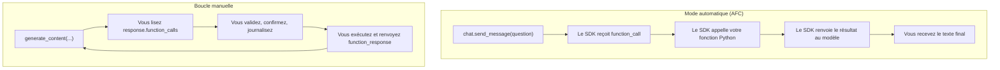

# Appel automatique ou boucle manuelle

> [!NOTE]
> Dans cette leçon, vous allez faire tourner le même outil de deux façons avec `google-genai` : en **mode automatique** (le SDK exécute vos fonctions Python) puis avec une **boucle manuelle** (votre code exécute), et choisir le bon mode selon le risque.

## Deux modes, une même mécanique

Dans les deux cas, le cycle est celui de la leçon précédente. La seule question est : **qui exécute la fonction entre deux appels au modèle ?**



AFC signifie *Automatic Function Calling* : c'est le nom du mode automatique dans le SDK.

## Le mode automatique : 10 lignes

On passe directement des **fonctions Python** dans `tools`. Le SDK déduit les schémas (signature + docstring), exécute les fonctions et relance le modèle jusqu'à obtenir du texte.

```python title="files/auto.py (extrait)"
client = genai.Client()
chat = client.chats.create(
    model=os.environ.get("MODEL", "gemini-3.5-flash"),
    config=types.GenerateContentConfig(
        tools=[chercher_employe, consulter_solde],  # le SDK déduit les schémas
        automatic_function_calling=types.AutomaticFunctionCallingConfig(
            maximum_remote_calls=5)))
reponse = chat.send_message("Combien de RTT reste-t-il à Karim Benali ?")
print(reponse.text)
```

`maximum_remote_calls` plafonne le nombre d'appels de fonctions que le SDK enchaîne : c'est votre ceinture de sécurité contre une boucle infinie.

> [!TIP]
> Le SDK recommande d'utiliser l'AFC via `client.chats` (une conversation) plutôt que via `client.models.generate_content` : il affiche d'ailleurs un avertissement dans ce second cas.

## La boucle manuelle : le contrôle total

On désactive l'AFC, on reçoit les `function_calls` et on décide. Voici le cœur de la boucle du lab :

```python title="files/assistant.py (extrait)"
config = types.GenerateContentConfig(
    system_instruction=SYSTEME.format(utilisateur=utilisateur, aujourdhui=...),
    tools=[types.Tool(function_declarations=outils_rh.DECLARATIONS)],
    automatic_function_calling=types.AutomaticFunctionCallingConfig(disable=True),
)
reponse = generer(client, historique, config)
historique.append(reponse.candidates[0].content)   # garde les thought signatures
appels = reponse.function_calls or []
if not appels:
    return reponse.text
parts = [types.Part(function_response=types.FunctionResponse(
             id=fc.id, name=fc.name, response=executer(fc, utilisateur, confirmer)))
         for fc in appels]
historique.append(types.Content(role="user", parts=parts))
```

Trois détails qui comptent :

1. On ajoute **le contenu complet** renvoyé par le modèle (`candidates[0].content`) à l'historique, pas une copie reconstruite. Les modèles Gemini récents y glissent des *thought signatures* (signatures de raisonnement) qu'il faut renvoyer telles quelles pour que le modèle retrouve le fil de son raisonnement.
2. On recopie `fc.id` dans la `FunctionResponse` : avec plusieurs appels simultanés, c'est ce qui associe chaque résultat à sa demande.
3. Tout passe par `executer(...)` : c'est **le point de contrôle** où l'on valide, confirme et journalise (module 3).

| Critère | Automatique (AFC) | Manuel |
| --- | --- | --- |
| Code à écrire | minimal | une boucle de 30 lignes |
| Valider les arguments avant exécution | dans chaque fonction | une fois, au point de contrôle |
| Demander une confirmation humaine | difficile (la fonction bloque le SDK) | naturel |
| Journal d'audit centralisé | à la main dans chaque fonction | une ligne dans `executer` |
| Identité de l'utilisateur | variable globale ou fermeture | paramètre explicite |
| Bon usage | prototype, outils en lecture seule | toute action qui écrit ou coûte |

```quiz
question: "Votre outil crée une demande de congés et débite un solde. Quel mode choisir ?"
options:
  - "Le mode automatique, car il demande moins de code"
  - "La boucle manuelle, pour pouvoir valider et demander confirmation avant d'exécuter"
  - "Peu importe, le modèle demande toujours confirmation avant d'écrire"
answer: 1
explanation: "Une action qui écrit doit passer par un point de contrôle que VOUS maîtrisez : validation, confirmation, journal. Le modèle ne demande rien de lui-même de façon fiable."
```

```quiz
question: "Pourquoi recopier fc.id dans la FunctionResponse ?"
options:
  - "Pour que le modèle associe chaque résultat au bon appel quand il en a demandé plusieurs"
  - "Parce que l'API facture à l'identifiant"
  - "Pour chiffrer la réponse"
answer: 0
explanation: "Quand le modèle demande deux consulter_solde à la fois, l'identifiant d'appel lève toute ambiguïté sur quel résultat correspond à quelle demande."
```

## Exercice : afficher les appels faits par l'AFC

En mode automatique, vous ne voyez que le texte final. Comment afficher la liste des fonctions réellement appelées par le SDK pendant `chat.send_message` ?

<details>
<summary>Voir la solution</summary>

L'historique de la conversation contient tous les tours, y compris les `function_call` intermédiaires :

```python
for contenu in chat.get_history():
    for part in contenu.parts:
        if part.function_call:
            print("appel :", part.function_call.name, dict(part.function_call.args))
```

C'est ce que fait la fin de [auto.py](../files/auto.py). Avec `client.models.generate_content`, on lirait `reponse.automatic_function_calling_history` à la place.

</details>

## Résultat obtenu

`python auto.py` exécuté le 2026-10-15 avec `gemini-3.5-flash`, API RH locale lancée :

```text
  appel : chercher_employe {'nom': 'Karim Benali'}
  appel : consulter_solde {'employe_id': 'E002'}
Il reste **9 jours de RTT** à Karim Benali (ainsi que 7 jours de congés payés).
```

Le SDK a enchaîné seul deux fonctions. Pratique, mais rien ne s'est intercalé entre la décision du modèle et l'appel HTTP : c'est exactement ce qu'on ne veut pas pour une écriture.

## Je sais faire

- [ ] Activer le mode automatique en passant des fonctions Python dans `tools`
- [ ] Désactiver l'AFC et lire `response.function_calls`
- [ ] Renvoyer un résultat avec `FunctionResponse(id=..., name=..., response=...)`
- [ ] Expliquer pourquoi on garde `candidates[0].content` tel quel dans l'historique
