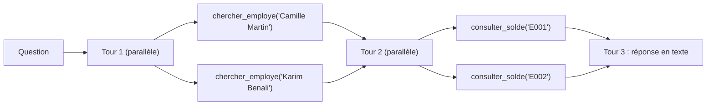

# Appels parallèles et appels en chaîne

> [!NOTE]
> Dans cette leçon, vous allez observer le modèle enchaîner **4 appels en 2 tours** pour une seule question, comprendre la différence entre appels parallèles et appels en chaîne, et faire en sorte que votre boucle gère les deux.

## Deux formes d'orchestration

- **Appels parallèles** : dans **un même tour**, le modèle demande plusieurs fonctions **indépendantes** (le solde de Camille et celui de Karim). Votre code reçoit une liste de `function_calls`.
- **Appels en chaîne** (on dit aussi *compositionnels*) : la sortie d'un appel sert d'**entrée** au suivant (on cherche l'identifiant de Camille, *puis* on lit son solde). Cela demande **plusieurs tours**.

La question « Compare les soldes de RTT de Camille Martin et de Karim Benali » combine les deux :



Le passage du tour 1 au tour 2 est la **chaîne** ; à l'intérieur de chaque tour, les deux appels sont **parallèles**.

## Ce que la boucle doit faire

Une boucle naïve qui ne traite que `response.function_calls[0]` perd le second appel. La boucle du lab traite **toute la liste** et renvoie **toutes** les réponses dans un seul message :

```python title="files/assistant.py (extrait)"
for tour in range(MAX_TOURS):
    reponse = generer(client, historique, config)
    historique.append(reponse.candidates[0].content)
    appels = reponse.function_calls or []
    if not appels:
        return reponse.text or ""
    parts = [types.Part(function_response=types.FunctionResponse(
                 id=fc.id, name=fc.name, response=executer(fc, utilisateur, confirmer)))
             for fc in appels]
    historique.append(types.Content(role="user", parts=parts))   # UN message, N réponses
return "Je n'ai pas pu terminer en un nombre raisonnable d'étapes. Un humain RH va reprendre."
```

| Situation | Ce que reçoit votre code | Ce que vous renvoyez |
| --- | --- | --- |
| Un appel | 1 `function_call` | 1 `function_response` |
| Appels parallèles | N `function_call` dans le même tour | N `function_response` dans **un** `Content`, mêmes `id` |
| Chaîne | un tour d'appels, puis un autre au tour suivant | les réponses du tour, puis on relance le modèle |
| Réponse finale | du texte, aucun `function_call` | rien : on sort de la boucle |

> [!TIP]
> L'instruction système du lab contient « Lance en parallèle les appels indépendants ». Sans elle, le modèle le fait souvent quand même, mais la consigne rend le comportement plus régulier, et chaque tour économisé est un aller-retour réseau de moins.

> [!WARNING]
> Ici les appels parallèles sont exécutés **l'un après l'autre** par la compréhension de liste : « parallèle » décrit la demande du modèle, pas votre exécution. Pour des API lentes, exécutez-les vraiment en même temps (`concurrent.futures.ThreadPoolExecutor` ou `asyncio.gather`) ; pour une API locale qui répond en quelques millisecondes, ce n'est pas utile.

## La limite de tours

`MAX_TOURS = 6` borne la chaîne. Sans limite, un modèle qui se trompe d'outil peut boucler en consommant des jetons. Au-delà, l'assistant **rend la main à un humain** au lieu d'inventer.

```quiz
question: "Le modèle renvoie deux function_calls dans le même tour. Que doit faire votre boucle ?"
options:
  - "Exécuter le premier, l'envoyer au modèle, puis attendre qu'il redemande le second"
  - "Exécuter les deux et renvoyer les deux function_response dans un seul message"
  - "Refuser : un seul appel par tour est autorisé"
answer: 1
explanation: "Le modèle attend les réponses à TOUS ses appels avant de continuer. On renvoie un Content avec N parts function_response, chacune avec l'id de son appel."
```

```quiz
question: "Pourquoi chercher_employe puis consulter_solde ne peuvent-ils pas être appelés en parallèle ?"
options:
  - "Parce que consulter_solde a besoin de l'identifiant que renvoie chercher_employe"
  - "Parce que l'API Gemini interdit deux outils différents dans un même tour"
  - "Parce que chercher_employe est une action sensible"
answer: 0
explanation: "C'est une dépendance de données : le second appel prend en entrée la sortie du premier. D'où deux tours, c'est-à-dire une chaîne."
```

## Exercice : exécuter vraiment en parallèle

Modifiez la construction de `parts` pour exécuter les appels d'un tour en même temps avec `ThreadPoolExecutor`, en conservant l'ordre des réponses.

<details>
<summary>Voir la solution</summary>

```python
from concurrent.futures import ThreadPoolExecutor

with ThreadPoolExecutor(max_workers=4) as pool:
    resultats = list(pool.map(lambda fc: executer(fc, utilisateur, confirmer), appels))
parts = [types.Part(function_response=types.FunctionResponse(id=fc.id, name=fc.name, response=r))
         for fc, r in zip(appels, resultats)]
```

`pool.map` conserve l'ordre. Deux précautions : le client `httpx.Client` est utilisable depuis plusieurs threads, mais la **confirmation console** ne l'est pas (deux `input()` simultanés). Exécutez donc en parallèle uniquement les outils de lecture, et les outils sensibles un par un.

</details>

## Résultat obtenu

`python e2e.py`, scénario 2, exécuté le 2026-10-15 avec `gemini-3.5-flash` (utilisateur E004, manager de Camille et Karim) :

```text
[E004] Compare les soldes de RTT de Camille Martin et de Karim Benali.   (mode AUTO)
  [tour 1] 2 appel(s) : chercher_employe({"nom": "Camille Martin"}), chercher_employe({"nom": "Karim Benali"})
  [tour 2] 2 appel(s) : consulter_solde({"employe_id": "E001"}), consulter_solde({"employe_id": "E002"})
  → Camille Martin dispose de **4 jours** de RTT, tandis que Karim Benali en a **9 jours**.
```

Le même scénario sur Vertex AI (`gemini-2.5-flash`, europe-west1) a produit exactement les mêmes 4 appels en 2 tours.

## Je sais faire

- [ ] Distinguer appels parallèles (même tour) et appels en chaîne (tours successifs)
- [ ] Renvoyer N réponses dans un seul message avec les bons `id`
- [ ] Borner la boucle avec un nombre maximal de tours
- [ ] Exécuter réellement en parallèle les outils de lecture quand l'API est lente
