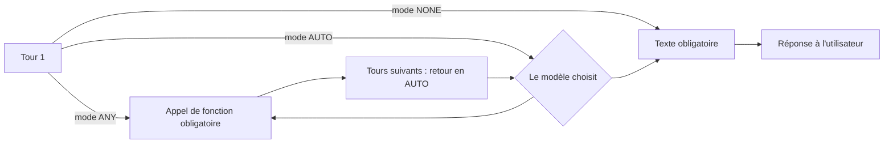

# Les modes AUTO, ANY et NONE

> [!NOTE]
> Dans cette leçon, vous allez contrôler **si** et **quels** outils le modèle a le droit d'appeler grâce à `FunctionCallingConfig`, et éviter le piège classique du mode `ANY` qui empêche le modèle de conclure.

## Le réglage `function_calling_config`

Par défaut, le modèle décide seul s'il appelle un outil ou s'il répond en texte. Vous pouvez le contraindre :

```python title="files/assistant.py (extrait)"
tool_config=types.ToolConfig(function_calling_config=types.FunctionCallingConfig(
    mode=mode if tour == 0 else "AUTO")),
```

| Mode | Comportement | Usage typique |
| --- | --- | --- |
| `AUTO` (défaut) | le modèle choisit : appel(s) ou texte | conversation normale |
| `ANY` | le modèle **doit** appeler au moins une fonction | forcer une extraction, un routage, un premier appel |
| `NONE` | appels **interdits**, texte seulement | question générale, résumé final, outils temporairement coupés |
| `VALIDATED` | le modèle peut répondre en texte, mais ses appels respectent strictement le schéma | quand le respect du schéma prime |

Avec `ANY`, on peut aussi restreindre la liste : `allowed_function_names=["consulter_solde"]`.



## Le piège du mode ANY

En mode `ANY`, le modèle **ne peut pas** répondre en texte. Si vous laissez `ANY` à tous les tours, il appellera des fonctions indéfiniment et votre boucle ne s'arrêtera qu'à `MAX_TOURS`. C'est pourquoi le lab applique le mode demandé **au premier tour seulement**, puis repasse en `AUTO`. Un test sans clé le vérifie :

```python title="files/test_assistant.py (extrait)"
def test_mode_any_seulement_au_premier_tour_et_limite_de_tours():
    faux = FauxModele([[("consulter_solde", {"employe_id": "E001"})]] * assistant.MAX_TOURS)
    rep = assistant.repondre(faux, [], "Boucle", "E001", lambda *a: True, mode="ANY", afficher=lambda *_: None)
    modes = [c.tool_config.function_calling_config.mode for c in faux.configs]
    assert modes[0] == "ANY" and set(modes[1:]) == {"AUTO"}
    assert "humain" in rep and len(faux.configs) == assistant.MAX_TOURS
```

> [!TIP]
> `NONE` est utile **sans retirer les outils** de la requête : le modèle sait qu'ils existent (il peut dire « je peux consulter votre solde si vous voulez ») mais ne les appelle pas. Retirer `tools` change davantage le comportement.

> [!WARNING]
> Les modes sont une **aide**, pas une barrière de sécurité. Un outil dangereux ne doit pas être protégé par `allowed_function_names` mais par votre code (validation, droits, confirmation) : la configuration peut changer, un bug peut l'oublier.

```quiz
question: "Vous voulez qu'un « Bonjour » déclenche quand même la lecture du solde, pour afficher un tableau de bord. Quel réglage ?"
options:
  - "mode NONE"
  - "mode ANY avec allowed_function_names=[\"consulter_solde\"], au premier tour"
  - "mode AUTO avec une température élevée"
answer: 1
explanation: "ANY oblige un appel, allowed_function_names le restreint à consulter_solde. Au tour suivant, on repasse en AUTO pour que le modèle puisse répondre."
```

```quiz
question: "Que se passe-t-il si l'on garde le mode ANY à tous les tours de la boucle ?"
options:
  - "Le modèle répond normalement au deuxième tour"
  - "L'API renvoie une erreur 400"
  - "Le modèle est obligé d'appeler une fonction à chaque tour et ne peut jamais rendre de texte"
answer: 2
explanation: "ANY interdit la réponse textuelle. Seule la limite de tours arrête la boucle, après avoir consommé des appels inutiles."
```

## Exercice : un routeur avec ANY

Vous ajoutez un outil `transmettre_rh(sujet: str)` qui ouvre un ticket pour un humain. Écrivez la configuration qui **oblige** le modèle, au premier tour, à choisir entre `consulter_solde` et `transmettre_rh`, et rien d'autre.

<details>
<summary>Voir la solution</summary>

```python
types.ToolConfig(function_calling_config=types.FunctionCallingConfig(
    mode="ANY",
    allowed_function_names=["consulter_solde", "transmettre_rh"]))
```

Les autres outils restent déclarés (le modèle les connaît) mais ne peuvent pas être appelés à ce tour. C'est un **routeur** : le premier appel indique la branche à suivre. Au tour suivant, `mode="AUTO"`.

</details>

## Résultat obtenu

Exécutions réelles du 2026-10-15 avec `gemini-3.5-flash`.

Mode `NONE` (scénario 6 de `e2e.py`) : aucune fonction appelée, réponse directe.

```text
[E001] Explique-moi en une phrase ce qu'est un RTT.   (mode NONE)
  → Un RTT (Réduction du Temps de Travail) est un jour de repos accordé aux salariés travaillant plus de 35 heures par semaine pour compenser leurs heures supplémentaires.
```

Mode `ANY` sur un simple « Bonjour ! » : le modèle est forcé d'appeler un outil au tour 1, puis, repassé en `AUTO`, il conclut en texte.

```text
[E001] Bonjour ! (mode ANY)
  [tour 1] 1 appel(s) : consulter_solde({"employe_id": "E001"})
  → Bonjour ! Comment puis-je vous aider aujourd'hui concernant vos congés ou vos RTT ?
```

## Je sais faire

- [ ] Régler `FunctionCallingConfig` en `AUTO`, `ANY` ou `NONE`
- [ ] Restreindre les outils appelables avec `allowed_function_names`
- [ ] Éviter la boucle infinie en ne gardant `ANY` qu'au premier tour
- [ ] Expliquer pourquoi un mode n'est pas une protection de sécurité
