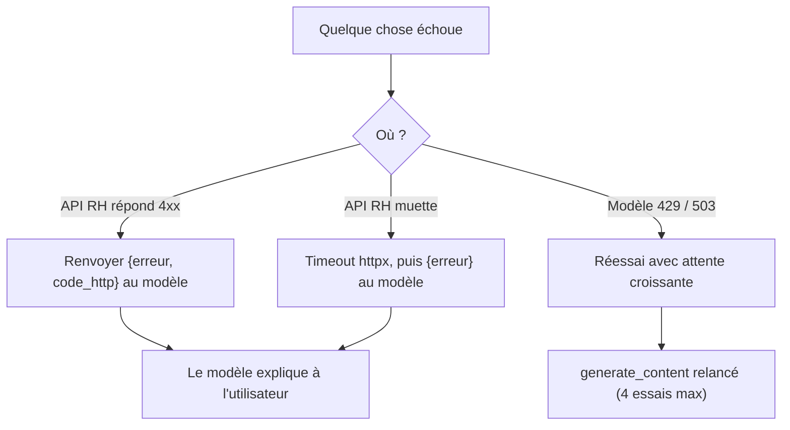

# Erreurs, timeouts et réessais

> [!NOTE]
> Dans cette leçon, vous allez rendre l'assistant robuste à trois familles de pannes : l'**API métier** qui répond une erreur (403, 404, 409), l'**API métier** qui ne répond pas (timeout), et le **modèle** saturé (429, 503).

## Trois pannes, trois traitements



Le principe pour les outils : **ne jamais lever d'exception vers la boucle**. Une exception casse la conversation ; un dictionnaire `{"erreur": ...}` est un résultat comme un autre que le modèle sait reformuler (« vous n'avez pas accès à ce solde »).

## Côté API métier : un seul point d'appel HTTP

Tous les outils passent par `_appel`, qui transforme chaque panne en dictionnaire :

```python title="files/outils_rh.py (extrait)"
# Timeout explicite : sans lui, un appel bloqué fige tout l'assistant.
http = httpx.Client(base_url=API_URL, timeout=httpx.Timeout(5.0, connect=2.0))

def _appel(utilisateur: str, methode: str, chemin: str, **kw) -> dict:
    try:
        r = http.request(methode, chemin, headers={"X-Utilisateur": utilisateur}, **kw)
    except httpx.TimeoutException:
        return {"erreur": "L'API RH n'a pas répondu à temps, réessayez plus tard."}
    except httpx.HTTPError as e:
        return {"erreur": f"API RH injoignable ({type(e).__name__})."}
    if r.status_code >= 400:
        try:
            detail = r.json().get("detail")
        except ValueError:
            detail = r.text[:200]
        return {"erreur": detail, "code_http": r.status_code}
    return r.json()
```

| Code | Signification dans l'API RH | Ce que le modèle doit en faire |
| --- | --- | --- |
| 403 | l'utilisateur n'est ni l'employé ni son manager | expliquer le refus, ne pas réessayer |
| 404 | employé ou demande inconnu | proposer de chercher par nom |
| 409 | solde insuffisant, demande déjà annulée | donner le solde disponible |
| 422 | données invalides (dates inversées…) | reformuler la demande |
| timeout | l'API n'a pas répondu en 5 s | dire de réessayer plus tard |

> [!TIP]
> Le message d'erreur est lu par le modèle : rendez-le **actionnable**. « employe_id doit ressembler à E001 (utilisez chercher_employe) » permet au modèle de se corriger seul au tour suivant ; « Bad Request » ne l'aide pas.

## Côté modèle : réessayer intelligemment

Les erreurs 429 (*quota dépassé*, trop de requêtes) et 503 (*service surchargé*) sont **temporaires**. On réessaie avec une attente qui double (*backoff exponentiel*). Les autres erreurs (400 : requête mal formée, 403 : clé invalide) ne guériront pas : on les remonte tout de suite.

```python title="files/assistant.py (extrait)"
def generer(client, contents, config, essais=4):
    for i in range(essais):
        try:
            return client.models.generate_content(model=MODEL, contents=contents, config=config)
        except errors.APIError as e:
            if e.code not in (429, 500, 503) or i == essais - 1:
                raise
            time.sleep(2 ** i * 2)  # 2 s, 4 s, 8 s
```

> [!WARNING]
> Ne réessayez **jamais automatiquement un outil qui écrit** (création de demande) après un timeout : la requête a peut-être été traitée côté serveur, et un second envoi créerait un doublon. Pour une écriture, renvoyez l'erreur au modèle et laissez l'utilisateur vérifier (`lister_demandes`), ou utilisez une **clé d'idempotence** si votre API en propose une.

```quiz
question: "L'API RH répond 403 à consulter_solde. Que doit renvoyer l'outil à la boucle ?"
options:
  - "Lever une exception HTTPStatusError pour arrêter la conversation"
  - "Un dictionnaire {\"erreur\": ..., \"code_http\": 403} que le modèle reformulera"
  - "Un solde à zéro, pour ne pas bloquer l'utilisateur"
answer: 1
explanation: "Une erreur métier est un résultat : le modèle l'explique. Inventer un solde à zéro serait un mensonge, et une exception casserait la conversation."
```

```quiz
question: "Quelles erreurs de l'API Gemini justifient un réessai automatique ?"
options:
  - "429 et 503"
  - "400 et 403"
  - "Toutes, jusqu'à ce que ça passe"
answer: 0
explanation: "429 (quota) et 503 (surcharge) sont temporaires. 400 (requête invalide) et 403 (clé refusée) se reproduiront à l'identique : réessayer ne fait que perdre du temps."
```

## Exercice : tester le timeout sans réseau

Écrivez un test pytest qui vérifie qu'un timeout de l'API devient un message lisible, **sans** lancer l'API ni attendre 5 secondes.

<details>
<summary>Voir la solution</summary>

`httpx.MockTransport` remplace le réseau par une fonction ; on lui fait lever un `ReadTimeout` :

```python title="files/test_assistant.py (extrait)"
def test_timeout_devient_message(monkeypatch):
    def lent(request):
        raise httpx.ReadTimeout("trop lent", request=request)
    monkeypatch.setattr(outils_rh, "http", httpx.Client(base_url="http://x",
                                                        transport=httpx.MockTransport(lent)))
    assert "pas répondu à temps" in outils_rh.consulter_solde("E001", "E001")["erreur"]
```

Le test s'exécute en quelques millisecondes et ne dépend d'aucun service.

</details>

## Résultat obtenu

`python e2e.py`, scénario 5, exécuté le 2026-10-15 avec `gemini-3.5-flash`. E004 (comptabilité) demande le solde d'une employée du marketing : l'API répond 403, le modèle l'explique.

```text
[E004] Quel est le solde de Lucie Moreau ?   (mode AUTO)
  [tour 1] 1 appel(s) : chercher_employe({"nom": "Lucie Moreau"})
  [tour 2] 1 appel(s) : consulter_solde({"employe_id": "E003"})
  → L'accès au solde de Lucie Moreau vous est refusé car vous n'êtes ni l'employée concernée ni son manager.
```

Et la ligne correspondante du journal d'audit :

```json
{"ts": "2026-10-15T14:35:26+00:00", "utilisateur": "E004", "outil": "consulter_solde", "args": {"employe_id": "E003"}, "statut": "erreur", "duree_ms": 3, "resultat": {"erreur": "Accès refusé : vous n'êtes ni l'employé ni son manager", "code_http": 403}}
```

## Je sais faire

- [ ] Fixer un timeout explicite sur un client HTTP
- [ ] Transformer toute panne d'outil en dictionnaire `{"erreur": ...}`
- [ ] Réessayer les 429/503 avec un backoff exponentiel, et seulement eux
- [ ] Expliquer pourquoi on ne réessaie pas automatiquement une écriture
