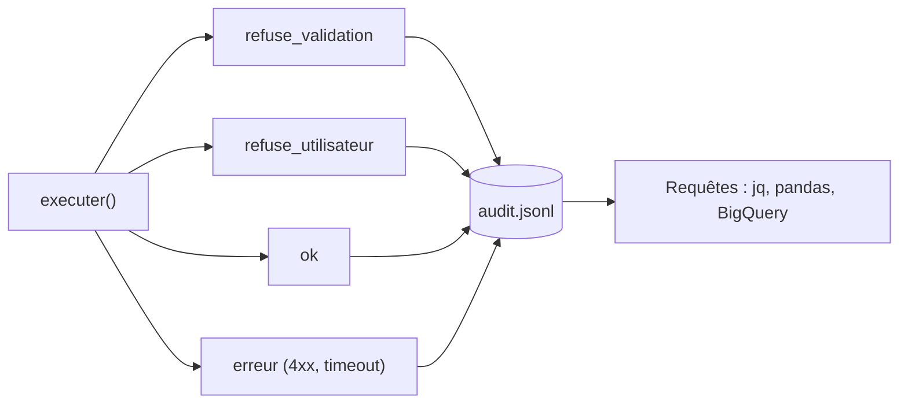

# Le journal d'audit

> [!NOTE]
> Dans cette leçon, vous allez tracer **chaque** appel d'outil (qui, quoi, avec quels arguments, quel résultat, en combien de temps) dans un fichier JSON Lines, puis l'interroger pour répondre aux questions d'un responsable RH ou d'un auditeur.

## Pourquoi un journal dédié ?

Quand un assistant agit dans un SIRH, on vous demandera tôt ou tard : « Qui a annulé la demande D0001 ? Est-ce l'IA ? ». Les journaux techniques (logs HTTP) ne suffisent pas : ils ne disent ni quel utilisateur a parlé à l'assistant, ni ce que le modèle avait demandé, ni si un humain avait confirmé.



**Tous** les chemins de `executer()` écrivent une ligne, y compris les refus : un refus est souvent l'événement le plus intéressant (tentative d'accès, injection de prompt).

## Le format : JSON Lines

JSON Lines (`.jsonl`) = **un objet JSON par ligne**. On ajoute en fin de fichier sans relire le reste, et chaque outil (jq, pandas, BigQuery) sait le lire.

```python title="files/assistant.py (extrait)"
def journaliser(**evenement):
    evenement = {"ts": datetime.now(timezone.utc).isoformat(timespec="seconds"), **evenement}
    with open(AUDIT_PATH, "a", encoding="utf-8") as f:
        f.write(json.dumps(evenement, ensure_ascii=False) + "\n")
```

Et dans `executer()`, l'appel après exécution :

```python title="files/assistant.py (extrait)"
t0 = time.perf_counter()
resultat = outils_rh.OUTILS[fc.name](utilisateur, **args)
journaliser(**base, statut="erreur" if "erreur" in resultat else "ok",
            duree_ms=round((time.perf_counter() - t0) * 1000), resultat=resultat)
```

| Champ | Exemple | À quoi il sert |
| --- | --- | --- |
| `ts` | `2026-10-15T14:35:19+00:00` | chronologie (en UTC, sans ambiguïté de fuseau) |
| `utilisateur` | `E001` | l'identité de **la session**, pas une affirmation du chat |
| `outil`, `args` | `creer_demande_conges`, dates | ce que le modèle a demandé |
| `statut` | `ok`, `erreur`, `refuse_validation`, `refuse_utilisateur` | filtrer les incidents |
| `duree_ms` | `4` | repérer une API lente |
| `resultat` | `{"demande_id": "D0001", ...}` | prouver ce qui a été fait |

> [!WARNING]
> Un journal d'audit contient des **données personnelles** (identifiants, absences). Appliquez-lui les mêmes règles que le SIRH : accès restreint, durée de conservation définie, pas de copie dans un outil grand public. Pour des données de santé (arrêt maladie), ne journalisez pas le motif, seulement l'identifiant de la demande.

> [!TIP]
> En production, envoyez ces lignes vers un service de logs (Cloud Logging, par exemple, qui accepte du JSON structuré) plutôt qu'un fichier local : un fichier sur le disque d'un conteneur disparaît au redémarrage.

```quiz
question: "Pourquoi journaliser aussi les appels refusés à la validation ?"
options:
  - "Pour gonfler les statistiques d'usage"
  - "Parce qu'un refus peut révéler une tentative d'injection ou un outil mal décrit"
  - "Ce n'est pas utile : seul ce qui est exécuté compte"
answer: 1
explanation: "Des refus répétés sur le même outil signalent soit une description ambiguë (le modèle se trompe de format), soit un utilisateur qui essaie de contourner les règles. Dans les deux cas, on veut le savoir."
```

```quiz
question: "D'où doit venir le champ utilisateur du journal ?"
options:
  - "De la session authentifiée de l'application"
  - "D'un argument que le modèle fournit à chaque appel"
  - "Du nom que l'utilisateur donne dans la conversation"
answer: 0
explanation: "Le journal doit être fiable même si la conversation est manipulée. Seule la session authentifiée fait foi."
```

## Exercice : répondre à l'auditeur

Avec le fichier `audit.jsonl`, listez toutes les actions sensibles (création, annulation) avec leur statut, en une commande Python ou `jq`.

<details>
<summary>Voir la solution</summary>

Avec `jq` :

```bash
jq -c 'select(.outil=="creer_demande_conges" or .outil=="annuler_demande")
       | {ts, utilisateur, outil, statut, args}' audit.jsonl
```

En Python pur :

```python
import json
for ligne in open("audit.jsonl", encoding="utf-8"):
    e = json.loads(ligne)
    if e["outil"] in {"creer_demande_conges", "annuler_demande"}:
        print(e["ts"], e["utilisateur"], e["outil"], e["statut"])
```

</details>

## Résultat obtenu

Extrait du journal produit par `python e2e.py` le 2026-10-15 (`gemini-3.5-flash`), tel qu'affiché à la fin du script :

```text
Journal d'audit :
  E001 consulter_solde       ok                  {"employe_id": "E001"}
  E004 chercher_employe      ok                  {"nom": "Camille Martin"}
  E004 chercher_employe      ok                  {"nom": "Karim Benali"}
  E004 consulter_solde       ok                  {"employe_id": "E001"}
  E004 consulter_solde       ok                  {"employe_id": "E002"}
  E001 creer_demande_conges  ok                  {"date_fin": "2026-11-06", "employe_id": "E001", "date_debut": "2026-11-04", "type_conge": "rtt"}
  E001 annuler_demande       refuse_utilisateur  {"demande_id": "D0001"}
  E004 chercher_employe      ok                  {"nom": "Lucie Moreau"}
  E004 consulter_solde       erreur              {"employe_id": "E003"}
```

La ligne brute de la création, avec la preuve de ce qui a été enregistré :

```json
{"ts": "2026-10-15T14:35:19+00:00", "utilisateur": "E001", "outil": "creer_demande_conges", "args": {"date_fin": "2026-11-06", "employe_id": "E001", "date_debut": "2026-11-04", "type_conge": "rtt"}, "statut": "ok", "duree_ms": 4, "resultat": {"demande_id": "D0001", "statut": "en_attente", "jours": 3, "employe_id": "E001", "type_conge": "rtt", "date_debut": "2026-11-04", "date_fin": "2026-11-06"}}
```

## Je sais faire

- [ ] Écrire une ligne d'audit JSON Lines pour chaque appel d'outil, refus compris
- [ ] Choisir les champs utiles : horodatage UTC, utilisateur de session, outil, arguments, statut, durée
- [ ] Interroger le journal avec `jq` ou Python
- [ ] Protéger le journal comme une donnée personnelle
