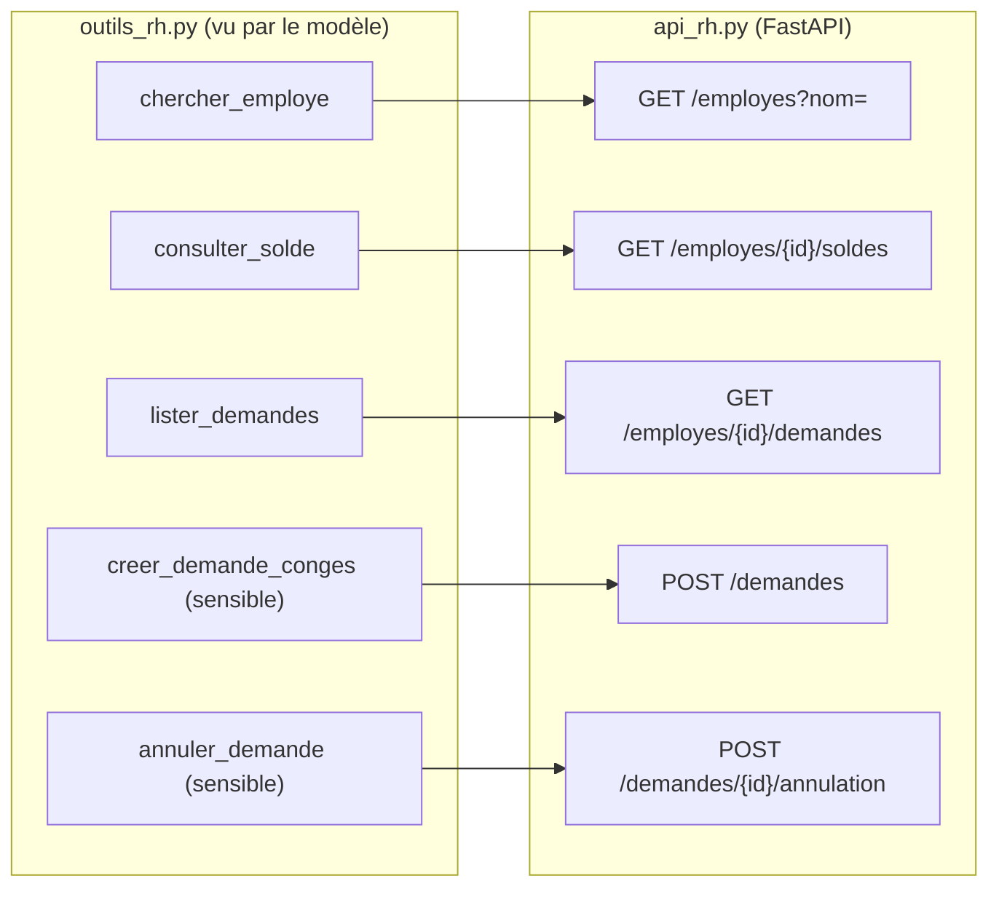

# Cahier des charges : l'API RH et ses outils

> [!NOTE]
> Dans cette leçon, vous allez lancer l'API RH fictive, l'explorer comme le ferait l'assistant, et relier chaque route HTTP à l'outil qui l'expose au modèle.

## Le cahier des charges

L'assistant RH doit permettre à un employé, ou à son manager :

1. de consulter un **solde** de congés payés et de RTT ;
2. de retrouver un collègue par son **nom** ;
3. de **lister** ses demandes ;
4. de **créer** une demande de congés (action sensible, confirmée) ;
5. d'**annuler** une demande (action sensible, confirmée).

Contraintes : aucune donnée inventée par le modèle, droits appliqués par l'API, chaque action tracée.



## Lancer l'API

```bash title="terminal"
cd files
python -m venv .venv && . .venv/bin/activate
pip install -r requirements.txt
uvicorn api_rh:app --port 8077
```

Ouvrez `http://127.0.0.1:8077/docs` : FastAPI génère une documentation interactive où l'on peut essayer chaque route. Les données (5 employés fictifs, leurs soldes) sont en mémoire et reviennent à leur état initial à chaque redémarrage.

| Employé | Service | Manager | Congés payés | RTT |
| --- | --- | --- | --- | --- |
| E001 Camille Martin | Comptabilité | E004 | 18 | 4 |
| E002 Karim Benali | Comptabilité | E004 | 7 | 9 |
| E003 Lucie Moreau | Marketing | E005 | 22 | 2 |
| E004 Sophie Durand | Comptabilité | aucun | 12 | 6 |
| E005 Hugo Lefèvre | Marketing | aucun | 25 | 0 |

## Une route de création, côté API

L'API fait son propre travail de validation (Pydantic) et applique les règles métier : jours ouvrés, solde suffisant.

```python title="files/api_rh.py (extrait)"
class NouvelleDemande(BaseModel):
    employe_id: str = Field(pattern=r"^E\d{3}$")
    type_conge: Literal["conges_payes", "rtt"]
    date_debut: date
    date_fin: date

@app.post("/demandes", status_code=201)
def creer(d: NouvelleDemande, x_utilisateur: str = Header()):
    _verifier_acces(x_utilisateur, d.employe_id)
    nb = jours_ouvres(d.date_debut, d.date_fin)
    if SOLDES[d.employe_id][d.type_conge] < nb:
        raise HTTPException(409, f"Solde insuffisant : {nb} jours demandés, ...")
    ...
```

> [!TIP]
> La validation existe **deux fois** (dans `outils_rh.valider` et dans l'API) et c'est voulu. La première renvoie un message utile au modèle avant tout appel réseau ; la seconde protège l'API contre **tous** ses clients, assistant compris.

> [!WARNING]
> `jours_ouvres` compte du lundi au vendredi et **ignore les jours fériés**. C'est une simplification du lab ; un vrai SIRH applique le calendrier de l'entreprise.

Essayez une route à la main, en vous faisant passer pour E004 :

```bash title="terminal"
curl -s -H "X-Utilisateur: E004" http://127.0.0.1:8077/employes/E002/soldes
curl -s -H "X-Utilisateur: E004" http://127.0.0.1:8077/employes/E003/soldes
```

```quiz
question: "Pourquoi l'outil creer_demande_conges ne prend-il pas de paramètre utilisateur dans son schéma ?"
options:
  - "Parce que le modèle ne sait pas manipuler les chaînes"
  - "Parce que l'identité vient de la session et est passée par le code, jamais par le modèle"
  - "Parce que l'API ignore l'identité de l'appelant"
answer: 1
explanation: "Si le modèle pouvait choisir l'utilisateur, une phrase bien tournée suffirait à agir au nom d'un autre. Le code injecte l'identité de la session dans l'en-tête X-Utilisateur."
```

```quiz
question: "Une demande du vendredi 2030-01-04 au mardi 2030-01-08 coûte combien de jours dans l'API ?"
options:
  - "5"
  - "3"
  - "4"
answer: 1
explanation: "Vendredi, lundi et mardi : 3 jours ouvrés. Le samedi et le dimanche ne sont pas décomptés. C'est vérifié par test_api_jours_ouvres_et_solde."
```

## Exercice : ajouter le solde prévisionnel

Ajoutez à l'API une route `GET /employes/{id}/soldes/simulation?jours=3&type_conge=rtt` qui renvoie le solde restant **si** la demande était acceptée, sans rien modifier. Quel outil déclareriez-vous, et serait-il sensible ?

<details>
<summary>Voir la solution</summary>

```python
@app.get("/employes/{employe_id}/soldes/simulation")
def simuler(employe_id: str, jours: int, type_conge: Literal["conges_payes", "rtt"],
            x_utilisateur: str = Header()):
    _verifier_acces(x_utilisateur, employe_id)
    reste = SOLDES[employe_id][type_conge] - jours
    return {"employe_id": employe_id, "type_conge": type_conge, "reste": reste, "possible": reste >= 0}
```

L'outil `simuler_solde(employe_id, type_conge, jours)` n'est **pas** sensible : il ne modifie rien. Il suffit de l'ajouter à `DECLARATIONS`, `OUTILS` et à `valider()` (vérifier `1 <= jours <= 31`).

</details>

## Résultat obtenu

Appels manuels le 2026-10-15, API lancée en local :

```text
$ curl -s -H "X-Utilisateur: E004" http://127.0.0.1:8077/employes/E002/soldes
{"employe_id":"E002","unite":"jours","conges_payes":7,"rtt":9}
$ curl -s -H "X-Utilisateur: E004" http://127.0.0.1:8077/employes/E003/soldes
{"detail":"Accès refusé : vous n'êtes ni l'employé ni son manager"}
```

## Je sais faire

- [ ] Lancer une API FastAPI locale et explorer `/docs`
- [ ] Faire correspondre chaque outil à une route HTTP
- [ ] Expliquer pourquoi la validation existe dans l'outil **et** dans l'API
- [ ] Ajouter une route et l'outil qui l'expose
