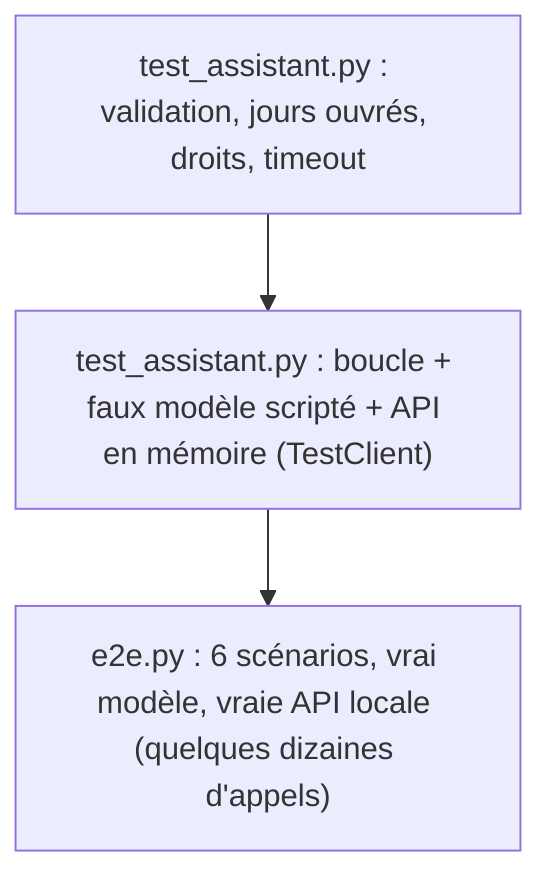

# Assembler, tester et passer sur Vertex AI

> [!NOTE]
> Dans cette leçon, vous allez faire tourner l'assistant complet, le tester **sans clé** (13 tests pytest avec un faux modèle), puis **de bout en bout** avec le vrai modèle, d'abord via l'API Gemini puis via Vertex AI.

## La pyramide de tests du lab



En bas, des tests rapides et gratuits que l'on lance à chaque modification. En haut, un test réel, plus lent et payant, que l'on lance avant une livraison.

## Tester sans clé : le faux modèle

Le faux modèle rejoue un **script** : à chaque appel de `generate_content`, il renvoie soit des `function_call`, soit du texte. On vérifie ainsi la boucle (appels parallèles, ids recopiés, confirmation, audit) sans réseau.

```python title="files/test_assistant.py (extrait)"
class FauxModele:
    """Rejoue une liste de réponses ; chaque réponse = liste de FunctionCall ou un texte."""
    def __init__(self, script):
        self.script, self.configs = list(script), []
        self.models = self

    def generate_content(self, model, contents, config):
        self.configs.append(config)
        etape = self.script.pop(0)
        parts = ([types.Part(text=etape)] if isinstance(etape, str) else
                 [types.Part(function_call=types.FunctionCall(id=f"c{i}", name=n, args=a))
                  for i, (n, a) in enumerate(etape)])
        return types.GenerateContentResponse(candidates=[types.Candidate(
            content=types.Content(role="model", parts=parts))])

def test_action_sensible_refusee_ne_touche_pas_l_api():
    faux = FauxModele([[("creer_demande_conges", {"employe_id": "E001", "type_conge": "rtt",
                        "date_debut": "2030-03-04", "date_fin": "2030-03-05"})],
                       "D'accord, je n'ai rien créé."])
    assistant.repondre(faux, [], "Pose 2 RTT", "E001", lambda *a: False, afficher=lambda *_: None)
    assert api_rh.DEMANDES == {} and api_rh.SOLDES["E001"]["rtt"] == 4
```

L'API est servie **en mémoire** par `fastapi.testclient.TestClient`, qui est un client `httpx` : il suffit de remplacer `outils_rh.http` dans une *fixture* pytest (une fonction de préparation exécutée avant chaque test).

```bash title="terminal"
cd files
pytest -q
```

## Tester de bout en bout

`e2e.py` lance l'API avec uvicorn dans un sous-processus, joue 6 scénarios (lecture, comparaison parallèle et en chaîne, création confirmée, annulation refusée, accès interdit, mode NONE) puis affiche le journal d'audit.

```bash title="terminal"
cp .env.example .env        # puis mettez votre clé dans GOOGLE_API_KEY
python e2e.py
```

| Commande | Clé requise | Durée indicative | Ce qu'elle prouve |
| --- | --- | --- | --- |
| `pytest -q` | non | moins d'une seconde | la logique de la boucle, la validation, les droits |
| `python e2e.py` | oui | quelques dizaines de secondes | que le **vrai** modèle choisit les bons outils |
| `python assistant.py --utilisateur E004` | oui | interactif | l'expérience utilisateur, confirmations à la console |

> [!TIP]
> Les sorties d'un LLM varient d'une exécution à l'autre. Dans un test de bout en bout, vérifiez **les appels d'outils et le journal**, pas la formulation exacte de la réponse.

## Passer sur Vertex AI

Le code ne change pas : `genai.Client()` lit les variables d'environnement. Sur Vertex AI, l'authentification passe par les identifiants de votre compte Google Cloud (ADC, *Application Default Credentials*) et la facturation par votre projet.

```bash title="terminal"
gcloud auth application-default login
export GOOGLE_GENAI_USE_VERTEXAI=TRUE
export GOOGLE_CLOUD_PROJECT=mon-projet
export GOOGLE_CLOUD_LOCATION=europe-west1
export MODEL=gemini-2.5-flash
unset GOOGLE_API_KEY
python e2e.py
```

> [!WARNING]
> Les modèles disponibles diffèrent selon la plateforme et la région. Le 2026-10-15, `gemini-2.5-flash` était validé sur Vertex AI en `europe-west1` ; vérifiez la liste des modèles de votre région avant de changer `MODEL`. Ce lab ne crée **aucune ressource** Google Cloud : il n'y a rien à supprimer après coup.

```quiz
question: "Que vérifie le test test_action_sensible_refusee_ne_touche_pas_l_api ?"
options:
  - "Que le vrai modèle refuse de créer une demande"
  - "Qu'un refus de confirmation empêche tout appel à l'API et laisse le solde intact"
  - "Que l'API renvoie 409 quand le solde est insuffisant"
answer: 1
explanation: "Le faux modèle demande la création, la fonction confirmer renvoie False : on vérifie qu'aucune demande n'existe et que le solde RTT est toujours de 4."
```

```quiz
question: "Que faut-il changer dans le code pour passer de l'API Gemini à Vertex AI ?"
options:
  - "Remplacer google-genai par un autre SDK"
  - "Rien : seules les variables d'environnement (et éventuellement MODEL) changent"
  - "Réécrire les déclarations de fonctions au format Vertex"
answer: 1
explanation: "Le SDK google-genai parle aux deux plateformes. GOOGLE_GENAI_USE_VERTEXAI, GOOGLE_CLOUD_PROJECT et GOOGLE_CLOUD_LOCATION suffisent."
```

## Exercice : un septième scénario

Ajoutez à `SCENARIOS` dans [e2e.py](../files/e2e.py) un scénario où E002 demande 10 jours de congés payés du 2026-11-02 au 2026-11-13 (il n'en a que 7). Que doit-il se passer, et qu'attendez-vous dans le journal ?

<details>
<summary>Voir la solution</summary>

```python
("E002", "Pose-moi des congés payés du 2026-11-02 au 2026-11-13.", "AUTO", True),
```

La validation locale passe (dates futures, 12 jours calendaires), l'utilisateur confirme, l'API calcule 10 jours ouvrés et répond **409 « Solde insuffisant : 10 jours demandés, 7 disponibles »**. Le modèle doit l'expliquer et éventuellement proposer une période plus courte. Dans le journal : une ligne `creer_demande_conges` avec `statut: "erreur"` et `code_http: 409`, et le solde de E002 inchangé.

</details>

## Résultat obtenu

Le 2026-10-15, tests sans clé :

```text
$ pytest -q
.............                                                            [100%]
13 passed in 0.46s
```

Bout en bout avec l'API Gemini (`gemini-3.5-flash`), scénario de création confirmée :

```text
Modèle : gemini-3.5-flash | Vertex AI : FALSE
[E001] Pose-moi des RTT du 2026-11-04 au 2026-11-06.   (mode AUTO)
  [tour 1] 1 appel(s) : creer_demande_conges({"date_fin": "2026-11-06", "employe_id": "E001", "date_debut": "2026-11-04", "type_conge": "rtt"})
  ⚠ confirmation creer_demande_conges -> oui
  → Votre demande de RTT du **04/11/2026 au 06/11/2026** (3 jours) a été créée avec succès (référence : **D0001**) et est en attente de validation.
```

Le même `e2e.py` sur Vertex AI (`gemini-2.5-flash`, europe-west1) :

```text
Modèle : gemini-2.5-flash | Vertex AI : TRUE
[E004] Compare les soldes de RTT de Camille Martin et de Karim Benali.   (mode AUTO)
  [tour 1] 2 appel(s) : chercher_employe({"nom": "Camille Martin"}), chercher_employe({"nom": "Karim Benali"})
  [tour 2] 2 appel(s) : consulter_solde({"employe_id": "E001"}), consulter_solde({"employe_id": "E002"})
  → Camille Martin a 4 jours de RTT. Karim Benali a 9 jours de RTT.
[E001] Pose-moi des RTT du 2026-11-04 au 2026-11-06.   (mode AUTO)
  [tour 1] 1 appel(s) : creer_demande_conges({"employe_id": "E001", "date_debut": "2026-11-04", "date_fin": "2026-11-06", "type_conge": "rtt"})
  ⚠ confirmation creer_demande_conges -> oui
  → Votre demande de 3 jours de RTT du 2026-11-04 au 2026-11-06 a bien été enregistrée sous le numéro D0001. Elle est en attente de validation.
```

> [!NOTE]
> Une première version des descriptions disait « Action sensible : l'utilisateur devra confirmer ». Sur Vertex AI, `gemini-2.5-flash` a alors demandé confirmation **en texte**, sans appeler l'outil, ce qui faisait une double confirmation. La description actuelle (« Appelle-le directement : l'application demande elle-même la confirmation ») a corrigé le comportement : la description d'un outil est bien un prompt.

## Je sais faire

- [ ] Tester une boucle de function calling avec un faux modèle scripté
- [ ] Servir une API FastAPI en mémoire dans pytest avec `TestClient`
- [ ] Lancer un test de bout en bout et le lire à travers le journal d'audit
- [ ] Basculer entre l'API Gemini et Vertex AI par variables d'environnement
