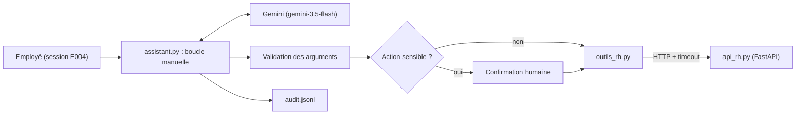

Un modèle de langage sait rédiger, résumer, expliquer. Il ne sait pas **combien de jours de congés il reste à Camille** : cette information vit dans votre SIRH (le système d'information RH), derrière une API. Le **function calling** (appel de fonctions) est le mécanisme qui permet au modèle de dire « appelle `consulter_solde` avec `employe_id=E001` », à votre code d'exécuter l'appel, puis au modèle de rédiger la réponse avec le vrai chiffre.

Fil rouge : un **assistant RH** interne, branché sur une petite API REST locale (FastAPI) qui gère un annuaire, des soldes de congés et des demandes. Toutes les données sont fictives.

## Pour qui ?

- Développeurs Python à l'aise avec les fonctions, les dictionnaires et JSON.
- Vous avez déjà appelé un LLM par API (une requête, une réponse). Aucune expérience des agents n'est requise.
- Pas besoin de Google Cloud : une clé Gemini gratuite suffit. Vertex AI est présenté en option.

## Ce que vous construisez

À la fin, l'assistant répond à des demandes comme « Compare les RTT de Camille Martin et de Karim Benali » (4 appels, dont 2 en parallèle), pose une demande de congés **après confirmation**, refuse proprement un accès non autorisé et trace chaque appel.

## Objectifs mesurables

1. **Déclarer** une fonction avec un schéma JSON que le modèle utilise correctement.
2. **Choisir** entre appel automatique (le SDK exécute) et appel manuel (votre boucle exécute).
3. **Gérer** les appels parallèles, les appels en chaîne et les modes `AUTO` / `ANY` / `NONE`.
4. **Fiabiliser** : erreurs HTTP, timeouts, réessais sur 429/503, limite de tours.
5. **Sécuriser** : validation des arguments, contrôle d'accès côté API, confirmation des actions sensibles.
6. **Tracer** chaque appel d'outil dans un journal d'audit exploitable.

## Prérequis techniques

- Python 3.10 ou plus récent, `pip install -r files/requirements.txt`.
- Une clé d'API Gemini (Google AI Studio) dans `GOOGLE_API_KEY`, ou un projet Google Cloud avec Vertex AI.

## Programme

| Module | Contenu | Durée indicative |
| --- | --- | --- |
| 1. Comprendre le function calling | Le cycle question → appel → résultat → réponse, déclarer des fonctions, automatique contre manuel | 1h |
| 2. Orchestrer les appels | Appels parallèles et en chaîne, modes AUTO / ANY / NONE, `allowed_function_names` | 45 min |
| 3. Fiabiliser et sécuriser | Erreurs et timeouts, validation, confirmation humaine, journal d'audit | 1h15 |
| 4. Projet final | L'API RH et ses outils, assembler, tester sans clé puis avec le vrai modèle, passer sur Vertex AI | 1h |

Chaque leçon contient un schéma, des quiz corrigés, un exercice avec solution et une checklist « Je sais faire ».

## Le code du lab

Tout est dans le dossier `files/` : [api_rh.py](./files/api_rh.py) (l'API), [outils_rh.py](./files/outils_rh.py) (schémas, validation, appels HTTP), [assistant.py](./files/assistant.py) (la boucle), [auto.py](./files/auto.py) (le mode automatique), [test_assistant.py](./files/test_assistant.py) (13 tests sans clé) et [e2e.py](./files/e2e.py) (6 scénarios avec le vrai modèle).

## En local ou sur Google Cloud ?

| | En local (« sans GCP ») | Sur Google Cloud (Vertex AI) |
| --- | --- | --- |
| Authentification | clé `GOOGLE_API_KEY` | `gcloud auth application-default login` |
| Variables | `GOOGLE_GENAI_USE_VERTEXAI=FALSE` | `GOOGLE_GENAI_USE_VERTEXAI=TRUE`, `GOOGLE_CLOUD_PROJECT`, `GOOGLE_CLOUD_LOCATION=europe-west1` |
| Modèle testé le 2026-10-15 | `gemini-3.5-flash` | `gemini-2.5-flash` (europe-west1) |
| Code | identique | identique |
| Ressources à supprimer | aucune | aucune (appels au modèle uniquement) |

Le même `e2e.py` a été exécuté dans les deux modes : mêmes appels d'outils, mêmes décisions.
