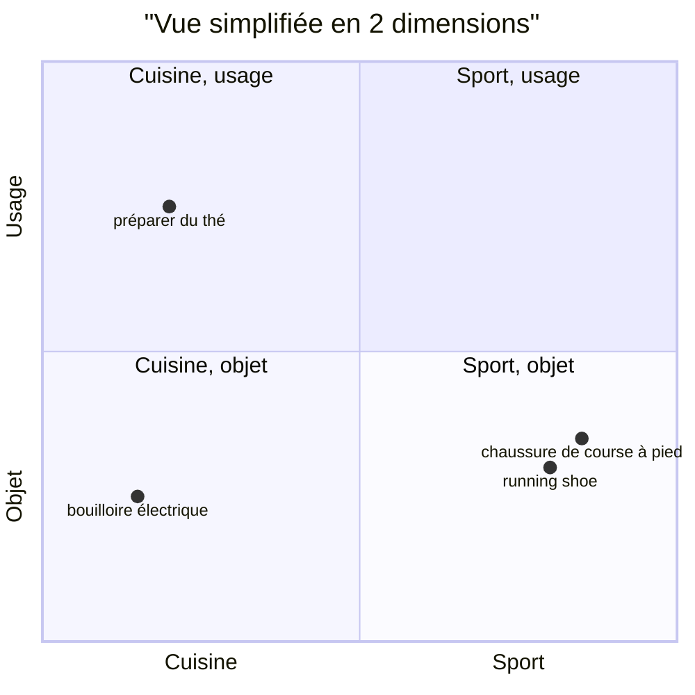

# Un embedding, c'est quoi ? La similarité cosinus avec numpy

> [!NOTE]
> Dans cette leçon, vous allez transformer trois phrases en vecteurs avec Gemini, puis mesurer leur proximité avec **une ligne de numpy**. Vous verrez qu'une phrase française et sa traduction anglaise sont plus proches entre elles que deux phrases françaises sans rapport.

## Du texte à un point dans l'espace

Un **embedding** (plongement, en français) est une liste de nombres à virgule, par exemple 768 nombres, qui représente le **sens** d'un texte. Le modèle d'embeddings a été entraîné pour que des textes de sens proche donnent des listes de nombres proches.

On peut imaginer chaque texte comme un **point** dans un espace à 768 dimensions. Impossible à dessiner, mais l'intuition en 2 dimensions fonctionne :



Les deux chaussures, l'une en français, l'autre en anglais, tombent au même endroit : l'embedding encode le sens, pas la langue ni les mots exacts.

## Mesurer la proximité : la similarité cosinus

Pour comparer deux vecteurs, on mesure l'**angle** entre eux. La **similarité cosinus** vaut :

$$\cos(a, b) = \frac{a \cdot b}{\lVert a \rVert \, \lVert b \rVert}$$

- $a \cdot b$ est le **produit scalaire** : on multiplie les nombres deux à deux et on additionne ;
- $\lVert a \rVert$ est la **norme** (la longueur) du vecteur.

Le résultat va de -1 (opposés) à 1 (même direction). Si les vecteurs sont **normalisés** (longueur 1), le cosinus est simplement le produit scalaire. C'est le cas des vecteurs de `gemini-embedding-2`, et le lab renormalise de toute façon par sécurité.

```python title="files/moteur.py (extrait)"
def normaliser(m: np.ndarray) -> np.ndarray:
    return m / np.linalg.norm(m, axis=-1, keepdims=True)


def top_k(vecteurs, requete, k=5, exclure=()):
    """Similarité cosinus = produit scalaire, car tous les vecteurs sont normalisés."""
    scores = vecteurs @ requete
    for i in exclure:
        scores[i] = -np.inf
    meilleurs = np.argsort(-scores)[:k]
    return [(int(i), float(scores[i])) for i in meilleurs]
```

`vecteurs @ requete` calcule en une opération le produit scalaire de la requête avec **les 60 fiches** : c'est une multiplication matrice × vecteur.

| Mesure | Formule | Quand l'utiliser |
| --- | --- | --- |
| Cosinus | angle entre vecteurs | le standard pour le texte |
| Produit scalaire | $a \cdot b$ | identique au cosinus si les vecteurs sont normalisés, et plus rapide |
| Distance euclidienne | $\lVert a - b \rVert$ | même classement que le cosinus sur des vecteurs normalisés |

> [!TIP]
> Un score cosinus n'est pas une probabilité. 0,64 entre « chaussure de course » et « bouilloire » ne veut pas dire « 64 % pareil » : avec ce modèle, même des textes sans rapport ont souvent un cosinus positif. Ce qui compte, c'est le **classement** et l'**écart** entre scores.

## Essayer

```python title="démo (à lancer depuis files/)"
import numpy as np
from google import genai
from google.genai import types

client = genai.Client()
textes = ["chaussure de course à pied", "running shoe", "bouilloire électrique"]
r = client.models.embed_content(
    model="gemini-embedding-2",
    contents=[types.Content(parts=[types.Part(text=t)]) for t in textes],
    config=types.EmbedContentConfig(output_dimensionality=768))
m = np.array([e.values for e in r.embeddings])
print(np.round(m @ m.T, 3))      # matrice des cosinus 3 x 3
```

```quiz
question: "Deux vecteurs normalisés ont un produit scalaire de 0,86. Que vaut leur similarité cosinus ?"
options:
  - "0,86"
  - "On ne peut pas savoir sans leurs normes"
  - "0,14"
answer: 0
explanation: "Si les normes valent 1, le dénominateur vaut 1 : cosinus et produit scalaire sont égaux."
```

```quiz
question: "Pourquoi « running shoe » est-il plus proche de « chaussure de course à pied » que de « bouilloire électrique » ?"
options:
  - "Parce que les deux textes partagent beaucoup de lettres"
  - "Parce que le modèle d'embeddings représente le sens, quelle que soit la langue"
  - "Parce que l'anglais est traduit en français avant le calcul"
answer: 1
explanation: "Aucune traduction ni comparaison de lettres : le modèle a appris à placer des textes de même sens au même endroit de l'espace, y compris entre langues."
```

## Exercice : cosinus à la main

Calculez à la main le cosinus entre $a = (3, 4)$ et $b = (4, 3)$, puis vérifiez avec numpy.

<details>
<summary>Voir la solution</summary>

Produit scalaire : $3 \times 4 + 4 \times 3 = 24$. Normes : $\sqrt{9 + 16} = 5$ pour les deux. Cosinus : $24 / 25 = 0{,}96$.

```python
import numpy as np
a, b = np.array([3, 4]), np.array([4, 3])
print(a @ b / (np.linalg.norm(a) * np.linalg.norm(b)))   # 0.96
```

</details>

## Résultat obtenu

Démo exécutée le 2026-10-15 avec `gemini-embedding-2` en 768 dimensions :

```text
forme : (3, 768) normes : [1. 1. 1.]
5 premières valeurs : [ 0.0186 -0.0522  0.0222  0.0468 -0.0257]
[[1.    0.858 0.64 ]
 [0.858 1.    0.561]
 [0.64  0.561 1.   ]]
```

Ligne 1 : « chaussure de course à pied » est à 0,858 de « running shoe » et à 0,64 de « bouilloire électrique ». Les vecteurs sont déjà de norme 1.

## Je sais faire

- [ ] Expliquer ce qu'est un embedding en une phrase
- [ ] Calculer une similarité cosinus avec numpy
- [ ] Expliquer pourquoi produit scalaire et cosinus coïncident sur des vecteurs normalisés
- [ ] Lire une matrice de similarités sans la prendre pour des probabilités
