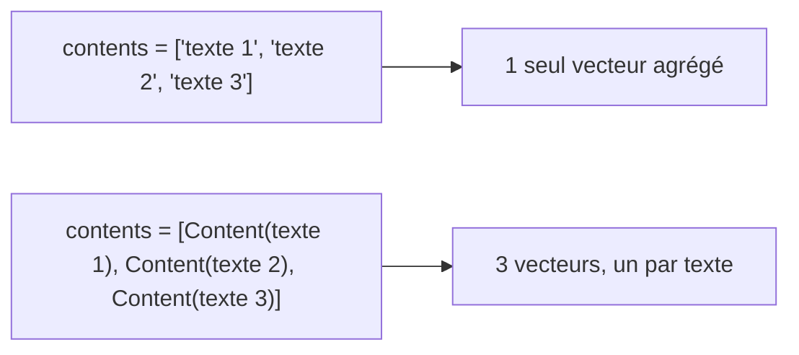

# gemini-embedding-2 : préfixes de tâche, dimensions et pièges

> [!NOTE]
> Dans cette leçon, vous allez apprendre à appeler `gemini-embedding-2` **correctement** : formater les textes selon la tâche (recherche, clustering…), choisir la dimension avec `output_dimensionality`, et éviter le piège qui transforme 20 textes en **un seul** vecteur.

## Les « task types » version gemini-embedding-2

Un même texte n'a pas le même embedding idéal selon l'usage : pour une **recherche**, la question courte doit tomber près du document long qui y répond ; pour un **clustering**, on veut regrouper des textes de même nature. Avec l'ancien modèle `gemini-embedding-001`, on le précisait avec le paramètre `task_type` (`RETRIEVAL_QUERY`, `RETRIEVAL_DOCUMENT`, `CLUSTERING`…).

Avec `gemini-embedding-2`, **ce paramètre ne s'utilise pas** : la documentation demande d'écrire la tâche **dans le texte lui-même**, avec un préfixe.

| Usage | Format de la requête | Format du document |
| --- | --- | --- |
| Recherche (asymétrique) | `task: search result \| query: {texte}` | `title: {titre} \| text: {contenu}` (`title: none` sans titre) |
| Question-réponse | `task: question answering \| query: {texte}` | `title: {titre} \| text: {contenu}` |
| Clustering (symétrique) | `task: clustering \| query: {texte}` | même format |
| Similarité de phrases | `task: sentence similarity \| query: {texte}` | même format (pas pour la recherche) |
| Classification | `task: classification \| query: {texte}` | même format |

**Asymétrique** : la requête et le document ont des formats différents (une question courte contre une fiche). **Symétrique** : tous les textes ont le même rôle.

```python title="files/moteur.py (extrait)"
def texte_document(p: dict) -> str:
    return f"title: {p['nom']} | text: {p['categorie']}. {p['description']}"


def texte_requete(q: str) -> str:
    return f"task: search result | query: {q}"


def texte_symetrique(p: dict, tache: str) -> str:
    """Pour le clustering ou la similarité : même format des deux côtés."""
    return f"task: {tache} | query: {p['nom']}. {p['description']}"
```

## Le piège de l'agrégation



Avec `gemini-embedding-2`, une **liste de chaînes** est vue comme **un seul contenu en plusieurs morceaux** : vous recevez un vecteur unique qui résume le tout. Pour obtenir un vecteur par texte, on envoie une liste d'objets `Content`, un par texte :

```python title="files/moteur.py (extrait)"
# Une Content par texte : une liste de str donnerait UN seul vecteur agrégé.
contents = [types.Content(parts=[types.Part(text=t)]) for t in textes[i:i + lot]]
r = client.models.embed_content(
    model=EMBED_MODEL, contents=contents,
    config=types.EmbedContentConfig(output_dimensionality=dim))
```

> [!WARNING]
> Ce piège ne lève **aucune erreur** : vous recevez un vecteur au lieu de 20, et `zip(produits, vecteurs)` associe silencieusement le premier produit au vecteur agrégé. Le test `test_embedder_envoie_une_content_par_texte` de [test_moteur.py](../files/test_moteur.py) protège le lab contre une régression.

Sur **Vertex AI**, l'appel avec plusieurs `Content` est refusé pour ce modèle (« only supports one content at a time ») : le lab passe alors à un texte par requête.

## Choisir la dimension

Par défaut, le modèle renvoie **3072** nombres. `output_dimensionality` permet d'en demander moins (768 et 1536 sont recommandés par la documentation). C'est possible grâce à l'apprentissage **Matryoshka** (comme les poupées russes) : les premières valeurs du vecteur portent déjà l'essentiel du sens. `gemini-embedding-2` **renormalise** automatiquement les vecteurs réduits.

| Dimension | Taille pour 1 million de fiches (float32) | Usage |
| --- | --- | --- |
| 3072 | environ 12 Go | qualité maximale |
| 768 | environ 3 Go | bon compromis (choix du lab) |
| 256 | environ 1 Go | gros volumes, qualité un peu moindre |

Le calcul : 1 000 000 × dimension × 4 octets.

> [!TIP]
> Comme les premières valeurs suffisent, vous pouvez **tronquer** localement un vecteur 768 en 256 puis le renormaliser, sans nouvel appel. Le lab l'a vérifié : tronquer un vecteur 3072 à 768 et le renormaliser donne le même vecteur que `output_dimensionality=768` (cosinus 0,9999998). C'est ainsi que `evaluer.py` compare plusieurs dimensions gratuitement.

```quiz
question: "Vous appelez embed_content(model=\"gemini-embedding-2\", contents=[\"a\", \"b\", \"c\"]). Combien de vecteurs recevez-vous ?"
options:
  - "3"
  - "1, qui agrège les trois textes"
  - "Une erreur 400"
answer: 1
explanation: "gemini-embedding-2 agrège une liste de chaînes en un seul embedding. Pour 3 vecteurs, envoyez 3 objets Content."
```

```quiz
question: "Comment indiquer à gemini-embedding-2 que le texte est une requête de recherche ?"
options:
  - "task_type=\"RETRIEVAL_QUERY\" dans EmbedContentConfig"
  - "En préfixant le texte par « task: search result | query: »"
  - "En utilisant un autre modèle pour les requêtes"
answer: 1
explanation: "task_type est réservé à gemini-embedding-001. Pour gemini-embedding-2, la tâche s'écrit en tête du texte."
```

## Exercice : préparer une FAQ

Vous indexez une FAQ RH (question + réponse) pour un moteur de question-réponse. Écrivez les deux fonctions de formatage, pour la requête de l'employé et pour chaque entrée de la FAQ.

<details>
<summary>Voir la solution</summary>

```python
def texte_requete_qa(question: str) -> str:
    return f"task: question answering | query: {question}"

def texte_faq(entree: dict) -> str:
    return f"title: {entree['question']} | text: {entree['reponse']}"
```

La question de la FAQ fait un excellent `title` : elle résume le document. La requête utilise la tâche `question answering` plutôt que `search result`, puisqu'on cherche une réponse.

</details>

## Résultat obtenu

Vérifications exécutées le 2026-10-15 avec la clé d'API Gemini :

```text
# démo de la leçon 1 : liste de chaînes
liste de str -> 1 vecteur(s)
# même appel avec deux objets Content
content list -> 2
# un texte : dimension et norme par défaut, puis avec output_dimensionality=768
3072 0.9999999373014921 768 0.9999997619101519
# cosinus entre la troncature locale (3072 -> 768, renormalisée) et le vecteur 768 natif
cos trunc vs 768 0.9999997619101513
```

Et sur Vertex AI, `gemini-embedding-2` répondait en `global` mais pas en `europe-west1` (404 « Publisher model … not found ») : la région compte.

## Je sais faire

- [ ] Formater requêtes et documents avec les préfixes de tâche de `gemini-embedding-2`
- [ ] Envoyer une `Content` par texte pour obtenir un vecteur par texte
- [ ] Choisir `output_dimensionality` en fonction du volume
- [ ] Tronquer et renormaliser un vecteur localement
