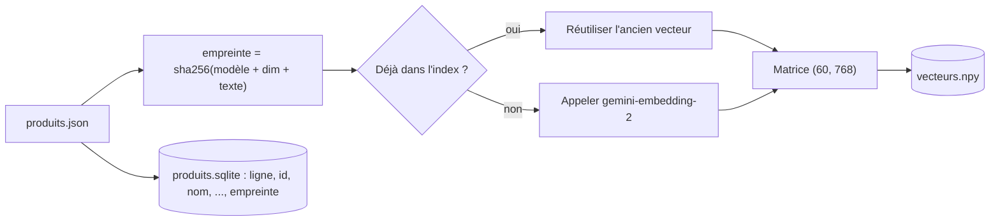

# Un index local persistant : .npy + sqlite

> [!NOTE]
> Dans cette leçon, vous allez sauvegarder les 60 embeddings sur disque pour ne **jamais** les recalculer inutilement : les vecteurs dans un fichier numpy, les fiches dans une base sqlite, et une **empreinte** par fiche pour ne recalculer que ce qui a changé.

## Pourquoi persister ?

Calculer un embedding coûte un appel réseau et un peu d'argent. Une fiche qui n'a pas changé a toujours le même vecteur : le recalculer à chaque démarrage est du gaspillage. On sépare deux choses :

- les **vecteurs** : une matrice `(60, 768)` de nombres, stockée en binaire numpy (`vecteurs.npy`), chargée en une milliseconde ;
- les **métadonnées** : nom, catégorie, prix, description, dans une table sqlite (`produits.sqlite`), une base de données dans un seul fichier, incluse dans Python.

La colonne `ligne` fait le lien : la fiche `ligne = 12` correspond à `vecteurs[12]`.



## Le code

```python title="files/moteur.py (extrait)"
def empreinte(texte: str) -> str:
    return hashlib.sha256(f"{EMBED_MODEL}|{EMBED_DIM}|{texte}".encode()).hexdigest()[:16]


def indexer(produits, embed, dossier=DOSSIER) -> int:
    os.makedirs(dossier, exist_ok=True)
    anciens = {}
    if os.path.exists(os.path.join(dossier, "vecteurs.npy")):
        v, ps = charger_index(dossier)
        anciens = {p["empreinte"]: v[p["ligne"]] for p in ps}
    textes = [texte_document(p) for p in produits]
    empreintes = [empreinte(t) for t in textes]
    a_calculer = [i for i, e in enumerate(empreintes) if e not in anciens]
    nouveaux = dict(zip(a_calculer, embed([textes[i] for i in a_calculer]))) if a_calculer else {}
    vecteurs = np.stack([nouveaux[i] if i in nouveaux else anciens[e]
                         for i, e in enumerate(empreintes)]).astype(np.float32)
    np.save(os.path.join(dossier, "vecteurs.npy"), vecteurs)
    ...  # réécriture de la table produits avec la colonne empreinte
    return len(a_calculer)
```

Le **modèle** et la **dimension** font partie de l'empreinte : si vous passez de 768 à 1536 dimensions, toutes les fiches sont recalculées, ce qui évite de mélanger des vecteurs incompatibles.

| Choix | Pourquoi | Limite |
| --- | --- | --- |
| `.npy` en float32 | lecture instantanée, 4 octets par nombre | tout tient en mémoire |
| sqlite | requêtes SQL sur les métadonnées (filtre par prix, catégorie) | un seul écrivain à la fois |
| empreinte sha256 | ne recalcule que les fiches modifiées | il faut garder le même formatage de texte |
| réécriture complète | code simple, toujours cohérent | lent au-delà de quelques centaines de milliers de fiches |

> [!TIP]
> `embed` est un **paramètre** de `indexer`. En production, c'est `embedder_gemini()` ; dans les tests, un faux embedder sans réseau. C'est ce qui permet de tester le cache en comptant les appels.

> [!WARNING]
> Ne versionnez pas `index/` dans git : c'est un artefact recalculable. Et si vos fiches contiennent des données sensibles, souvenez-vous qu'un embedding n'est **pas** un chiffrement : des travaux de recherche montrent qu'on peut reconstruire une partie du texte à partir du vecteur.

```quiz
question: "Vous modifiez la description d'une seule fiche puis relancez l'indexation. Combien de textes sont envoyés au modèle ?"
options:
  - "60"
  - "1"
  - "0"
answer: 1
explanation: "Seule l'empreinte de la fiche modifiée a changé ; les 59 autres vecteurs sont réutilisés. C'est exactement ce que vérifie test_index_persistant_et_cache."
```

```quiz
question: "Pourquoi inclure le nom du modèle dans l'empreinte ?"
options:
  - "Pour que changer de modèle force le recalcul de tous les vecteurs"
  - "Pour accélérer sha256"
  - "Parce que sqlite l'exige"
answer: 0
explanation: "Deux modèles produisent des espaces de vecteurs incompatibles : comparer une requête du nouveau modèle à des fiches de l'ancien donnerait des scores sans signification."
```

## Exercice : filtrer par prix

Écrivez une fonction `chercher_moins_de(vecteurs, produits, embed, requete, prix_max, k=5)` qui ne renvoie que des produits sous un prix donné. Faut-il filtrer avant ou après le calcul des scores ?

<details>
<summary>Voir la solution</summary>

On filtre **avant** de prendre le top k, sinon on risque de ne garder que 1 ou 2 résultats sur 5 :

```python
def chercher_moins_de(vecteurs, produits, embed, requete, prix_max, k=5):
    q = embed([texte_requete(requete)])[0]
    exclus = [i for i, p in enumerate(produits) if p["prix"] > prix_max]
    return [(produits[i], s) for i, s in top_k(vecteurs, q, k, exclure=exclus)]
```

`top_k` accepte déjà une liste `exclure`, utilisée aussi par `similaires`. Avec sqlite, on obtiendrait la liste par `SELECT ligne FROM produits WHERE prix > ?`.

</details>

## Résultat obtenu

Indexation réelle le 2026-10-15 (`gemini-embedding-2`, 768 dimensions), lancée deux fois de suite (chemin du dossier raccourci en `index/`) :

```text
$ python moteur.py indexer
Index à jour dans index/ (60 fiche(s) recalculée(s), modèle gemini-embedding-2, 768 dims)
$ python moteur.py indexer
Index à jour dans index/ (0 fiche(s) recalculée(s), modèle gemini-embedding-2, 768 dims)
$ ls -l index/
-rw-r--r-- 1 ... 24576 produits.sqlite
-rw-rw-r-- 1 ... 184448 vecteurs.npy
```

184 448 octets = 60 × 768 × 4 octets + 128 octets d'en-tête numpy.

## Je sais faire

- [ ] Sauvegarder une matrice d'embeddings en `.npy` et les métadonnées en sqlite
- [ ] Relier une ligne de la matrice à une fiche par un numéro de ligne
- [ ] Éviter les recalculs grâce à une empreinte du texte, du modèle et de la dimension
- [ ] Rendre l'embedder injectable pour tester sans réseau
