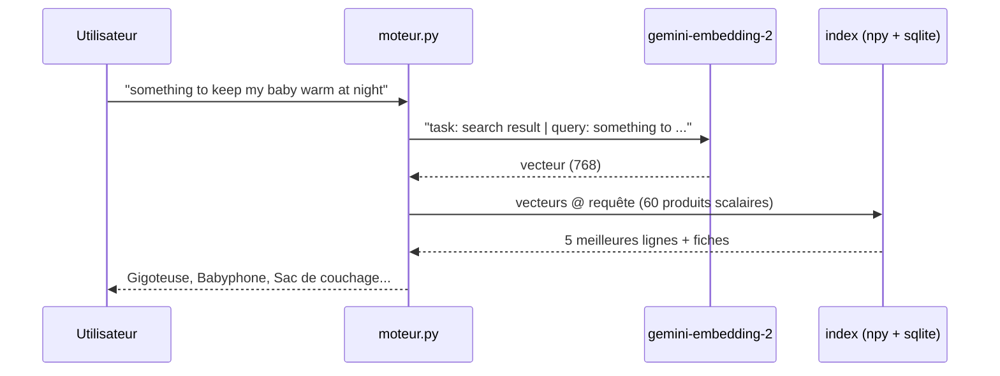

# Chercher par le sens, dans toutes les langues

> [!NOTE]
> Dans cette leçon, vous allez interroger l'index avec des requêtes qui ne contiennent **aucun mot** des fiches, puis en anglais, espagnol et allemand sur un catalogue rédigé en français, et comprendre pourquoi une recherche par mots-clés échoue là où les embeddings réussissent.

## Le chemin d'une requête



Une seule requête au modèle par recherche : les 60 fiches sont déjà vectorisées.

```python title="files/moteur.py (extrait)"
def chercher(vecteurs, produits, embed, requete, k=5):
    q = embed([texte_requete(requete)])[0]
    return [(produits[i], s) for i, s in top_k(vecteurs, q, k)]
```

```bash title="terminal"
python moteur.py chercher "chaussure pour courir dans la boue"
python moteur.py chercher "something to keep my baby warm at night"
```

## Pourquoi les mots-clés échouent

Une recherche par **mots-clés** compare les mots écrits. Le standard du domaine s'appelle **BM25** : il donne un score à chaque document selon les mots de la requête qu'il contient, en favorisant les mots rares. Il est rapide, explicable, et ne demande aucun modèle. Mais :

| Requête | Ce que fait BM25 | Ce que font les embeddings |
| --- | --- | --- |
| « faire le ménage sans y penser » | aucun mot commun avec « Robot aspirateur laveur » | trouve l'aspirateur robot |
| « Rasen mähen mit Akku » (allemand) | aucun mot français en commun | trouve la tondeuse à batterie |
| « noise cancelling headphones » | « noise », « headphones » absents du catalogue | trouve le casque à réduction de bruit |
| « P043 » ou une référence exacte | trouve tout de suite | peut se tromper : un code n'a pas de « sens » |

> [!TIP]
> Les deux approches sont complémentaires. Beaucoup de moteurs en production font une **recherche hybride** : ils combinent le score BM25 (excellent sur les références, les noms propres, les codes) et le score sémantique (excellent sur les reformulations), par exemple avec une fusion des classements (*Reciprocal Rank Fusion*).

## Multilingue sans traduction

`gemini-embedding-2` place les textes de plus de 100 langues dans **le même espace**. Le catalogue est en français, les requêtes peuvent être dans n'importe quelle langue couverte : aucune étape de traduction, aucun index par langue.

> [!WARNING]
> « Multilingue » ne veut pas dire « parfait dans toutes les langues ». Mesurez **par langue** (c'est ce que fait `evaluer.py`, module 3) avant de promettre une langue à vos utilisateurs, et prévoyez des requêtes de test dans chacune.

```quiz
question: "Un client tape la référence exacte « P043 ». Quelle approche est la plus fiable ?"
options:
  - "Les embeddings, car ils comprennent tout"
  - "Une recherche exacte ou BM25, car un code n'a pas de sens sémantique"
  - "Aucune des deux"
answer: 1
explanation: "Un identifiant est une chaîne arbitraire : sa proximité sémantique avec d'autres codes ne veut rien dire. Une recherche exacte (ou BM25) est faite pour ça ; d'où l'intérêt de la recherche hybride."
```

```quiz
question: "Combien d'appels au modèle d'embeddings coûte une recherche dans l'index de 60 fiches ?"
options:
  - "60, un par fiche"
  - "1, pour vectoriser la requête"
  - "0"
answer: 1
explanation: "Les fiches ont été vectorisées une fois pour toutes à l'indexation. À la recherche, seule la requête est vectorisée, puis numpy calcule les 60 scores localement."
```

## Exercice : une recherche hybride minimale

Combinez les classements BM25 et sémantique avec la fusion RRF : score(d) = Σ 1 / (60 + rang(d)) sur les deux classements. Écrivez la fonction à partir de deux listes d'identifiants ordonnées.

<details>
<summary>Voir la solution</summary>

```python
def fusion_rrf(*classements, k=60, n=5):
    scores = {}
    for classement in classements:
        for rang, doc in enumerate(classement, 1):
            scores[doc] = scores.get(doc, 0) + 1 / (k + rang)
    return sorted(scores, key=scores.get, reverse=True)[:n]

# fusion_rrf(ids_semantiques_top20, ids_bm25_top20)
```

La constante 60 est la valeur proposée par les auteurs de la méthode : elle atténue l'écart entre la 1re et la 2e place. Pas besoin de rendre les scores comparables entre eux, seuls les rangs comptent.

</details>

## Résultat obtenu

Recherches réelles le 2026-10-15 (`gemini-embedding-2`, 768 dimensions) :

```text
$ python moteur.py chercher "chaussure pour courir dans la boue"
0.780  P058  Trail Gecko (coloris forêt)  (Chaussures)
0.774  P001  Trailrun Gecko  (Chaussures)
0.716  P002  Asphalte Flow  (Chaussures)
0.693  P003  Randonnée Cimes Mid  (Chaussures)
0.672  P004  Sandale Rivière  (Chaussures)
$ python moteur.py chercher "something to keep my baby warm at night"
0.714  P036  Gigoteuse Douillette TOG 2.5  (Bébé)
0.689  P032  Babyphone Vidéo Veille  (Bébé)
0.665  P038  Sac de couchage Grand Froid  (Camping)
0.643  P006  Pantoufle Nuage  (Chaussures)
0.642  P035  Tapis d'éveil Jungle  (Bébé)
```

La requête anglaise trouve en premier la gigoteuse (« turbulette pour dormir au chaud sans couverture ») alors qu'elle ne partage aucun mot avec la fiche. Notez le sac de couchage en 3e position : « au chaud la nuit » est aussi son sens.

## Je sais faire

- [ ] Lancer une recherche sémantique sur l'index local
- [ ] Expliquer ce que fait BM25 et quand il bat les embeddings
- [ ] Interroger un catalogue français dans une autre langue sans traduction
- [ ] Combiner deux classements avec une fusion RRF
