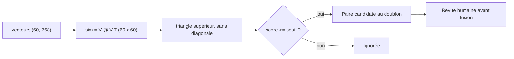

# Produits similaires et dédoublonnage

> [!NOTE]
> Dans cette leçon, vous allez réutiliser les vecteurs **sans aucun nouvel appel** au modèle pour deux fonctions concrètes : une recommandation « produits similaires » et la détection des 3 quasi-doublons cachés dans le catalogue.

## Une fiche contre les autres

Pour recommander des produits proches d'une fiche, on prend **son propre vecteur** comme requête. Aucun appel au modèle : tout est déjà dans `vecteurs.npy`.

```python title="files/moteur.py (extrait)"
def similaires(vecteurs, produits, produit_id, k=4):
    ligne = next(p["ligne"] for p in produits if p["id"] == produit_id)
    return [(produits[i], s) for i, s in top_k(vecteurs, vecteurs[ligne], k, exclure=[ligne])]
```

On **exclut** la fiche elle-même, sinon elle serait toujours première avec un score de 1.

## Toutes les paires d'un coup

Pour trouver les doublons, on compare **chaque fiche à chaque autre** : la matrice `vecteurs @ vecteurs.T` contient les 60 × 60 cosinus. On garde le triangle supérieur (chaque paire une fois, sans la diagonale) au-dessus d'un seuil.

```python title="files/moteur.py (extrait)"
def doublons(vecteurs, seuil=0.9):
    """Paires (i, j, score) au-dessus du seuil. Limite : O(n²), passer à un index ANN au-delà de ~100 000 fiches."""
    sim = vecteurs @ vecteurs.T
    i, j = np.where(np.triu(sim, k=1) >= seuil)
    return sorted(((int(a), int(b), float(sim[a, b])) for a, b in zip(i, j)), key=lambda x: -x[2])
```



## Choisir le seuil

Il n'existe pas de seuil universel : il dépend du modèle, du formatage des textes et de votre catalogue. La méthode : **regarder la distribution** des meilleures paires et chercher une cassure.

| Rang de la paire | Score | Nature |
| --- | --- | --- |
| 1 | 0,978 | doublon (P037 / P060, tente) |
| 2 | 0,950 | doublon (P019 / P059, casque) |
| 3 | 0,936 | doublon (P001 / P058, chaussure de trail) |
| 4 | 0,797 | produits différents de même famille |
| 5 | 0,792 | produits différents de même famille |

Ici, une cassure nette entre 0,936 et 0,797 : n'importe quel seuil entre 0,80 et 0,93 trouve exactement les 3 doublons.

> [!WARNING]
> Un score élevé signifie « même sens », pas « même produit ». Deux tailles d'un même t-shirt ou une version 2024 et 2025 seront très proches et pourtant différentes. Le dédoublonnage automatique **propose** des paires ; un humain (ou une règle métier sur la référence fournisseur, le prix…) **décide**.

> [!TIP]
> Comparer toutes les paires coûte n² opérations : 3 600 pour 60 fiches, instantané ; 10 milliards pour 100 000 fiches, plusieurs secondes et beaucoup de mémoire. Au-delà, on cherche les voisins de chaque fiche avec un index de recherche approximative (module 3).

```quiz
question: "Pourquoi exclure la fiche elle-même dans similaires() ?"
options:
  - "Parce qu'elle a toujours un cosinus de 1 avec elle-même et occuperait la première place"
  - "Pour économiser un appel au modèle"
  - "Parce que numpy ne sait pas comparer un vecteur à lui-même"
answer: 0
explanation: "Le cosinus d'un vecteur normalisé avec lui-même vaut 1, le maximum possible. Sans exclusion, la recommandation commencerait toujours par le produit consulté."
```

```quiz
question: "Combien d'appels au modèle d'embeddings coûte la détection des doublons sur l'index existant ?"
options:
  - "60"
  - "3 600"
  - "0"
answer: 2
explanation: "Tous les vecteurs sont déjà calculés : la détection n'est qu'un produit de matrices numpy."
```

## Exercice : produits complémentaires

« Similaires » propose des produits **substituables** (un autre sac à dos). Comment proposer des produits **complémentaires** (avec une tente : un sac de couchage, une frontale) en réutilisant `top_k` ?

<details>
<summary>Voir la solution</summary>

Une piste simple : chercher les voisins **dans d'autres catégories** que le produit consulté.

```python
def complementaires(vecteurs, produits, produit_id, k=4):
    p = next(p for p in produits if p["id"] == produit_id)
    meme_categorie = [x["ligne"] for x in produits if x["categorie"] == p["categorie"]]
    return [(produits[i], s) for i, s in top_k(vecteurs, vecteurs[p["ligne"]], k, exclure=meme_categorie)]
```

Pour la tente (Camping), cela exclut les autres articles de camping et remonte des produits d'autres rayons utilisés dans le même contexte (sac de randonnée, chaussures de montagne). En production, les vraies données de co-achat (« achetés ensemble ») sont souvent un meilleur signal ; les embeddings servent alors au démarrage, quand ces données n'existent pas encore.

</details>

## Résultat obtenu

Exécutions réelles le 2026-10-15 (`gemini-embedding-2`, 768 dimensions) :

```text
$ python moteur.py similaires P044
0.792  P048  Sac à dos randonnée Crête 45
0.754  P045  Sac de voyage Weekend
0.732  P043  Valise cabine Escale 55
0.721  P047  Pèse-bagage Envol
$ python moteur.py doublons
0.978  P037 Tente Dôme 3 places  <->  P060 Tente Dôme 3 personnes
0.950  P019 Casque Silence Pro  <->  P059 Casque Silence Pro - édition noire
0.936  P001 Trailrun Gecko  <->  P058 Trail Gecko (coloris forêt)
$ python moteur.py doublons 0.8
0.978  P037 Tente Dôme 3 places  <->  P060 Tente Dôme 3 personnes
0.950  P019 Casque Silence Pro  <->  P059 Casque Silence Pro - édition noire
0.936  P001 Trailrun Gecko  <->  P058 Trail Gecko (coloris forêt)
```

Les 3 quasi-doublons placés volontairement dans `produits.json` sont trouvés, et aucun faux positif même au seuil de 0,8.

## Je sais faire

- [ ] Recommander des produits similaires à partir du vecteur d'une fiche
- [ ] Calculer toutes les similarités d'un catalogue avec un produit de matrices
- [ ] Choisir un seuil de doublon en regardant la distribution des scores
- [ ] Expliquer pourquoi le dédoublonnage reste une proposition à valider
