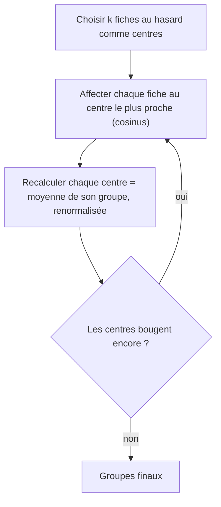

# Regrouper automatiquement : un clustering simple

> [!NOTE]
> Dans cette leçon, vous allez regrouper les 60 fiches **sans leur dire leurs catégories**, avec un k-means de 20 lignes en numpy, puis mesurer si les groupes trouvés ressemblent aux vraies catégories grâce à un score de **pureté**.

## L'idée du k-means

Le **clustering** (partitionnement) range des éléments en groupes sans étiquettes préalables. Le **k-means** est l'algorithme le plus simple :



Avec des embeddings, on mesure la proximité au cosinus et on renormalise les centres : c'est un **k-means sphérique**. Le résultat dépend du tirage initial ; on relance donc plusieurs fois et on garde la partition la plus **compacte** (la plus grande somme des cosinus au centre).

```python title="files/moteur.py (extrait)"
def kmeans(vecteurs, k, iterations=50, graine=0, essais=5):
    rng = np.random.default_rng(graine)
    meilleur, meilleure_cohesion = None, -np.inf
    for _ in range(essais):
        centres = vecteurs[rng.choice(len(vecteurs), k, replace=False)]
        for _ in range(iterations):
            etiquettes = np.argmax(vecteurs @ centres.T, axis=1)
            nouveaux = normaliser(np.stack([vecteurs[etiquettes == c].mean(0) if np.any(etiquettes == c)
                                            else centres[c] for c in range(k)]))
            if np.allclose(nouveaux, centres):
                break
            centres = nouveaux
        cohesion = float(np.sum(vecteurs * centres[etiquettes]))  # somme des cosinus au centre
        if cohesion > meilleure_cohesion:
            meilleur, meilleure_cohesion = etiquettes, cohesion
    return meilleur
```

## Mesurer : la pureté

Comme on connaît les vraies catégories, on peut noter le résultat. La **pureté** : pour chaque groupe, on compte les fiches de sa catégorie majoritaire, on additionne, on divise par le total. 1,0 signifie que chaque groupe ne contient qu'une catégorie.

```python title="files/moteur.py (extrait)"
def purete(etiquettes, categories) -> float:
    total = 0
    for c in set(etiquettes.tolist()):
        membres = [categories[i] for i in np.where(etiquettes == c)[0]]
        total += max(membres.count(x) for x in set(membres))
    return total / len(categories)
```

## Le préfixe « clustering » change-t-il quelque chose ?

`gemini-embedding-2` propose une tâche symétrique `task: clustering | query: ...`. La commande `clusters` calcule ces vecteurs (3 appels pour 60 fiches) et compare la pureté avec celle des vecteurs de recherche déjà indexés.

| Vecteurs | Formatage | Pureté mesurée (k = 10) |
| --- | --- | --- |
| de recherche (index) | `title: ... \| text: ...` | 0,78 |
| « clustering » | `task: clustering \| query: ...` | 0,77 |

Sur ce petit catalogue, **aucune différence significative**. Lors d'un essai précédent, avec un seul tirage par graine, l'écart allait de 0,01 à 0,07 en faveur du préfixe « clustering » selon la graine : la variabilité du k-means pesait plus que le préfixe. Leçon de méthode : **mesurer**, et relancer plusieurs fois avant de conclure.

> [!TIP]
> Le clustering est un outil d'**exploration** : il révèle des regroupements que personne n'a nommés (ici, un groupe « travail sur écran » mêlant lampe, webcam, micro et support d'écran, rangés dans des catégories différentes). C'est souvent plus utile que de retrouver les catégories existantes.

> [!WARNING]
> Le choix de `k` est arbitraire. Avec 10 groupes pour 10 catégories, on « aide » l'algorithme. Sur des données réelles, essayez plusieurs valeurs et regardez si les groupes ont un sens métier ; aucune formule ne remplace cette lecture.

```quiz
question: "Pourquoi relancer le k-means plusieurs fois ?"
options:
  - "Parce que le résultat dépend des centres tirés au hasard au départ"
  - "Parce que numpy fait des erreurs d'arrondi"
  - "Pour consommer moins de mémoire"
answer: 0
explanation: "Un mauvais tirage initial peut bloquer l'algorithme dans une partition médiocre. Plusieurs essais et la conservation du plus compact réduisent ce risque."
```

```quiz
question: "Une pureté de 0,78 sur 60 fiches signifie :"
options:
  - "Que 78 % des groupes sont parfaits"
  - "Qu'environ 47 fiches sont dans un groupe dominé par leur propre catégorie"
  - "Que le modèle a 78 % de précision en recherche"
answer: 1
explanation: "0,78 × 60 ≈ 47 fiches appartiennent à la catégorie majoritaire de leur groupe. Ce n'est pas une mesure de qualité de recherche."
```

## Exercice : nommer les groupes automatiquement

Proposez une méthode pour donner un nom lisible à chaque groupe, avec ou sans LLM.

<details>
<summary>Voir la solution</summary>

Sans LLM : prendre le nom de la fiche **la plus proche du centre** du groupe (le « représentant ») :

```python
for c in range(k):
    membres = np.where(etiquettes == c)[0]
    centre = moteur.normaliser(vecteurs[membres].mean(0))
    representant = membres[np.argmax(vecteurs[membres] @ centre)]
    print(c, produits[representant]["nom"])
```

Avec un LLM : envoyer les noms des membres à Gemini avec la consigne « Donne un nom de rayon de 2 à 4 mots pour ces produits ». Un appel par groupe, un résultat plus naturel, mais à relire.

</details>

## Résultat obtenu

`python moteur.py clusters 10` exécuté le 2026-10-15 (extrait) :

```text
Pureté avec les vecteurs de recherche : 0.78
Pureté avec les vecteurs « clustering » : 0.77
Groupe 0: Valise cabine Escale 55, Sac à dos urbain Navette, Sac de voyage Weekend, Cubes de rangement Ordre, Pèse-bagage Envol, Sac à dos randonnée Crête 45
Groupe 2: Poussette Citadine Plume, Babyphone Vidéo Veille, Porte-bébé Kangou, Chaise haute Évolutive, Tapis d'éveil Jungle, Gigoteuse Douillette TOG 2.5
Groupe 3: Tondeuse sans fil Herbo 40, Tuyau extensible Flexi 30 m, Composteur Humus 400 L, Sécateur Coupe-Net, Récupérateur d'eau 300 L, Hôtel à insectes Ruche
Groupe 5: Asphalte Flow, Randonnée Cimes Mid, Sandale Rivière, Tente Dôme 3 places, Sac de couchage Grand Froid, Réchaud gaz Mini-Flamme, Lampe frontale Lumen 400, Matelas autogonflant Repos, Tente Dôme 3 personnes
Groupe 7: Lampe de bureau Halo, Support écran double Duo, Tapis de souris XXL Plaine, Micro USB Podcast, Webcam Full HD Visio, Support PC portable Alu, Ampoule connectée Teinte
Groupe 9: Indoor Court, Pantoufle Nuage
```

Bagagerie, bébé et jardin sont retrouvés parfaitement. Le groupe 5 mélange chaussures de marche et camping : c'est un rayon « plein air » cohérent, que nos catégories ne nomment pas.

## Je sais faire

- [ ] Expliquer les étapes du k-means
- [ ] Adapter le k-means aux embeddings (cosinus, centres renormalisés)
- [ ] Mesurer une partition avec la pureté quand des étiquettes existent
- [ ] Interpréter un groupe inattendu comme une information plutôt qu'une erreur
