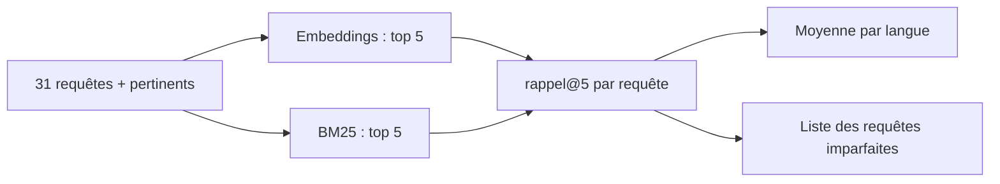

# Évaluer la recherche : le rappel@k

> [!NOTE]
> Dans cette leçon, vous allez construire un jeu de 31 requêtes de référence, calculer le **rappel@5** du moteur sémantique et d'une recherche BM25, par langue et par dimension, et lire les échecs pour améliorer le moteur.

## Sans mesure, pas d'amélioration

« Ça a l'air de marcher » ne suffit pas : changer un préfixe, une dimension ou un formatage peut améliorer trois requêtes et en casser cinq. On fixe donc un **jeu de référence** : des requêtes réalistes, et pour chacune la liste des produits qu'un humain juge **pertinents**.

```json title="files/requetes_eval.json (extrait)"
{"requete": "faire le ménage sans y penser", "langue": "fr", "pertinents": ["P055"]},
{"requete": "noise cancelling headphones for long flights", "langue": "en", "pertinents": ["P019", "P059"]},
{"requete": "idée de cadeau pour de jeunes parents", "langue": "fr", "pertinents": ["P031", "P032", "P033", "P034", "P035", "P036"]},
```

Règles suivies pour ce jeu : des **reformulations** (pas les mots des fiches), plusieurs **langues**, des requêtes à **plusieurs** bonnes réponses, et quelques requêtes **difficiles** (« boire un café le matin en camping » : cafetière ET réchaud).

## Le rappel@k

Le **rappel@k** (*recall at k*) répond à : « parmi les produits pertinents, quelle part apparaît dans les k premiers résultats ? »

$$\text{rappel@}k = \frac{|\text{pertinents} \cap \text{top}_k|}{|\text{pertinents}|}$$

```python title="files/evaluer.py (extrait)"
def rappel_at_k(trouves: list, pertinents: list, k: int) -> float:
    """Part des produits pertinents présents dans les k premiers résultats."""
    return len(set(trouves[:k]) & set(pertinents)) / len(pertinents)
```

On fait la moyenne sur toutes les requêtes. Pour une requête à 6 produits pertinents, le rappel@5 ne peut pas dépasser 5/6 ≈ 0,83 : c'est normal, le jeu le prévoit.



| Métrique | Question | Quand la regarder |
| --- | --- | --- |
| Rappel@k | ai-je trouvé les bons produits dans les k premiers ? | catalogue, RAG (le bon passage doit être dans le contexte) |
| Précision@k | quelle part des k résultats est pertinente ? | page de résultats affichée à l'utilisateur |
| MRR | à quel rang arrive le premier bon résultat ? | quand une seule bonne réponse compte |

## La comparaison avec BM25

`evaluer.py` calcule le même rappel@5 avec BM25 (bibliothèque `rank-bm25`) sur les mêmes textes. C'est la **référence** (*baseline*) : si les embeddings ne la battent pas, ils ne valent pas leur coût.

```python title="files/evaluer.py (extrait)"
embed = moteur.embedder_gemini()
requetes = embed([moteur.texte_requete(q["requete"]) for q in jeu])   # 2 appels (lots de 20)
bm25 = BM25Okapi([mots(moteur.texte_document(p)) for p in produits])
for q, vq in zip(jeu, requetes):
    sem = [ids[i] for i, _ in moteur.top_k(vecteurs, vq, k)]
    mc = [ids[i] for i in np.argsort(-bm25.get_scores(mots(q["requete"])))[:k]]
```

> [!WARNING]
> 31 requêtes, c'est un **petit** jeu : un écart de 0,01 correspond à une seule requête un peu mieux classée. Ne tirez pas de conclusion d'un tel écart. Visez plutôt une centaine de requêtes tirées de vrais journaux de recherche (anonymisés) avant de décider d'un changement en production.

> [!TIP]
> Relancez `evaluer.py` à **chaque** modification du formatage, du modèle ou de la dimension, comme on relance des tests unitaires. Le jeu de requêtes est versionné à côté du code.

```quiz
question: "Une requête a 2 produits pertinents ; un seul apparaît dans le top 5. Quel est son rappel@5 ?"
options:
  - "0,2"
  - "0,5"
  - "1"
answer: 1
explanation: "1 pertinent trouvé sur 2 pertinents : 1/2 = 0,5. Le nombre de résultats non pertinents dans le top 5 n'entre pas dans le rappel (c'est la précision)."
```

```quiz
question: "Les embeddings obtiennent 0,99 et une variante 0,98 sur 31 requêtes. Que conclure ?"
options:
  - "La première est nettement meilleure"
  - "L'écart est trop faible pour conclure sur un si petit jeu"
  - "La variante est cassée"
answer: 1
explanation: "Sur 31 requêtes, 0,01 représente moins d'une requête. Il faut un jeu plus grand ou des requêtes plus difficiles pour départager."
```

## Exercice : ajouter le MRR

Ajoutez à `evaluer.py` le calcul du **MRR** (*Mean Reciprocal Rank*) : pour chaque requête, 1 / rang du premier produit pertinent (0 s'il n'y en a aucun dans le top k), puis la moyenne.

<details>
<summary>Voir la solution</summary>

```python
def rang_reciproque(trouves, pertinents, k):
    for rang, pid in enumerate(trouves[:k], 1):
        if pid in pertinents:
            return 1 / rang
    return 0.0

# dans main(), à côté du rappel :
mrr = np.mean([rang_reciproque(sem, q["pertinents"], k) for q, _, _, sem in lignes])
print(f"MRR@{k} embeddings : {mrr:.2f}")
```

Le MRR est sensible à l'**ordre** : un bon produit en 1re place vaut 1, en 5e place 0,2. Le rappel@5 ne voit pas la différence.

</details>

## Résultat obtenu

`python evaluer.py` exécuté le 2026-10-15 (`gemini-embedding-2`, 768 dimensions, avec préfixes de tâche) :

```text
langue   n   rappel@5 embeddings   rappel@5 BM25
fr      24                0.98            0.65
en       3                1.00            0.00
es       2                1.00            0.00
de       2                1.00            0.50
toutes  31                0.99            0.54
dimension  128 : rappel@5 = 0.93
dimension  256 : rappel@5 = 0.97
dimension  768 : rappel@5 = 0.99

Requêtes imparfaites (2) :
  0.75  « équiper mon bivouac pour la nuit »  attendu ['P037', 'P038', 'P041', 'P060']  obtenu ['P038', 'P041', 'P040', 'P042', 'P037']
  0.83  « idée de cadeau pour de jeunes parents »  attendu ['P031', 'P032', 'P033', 'P034', 'P035', 'P036']  obtenu ['P032', 'P035', 'P036', 'P034', 'P033']
```

Lecture : BM25 ne trouve **rien** en anglais et en espagnol (aucun mot commun), les embeddings tout. Passer de 768 à 128 dimensions fait perdre 6 points. La 2e requête imparfaite est à son maximum possible (5 places pour 6 pertinents). Le même script sans les préfixes de tâche donnait 0,98 : écart trop faible pour conclure ici.

## Je sais faire

- [ ] Construire un jeu de requêtes de référence avec leurs produits pertinents
- [ ] Calculer un rappel@k et le comparer à une baseline BM25
- [ ] Ventiler une métrique par langue et par dimension
- [ ] Refuser de conclure sur un écart plus petit que le bruit du jeu
