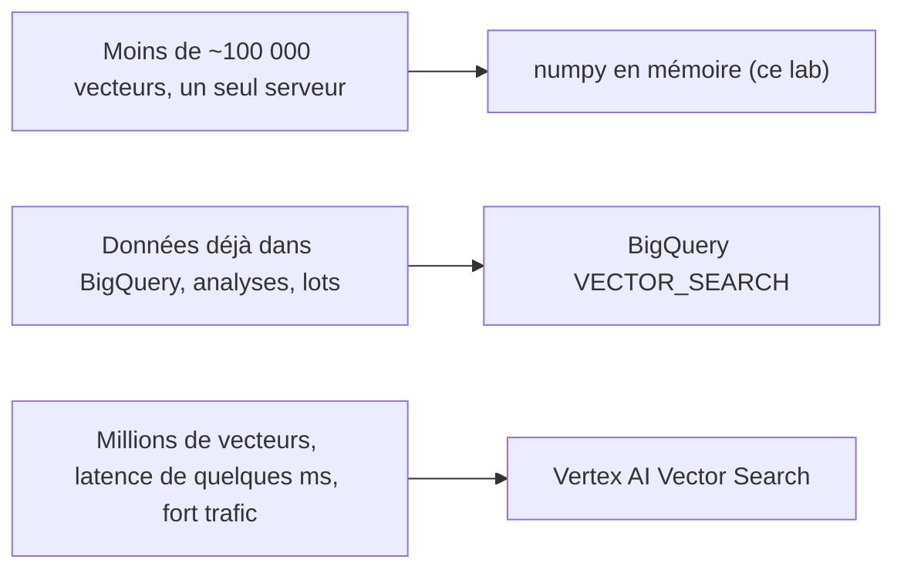

# Quand passer à BigQuery VECTOR_SEARCH ou Vertex AI Vector Search

> [!NOTE]
> Dans cette leçon, vous allez pousser l'index local dans une table BigQuery, retrouver **les mêmes 5 résultats** avec la fonction SQL `VECTOR_SEARCH`, supprimer ce que vous avez créé, puis décider à partir de quel volume et de quelles contraintes chaque solution se justifie.

## Les trois paliers



| Critère | numpy local | BigQuery `VECTOR_SEARCH` | Vertex AI Vector Search |
| --- | --- | --- | --- |
| Volume confortable | jusqu'à environ 100 000 vecteurs (ordre de grandeur) | de quelques milliers à des milliards de lignes | des millions à des milliards |
| Latence typique | milliseconde | secondes (une requête SQL) | quelques millisecondes |
| Coût | nul | au volume scanné (ou index vectoriel) | un endpoint déployé facturé **en continu** |
| Recherche | exacte | exacte, ou approximative avec `CREATE VECTOR INDEX` | approximative (ANN) |
| Idéal pour | prototypes, petits catalogues, tests | jointures avec vos tables, analyses, traitements par lots | moteur de recherche en ligne à fort trafic |

**ANN** (*Approximate Nearest Neighbors*, plus proches voisins approximatifs) : au lieu de comparer la requête à **tous** les vecteurs, un index pré-organise l'espace pour n'en examiner qu'une petite partie. On accepte de rater parfois un voisin, en échange d'une recherche beaucoup plus rapide.

## BigQuery en pratique

On charge une table `(id, nom, categorie, embedding ARRAY<FLOAT64>)`, puis on interroge avec un vecteur passé en **paramètre** de requête :

```python title="files/bigquery_vector_search.py (extrait)"
SQL = f"""
SELECT base.id, base.nom, ROUND(1 - distance, 3) AS cosinus
FROM VECTOR_SEARCH(TABLE `{TABLE}`, 'embedding',
                   (SELECT @q AS embedding), top_k => 5, distance_type => 'COSINE')
ORDER BY distance
"""

config = bigquery.QueryJobConfig(
    query_parameters=[bigquery.ArrayQueryParameter("q", "FLOAT64", [float(x) for x in q])],
    maximum_bytes_billed=100 * 1024 ** 2, labels=LABELS)   # garde-fou : 100 Mo max
```

`VECTOR_SEARCH` renvoie une **distance** cosinus (0 = identiques) : `1 - distance` redonne la similarité affichée par le moteur local.

```bash title="terminal"
export GOOGLE_CLOUD_PROJECT=mon-projet BQ_LOCATION=europe-west1
python bigquery_vector_search.py "chaussure pour courir dans la boue"
python bigquery_vector_search.py --nettoyer      # supprime le dataset et sa table
bq ls --project_id mon-projet | grep lab_embeddings || echo "supprimé"
```

> [!WARNING]
> `maximum_bytes_billed` fait **échouer** la requête plutôt que de la facturer si elle dépasse 100 Mo : un garde-fou simple contre une erreur de table. Et pensez au `--nettoyer` : un dataset oublié coûte peu en stockage, mais il s'accumule.

## Vertex AI Vector Search

Vertex AI Vector Search sert des index ANN derrière un **endpoint** (un serveur dédié) : latence de l'ordre de la milliseconde à très grande échelle, filtres, mises à jour en continu. Contrepartie : l'endpoint déployé est facturé **à l'heure, même sans trafic**. Ce lab ne le déploie donc pas ; on le choisit quand un moteur en ligne à fort trafic le justifie.

> [!TIP]
> Avant de changer d'infrastructure, vérifiez que le **rappel@k** reste le même. Le moteur local sert alors de référence exacte : un index ANN qui fait perdre des points de rappel doit être réglé (plus de voisins examinés) avant la mise en production.

```quiz
question: "Votre catalogue de 5 000 produits est déjà dans BigQuery et vous voulez des recommandations calculées chaque nuit. Quel palier ?"
options:
  - "Vertex AI Vector Search avec un endpoint dédié"
  - "BigQuery VECTOR_SEARCH, en traitement par lots"
  - "Il faut forcément un index ANN"
answer: 1
explanation: "Données déjà dans BigQuery, pas de contrainte de latence, petit volume : une requête SQL par lot suffit, sans serveur à maintenir ni coût fixe."
```

```quiz
question: "Que signifie distance_type => 'COSINE' avec un résultat distance = 0,22 ?"
options:
  - "Une similarité cosinus de 0,78"
  - "Une similarité cosinus de 0,22"
  - "Une probabilité de 22 %"
answer: 0
explanation: "La distance cosinus vaut 1 - similarité. 1 - 0,22 = 0,78, le même score que le moteur local pour ce produit."
```

## Exercice : un index vectoriel BigQuery

Au-delà de quelques milliers de lignes, BigQuery permet de créer un index vectoriel pour accélérer `VECTOR_SEARCH`. Écrivez l'instruction SQL qui le crée sur la colonne `embedding`, en distance cosinus.

<details>
<summary>Voir la solution</summary>

```sql
CREATE VECTOR INDEX idx_produits
ON `mon-projet.lab_embeddings_recherche.produits`(embedding)
OPTIONS (index_type = 'IVF', distance_type = 'COSINE');
```

`IVF` (*inverted file*) découpe l'espace en groupes et ne cherche que dans les plus proches : c'est de l'ANN. BigQuery impose un nombre minimal de lignes pour construire l'index (voir la documentation `VECTOR_SEARCH`) : sur nos 60 fiches, il n'apporterait rien, la recherche exacte est déjà immédiate.

</details>

## Résultat obtenu

Exécution réelle le 2026-10-15 dans un projet de test (région `europe-west1`), puis suppression :

```text
$ python bigquery_vector_search.py "chaussure pour courir dans la boue"
60 lignes chargées dans <projet>.lab_embeddings_recherche.produits
0.780  P058  Trail Gecko (coloris forêt)
0.774  P001  Trailrun Gecko
0.716  P002  Asphalte Flow
0.693  P003  Randonnée Cimes Mid
0.672  P004  Sandale Rivière
Octets traités : 370466
$ python bigquery_vector_search.py --nettoyer
Dataset <projet>.lab_embeddings_recherche supprimé
$ bq ls | grep -c lab_embeddings  (après)
0
```

Les 5 résultats et leurs scores sont **identiques** à la recherche locale numpy de la leçon 2.2. 370 466 octets traités : bien sous la facturation minimale de BigQuery.

## Je sais faire

- [ ] Choisir entre numpy, BigQuery et Vertex AI Vector Search selon volume, latence et coût
- [ ] Charger des embeddings dans BigQuery et les interroger avec `VECTOR_SEARCH`
- [ ] Protéger une requête avec `maximum_bytes_billed` et nettoyer ce que j'ai créé
- [ ] Expliquer ce qu'est une recherche ANN et ce qu'elle coûte en rappel
