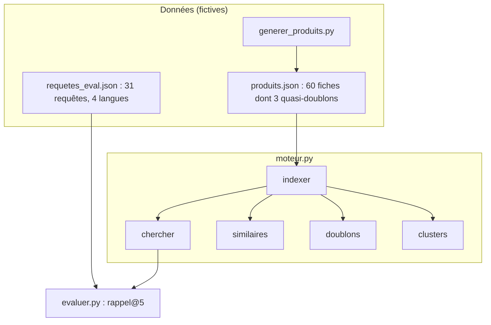

# Cahier des charges et données du moteur produits

> [!NOTE]
> Dans cette leçon, vous allez cadrer le projet final : ce que le moteur produits doit faire, avec quelles données fictives, et quels critères mesurables décident qu'il est « prêt ».

## Le besoin

Une boutique en ligne fictive vend 60 produits dans 10 rayons. Elle veut :

1. une **barre de recherche** qui comprend les reformulations (« faire le ménage sans y penser ») et les visiteurs étrangers ;
2. un bloc **« produits similaires »** sur chaque fiche ;
3. un rapport des **doublons** du catalogue, à faire valider par l'équipe produit ;
4. une **exploration** des regroupements naturels du catalogue ;
5. une **mesure** de qualité rejouable à chaque changement.



## Les données

Les fiches sont **inventées** : noms de produits et de marques fictifs, prix d'exemple. `generer_produits.py` les écrit dans `produits.json` à partir d'une liste en dur, pour que tout le monde ait exactement le même catalogue.

```python title="files/generer_produits.py (extrait)"
FICHES = [
    # (catégorie, nom, description, prix en euros)
    ("Chaussures", "Trailrun Gecko", "Chaussure de trail à crampons de 5 mm pour terrains boueux et rocailleux, membrane respirante.", 129),
    ...
    # Quasi-doublons volontaires (même produit, rédaction différente)
    ("Chaussures", "Trail Gecko (coloris forêt)", "Chaussure de trail running avec crampons de 5 mm, pensée pour la boue et les rochers, tige respirante.", 129),
]
```

| Fichier | Contenu | Rôle |
| --- | --- | --- |
| `produits.json` | 60 fiches : `id`, `categorie`, `nom`, `description`, `prix` | le catalogue à indexer |
| `requetes_eval.json` | 31 requêtes, langue, produits pertinents | le jeu de référence |
| `index/vecteurs.npy` | matrice (60, 768) | généré par `moteur.py indexer` |
| `index/produits.sqlite` | fiches + empreintes | généré par `moteur.py indexer` |

> [!TIP]
> Les 3 quasi-doublons servent deux fois : comme **vérité terrain** pour le dédoublonnage, et comme **pertinents multiples** dans l'évaluation (« courir dans la boue » attend P001 **et** P058).

## Les critères d'acceptation

| Critère | Seuil | Mesuré par |
| --- | --- | --- |
| Rappel@5 global | au moins 0,90 | `evaluer.py` |
| Rappel@5 en anglais, espagnol, allemand | au moins 0,90 chacun | `evaluer.py` (par langue) |
| Meilleur que la recherche par mots-clés | oui, sur chaque langue | colonne BM25 |
| Doublons connus retrouvés | 3 sur 3, aucun faux positif | `moteur.py doublons` |
| Coût de réindexation sans changement | 0 appel | `moteur.py indexer` deux fois |
| Tests sans clé | tous verts | `pytest -q` |

> [!WARNING]
> Ces seuils sont ceux **de ce lab**, sur un petit catalogue propre. Sur un vrai catalogue (descriptions vides, fautes, jargon fournisseur), attendez-vous à des chiffres plus bas : fixez vos seuils après une première mesure, pas avant.

```quiz
question: "Pourquoi générer le catalogue à partir d'une liste en dur plutôt que de demander à un LLM à chaque exécution ?"
options:
  - "Parce qu'un LLM ne sait pas écrire de JSON"
  - "Pour que le catalogue soit identique pour tout le monde, et les résultats comparables"
  - "Pour réduire la taille du fichier"
answer: 1
explanation: "Une évaluation n'a de sens que si les données sont fixes. Un catalogue régénéré différemment à chaque fois rendrait les rappels@5 incomparables."
```

```quiz
question: "Quels fichiers peut-on supprimer sans perte, car ils se régénèrent ?"
options:
  - "produits.json"
  - "index/vecteurs.npy"
  - "requetes_eval.json"
  - "index/produits.sqlite"
answer: [0, 1, 3]
explanation: "produits.json se régénère avec generer_produits.py, et l'index avec moteur.py indexer (au prix de quelques appels). requetes_eval.json est un travail humain de jugement : il se versionne et ne se régénère pas."
```

## Exercice : 5 requêtes de plus

Ajoutez 5 requêtes à `requetes_eval.json` qui mettent le moteur en difficulté : au moins une avec négation, une très courte, une avec une faute de frappe. Notez vos prédictions avant de lancer `evaluer.py`.

<details>
<summary>Voir la solution</summary>

Exemples possibles :

```json
{"requete": "casque mais pas pour l'avion, pour courir", "langue": "fr", "pertinents": ["P020"]},
{"requete": "thé", "langue": "fr", "pertinents": ["P007"]},
{"requete": "aspirateur robo", "langue": "fr", "pertinents": ["P055"]},
{"requete": "cadeau pour quelqu'un qui télétravaille", "langue": "fr", "pertinents": ["P013", "P014", "P016", "P017", "P051", "P054"]},
{"requete": "regalo para un aficionado a los discos", "langue": "es", "pertinents": ["P023"]}
```

Les **négations** sont un point faible connu des embeddings : « pas pour l'avion » contient « avion » et peut remonter le casque de voyage. Les requêtes très courtes donnent peu de contexte. Les fautes de frappe légères passent souvent bien. Mesurez pour savoir.

</details>

## Résultat obtenu

Génération du catalogue le 2026-10-15 :

```text
$ python generer_produits.py
60 fiches écrites dans produits.json
```

Et un aperçu des identifiants (les 3 dernières fiches sont les quasi-doublons de P001, P019 et P037) :

```text
P001 Trailrun Gecko               P002 Asphalte Flow                       P003 Randonnée Cimes Mid
P019 Casque Silence Pro           P020 Écouteurs Sport Fil-Libre           P021 Enceinte Galet
P037 Tente Dôme 3 places          P038 Sac de couchage Grand Froid         P039 Réchaud gaz Mini-Flamme
P058 Trail Gecko (coloris forêt)  P059 Casque Silence Pro - édition noire  P060 Tente Dôme 3 personnes
```

## Je sais faire

- [ ] Traduire un besoin métier en fonctions du moteur (recherche, similaires, doublons, clusters)
- [ ] Préparer des données fictives reproductibles avec une vérité terrain
- [ ] Écrire des critères d'acceptation mesurables
- [ ] Enrichir un jeu de requêtes avec des cas difficiles
