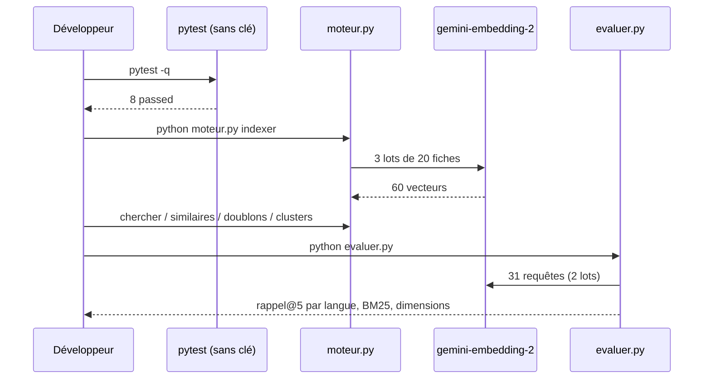

# Assembler, tester et livrer le moteur

> [!NOTE]
> Dans cette leçon, vous allez dérouler le projet de bout en bout : installation, tests sans clé, indexation réelle, recherche, évaluation, puis la même chaîne sur Vertex AI, et vérifier chaque critère d'acceptation.

## Le déroulé complet



```bash title="terminal"
cd files
python -m venv .venv && . .venv/bin/activate
pip install -r requirements.txt
cp .env.example .env            # mettez votre clé dans GOOGLE_API_KEY
pytest -q
python generer_produits.py
python moteur.py indexer
python moteur.py chercher "faire le ménage sans y penser"
python moteur.py doublons
python evaluer.py
```

## Tester sans clé : un faux embedder

Le faux embedder transforme chaque mot en une case d'un vecteur de 64 nombres (par hachage). Il ne « comprend » rien, mais il est **déterministe** et suffit pour tester toute la mécanique : cache, persistance, top k, doublons, k-means, rappel.

```python title="files/test_moteur.py (extrait)"
def faux_embed(textes, dim=64):
    m = np.zeros((len(textes), dim), dtype=np.float32)
    for i, t in enumerate(textes):
        for mot in re.findall(r"\w+", t.lower()):
            m[i, zlib.crc32(mot.encode()) % dim] += 1
    return moteur.normaliser(m + 1e-6)


def test_index_persistant_et_cache(tmp_path, produits):
    e = Compteur()
    assert moteur.indexer(produits, e, tmp_path) == 60
    assert moteur.indexer(produits, e, tmp_path) == 0          # rien n'a changé
    produits[4]["description"] += " Nouveau coloris."
    assert moteur.indexer(produits, e, tmp_path) == 1          # une seule fiche recalculée
```

| Test | Ce qu'il protège |
| --- | --- |
| `test_cosinus_et_top_k` | classement et exclusion |
| `test_index_persistant_et_cache` | 0 appel si rien ne change, 1 si une fiche change |
| `test_recherche_similaires_doublons` | recherche, exclusion de soi, détection d'un doublon connu |
| `test_kmeans_separe_deux_groupes` | k-means sur deux nuages évidents |
| `test_rappel_at_k` | la formule d'évaluation |
| `test_embedder_envoie_une_content_par_texte` | le piège de l'agrégation, les lots de 20, la normalisation |
| `test_prefixes`, `test_purete` | formatage des textes, score de pureté |

> [!TIP]
> `zlib.crc32` plutôt que `hash()` : le `hash()` de Python change d'une exécution à l'autre pour les chaînes, ce qui rendrait le faux embedder (et donc les tests) non reproductible.

## Sur Vertex AI

Même code, autres variables. Deux différences constatées le 2026-10-15 : `gemini-embedding-2` est servi en **`global`** (pas en `europe-west1`), et un seul contenu est accepté par requête, ce que `embedder_gemini` gère automatiquement :

```python title="files/moteur.py (extrait)"
client = client or genai.Client()
if getattr(client, "vertexai", False):
    lot = 1  # sur Vertex AI, gemini-embedding-2 n'accepte qu'un contenu par requête
```

```bash title="terminal"
gcloud auth application-default login
export GOOGLE_GENAI_USE_VERTEXAI=TRUE GOOGLE_CLOUD_PROJECT=mon-projet GOOGLE_CLOUD_LOCATION=global
unset GOOGLE_API_KEY
python moteur.py indexer && python evaluer.py
```

> [!WARNING]
> Sur Vertex AI, l'indexation fait donc **60 requêtes** au lieu de 3. Sur un gros catalogue, utilisez le traitement par lots (*batch*) de la plateforme plutôt qu'une boucle de requêtes unitaires. Ce mode n'a créé **aucune ressource** à supprimer ; seule l'option BigQuery (leçon précédente) en crée une, supprimée par `--nettoyer`.

```quiz
question: "Pourquoi le faux embedder suffit-il pour tester le cache de l'index ?"
options:
  - "Parce qu'il comprend le sens des fiches comme Gemini"
  - "Parce que le cache ne dépend que des textes et du nombre de textes envoyés, pas de la qualité des vecteurs"
  - "Parce qu'il appelle Gemini en arrière-plan"
answer: 1
explanation: "Le test compte les textes envoyés à l'embedder. N'importe quelle fonction déterministe texte → vecteur permet de le vérifier, sans réseau."
```

```quiz
question: "Sur Vertex AI, pourquoi l'indexation de 60 fiches fait-elle 60 requêtes au lieu de 3 ?"
options:
  - "Parce que Vertex AI facture à la requête et l'impose"
  - "Parce que gemini-embedding-2 n'y accepte qu'un contenu par requête"
  - "Parce que la dimension est plus grande"
answer: 1
explanation: "L'appel avec plusieurs Content a été refusé (« only supports one content at a time ») ; le lab passe automatiquement à un texte par requête."
```

## Exercice : un critère qui casse

Passez `EMBED_DIM=128` dans `.env`, relancez `python moteur.py indexer` puis `python evaluer.py`. Combien de fiches sont recalculées, et le critère « rappel@5 ≥ 0,90 » tient-il ?

<details>
<summary>Voir la solution</summary>

Les **60** fiches sont recalculées : la dimension fait partie de l'empreinte. D'après la troncature mesurée par `evaluer.py` (ligne `dimension 128`), le rappel@5 attendu tourne autour de 0,93 : le critère global tient encore, mais de peu. C'est le genre de compromis (4 fois moins de stockage contre quelques points de rappel) qu'on ne tranche qu'avec une mesure.

</details>

## Résultat obtenu

Le 2026-10-15, tests sans clé :

```text
$ pytest -q
........                                                                 [100%]
8 passed in 0.64s
```

Vérification des critères d'acceptation avec l'API Gemini (sorties détaillées dans les leçons précédentes) :

| Critère | Résultat |
| --- | --- |
| Rappel@5 global ≥ 0,90 | 0,99 |
| Anglais / espagnol / allemand ≥ 0,90 | 1,00 / 1,00 / 1,00 |
| Meilleur que BM25 sur chaque langue | oui (BM25 en fr / en / es / de : 0,65 / 0,00 / 0,00 / 0,50) |
| Doublons connus retrouvés | 3 sur 3, aucun faux positif au seuil 0,8 |
| Réindexation sans changement | 0 fiche recalculée |

Et la même chaîne sur Vertex AI (`GOOGLE_CLOUD_LOCATION=global`, chemin du dossier raccourci en `index/`) :

```text
$ python moteur.py indexer   # Vertex AI, location global
Index à jour dans index/ (60 fiche(s) recalculée(s), modèle gemini-embedding-2, 768 dims)
$ python evaluer.py
langue   n   rappel@5 embeddings   rappel@5 BM25
fr      24                0.98            0.65
en       3                1.00            0.00
es       2                1.00            0.00
de       2                1.00            0.50
toutes  31                0.99            0.54
```

Mêmes chiffres qu'avec la clé d'API, au centième près.

## Je sais faire

- [ ] Dérouler le projet de l'installation à l'évaluation
- [ ] Tester toute la mécanique du moteur avec un faux embedder déterministe
- [ ] Faire tourner le même code sur l'API Gemini et sur Vertex AI
- [ ] Vérifier des critères d'acceptation chiffrés avant de livrer
