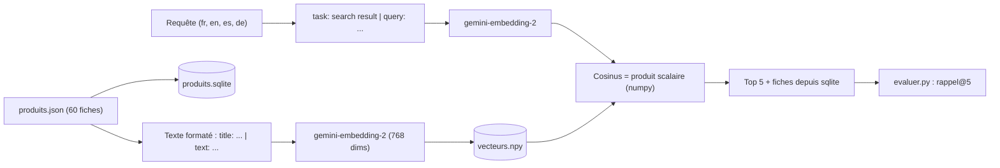

Une recherche par mots-clés trouve « tente » quand on tape « tente ». Elle ne trouve rien quand un client tape « dormir dehors à trois » ou « tent for three people ». Une **recherche sémantique** compare le **sens** des textes : chaque texte devient un vecteur de nombres, un **embedding**, et deux textes proches par le sens ont des vecteurs proches.

Fil rouge : un catalogue de **60 fiches produit fictives** (chaussures, cuisine, bureau, audio, camping…), dont 3 quasi-doublons glissés volontairement. On y construit un moteur de recherche, une recommandation « produits similaires », un détecteur de doublons, un regroupement automatique, et on **mesure** la qualité avec un jeu de 31 requêtes en 4 langues.

## Pour qui ?

- Développeurs ou analystes Python à l'aise avec les listes, les dictionnaires et JSON.
- Aucune connaissance préalable des embeddings ni de l'algèbre linéaire : on explique le produit scalaire au moment où on s'en sert.
- Une clé Gemini suffit. BigQuery et Vertex AI sont présentés en option.

## Ce que vous construisez

## Objectifs mesurables

1. **Expliquer** ce qu'est un embedding et calculer une similarité cosinus avec numpy.
2. **Utiliser** `gemini-embedding-2` correctement : préfixes de tâche, `output_dimensionality`, une `Content` par texte.
3. **Construire** un index local persistant (`.npy` + sqlite) qui ne recalcule que les fiches modifiées.
4. **Exploiter** les vecteurs : recherche multilingue, produits similaires, doublons, clustering.
5. **Mesurer** la qualité avec le rappel@k et comparer à une recherche par mots-clés (BM25).
6. **Décider** quand passer à BigQuery `VECTOR_SEARCH` ou à Vertex AI Vector Search.

## Prérequis techniques

- Python 3.10 ou plus récent, `pip install -r files/requirements.txt`.
- Une clé d'API Gemini (Google AI Studio) dans `GOOGLE_API_KEY`, ou un projet Google Cloud.

## Programme

| Module | Contenu | Durée indicative |
| --- | --- | --- |
| 1. Comprendre les embeddings | Vecteurs, cosinus avec numpy, `gemini-embedding-2`, préfixes de tâche, dimensions | 1h |
| 2. Construire le moteur | Index persistant `.npy` + sqlite, recherche multilingue, similaires et doublons, clustering | 1h30 |
| 3. Évaluer et passer à l'échelle | Rappel@k contre BM25, BigQuery `VECTOR_SEARCH`, Vertex AI Vector Search | 45 min |
| 4. Projet final | Le moteur produits de bout en bout, tests sans clé, résultats réels | 45 min |

## Le code du lab

Tout est dans le dossier `files/` : [generer_produits.py](./files/generer_produits.py) et [produits.json](./files/produits.json) (les 60 fiches), [moteur.py](./files/moteur.py) (index, recherche, similaires, doublons, clusters), [requetes_eval.json](./files/requetes_eval.json) et [evaluer.py](./files/evaluer.py) (rappel@5), [test_moteur.py](./files/test_moteur.py) (8 tests sans clé), [bigquery_vector_search.py](./files/bigquery_vector_search.py) (option Google Cloud).

## En local ou sur Google Cloud ?

| | En local (« sans GCP ») | Sur Google Cloud |
| --- | --- | --- |
| Embeddings | API Gemini, clé `GOOGLE_API_KEY` | Vertex AI, `GOOGLE_CLOUD_LOCATION=global` |
| Lots | jusqu'à 20 textes par requête dans le lab | 1 texte par requête (limite constatée sur Vertex AI) |
| Index | `vecteurs.npy` + `produits.sqlite` | table BigQuery + `VECTOR_SEARCH` |
| Testé le 2026-10-15 | indexation, recherche, rappel@5 = 0,99 | indexation Vertex AI (rappel@5 = 0,99), BigQuery `VECTOR_SEARCH` (mêmes 5 résultats qu'en local) |
| À supprimer après | rien | le dataset `lab_embeddings_recherche` (`--nettoyer`) |
