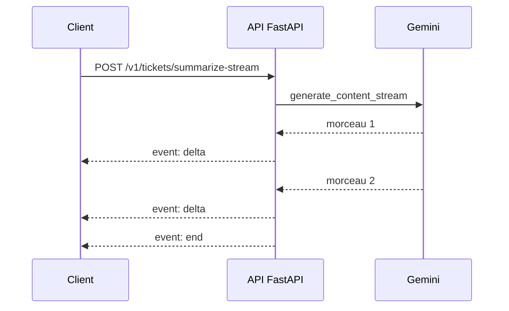

# Streaming SSE, délais et erreurs du modèle

> [!NOTE]
> Dans cette leçon, vous allez ajouter une route qui envoie le résumé **au fil de l'eau** (Server-Sent Events), borner la durée de chaque appel au modèle et traduire les erreurs de Gemini en codes HTTP utiles à l'appelant. Code : [main.py](../files/main.py), tests : [test_main.py](../files/test_main.py).

## Pourquoi streamer ?

Un LLM génère sa réponse **jeton par jeton** (un jeton, ou *token*, est un morceau de mot). Attendre la fin pour tout envoyer, c'est faire patienter l'utilisateur plusieurs secondes devant un écran vide. Avec le streaming, le premier morceau arrive vite et le texte s'affiche à mesure.

**Server-Sent Events (SSE)** est le format standard du web pour cela : une réponse HTTP de type `text/event-stream` qui reste ouverte, et dans laquelle le serveur écrit des événements séparés par une ligne vide :

```text
event: delta
data: {"text": "- Problème : double prélèvement"}

event: end
data: {"done": true}
```



| | Réponse classique | SSE | WebSocket |
| --- | --- | --- | --- |
| Sens | serveur → client, une fois | serveur → client, en continu | les deux sens |
| Complexité | minimale | faible : du HTTP normal | plus élevée (protocole dédié) |
| Bon pour | JSON structuré (`/analyze`) | texte généré par un LLM | chat temps réel bidirectionnel |

## La route SSE avec FastAPI

FastAPI fournit `EventSourceResponse` et `ServerSentEvent` (module `fastapi.sse`) : la fonction de route devient un **générateur** (`yield`) et chaque événement est encodé pour vous.

```python title="files/main.py"
@app.post("/v1/tickets/summarize-stream", response_class=EventSourceResponse)
async def summarize_stream(ticket: Ticket, llm: GeminiLLM = Depends(get_llm)):
    try:
        async for piece in llm.stream_summary(ticket):
            yield ServerSentEvent(data={"text": piece}, event="delta")
        yield ServerSentEvent(data={"done": True}, event="end")
    except errors.APIError as e:  # les en-têtes sont déjà partis : on signale l'erreur dans le flux
        log.error("llm_stream_error", extra={"fields": {"code": e.code}})
        yield ServerSentEvent(data={"error": "erreur du modèle"}, event="error")
```

> [!WARNING]
> Une fois le premier événement envoyé, le code HTTP (200) est **déjà parti** : impossible de renvoyer un 503 en plein flux. D'où l'événement `error` explicite, et l'événement `end` qui permet au client de savoir que la réponse est **complète** (et non coupée par le réseau).

```quiz
question: "Le client reçoit trois événements delta puis la connexion se ferme, sans événement end. Que doit-il en conclure ?"
options:
  - "La réponse est complète"
  - "La réponse est probablement incomplète : il faut la signaler ou réessayer"
  - "Le serveur a renvoyé un code 503"
answer: 1
explanation: "Sans événement de fin, rien ne distingue une réponse terminée d'une coupure. C'est pour cela que la route envoie toujours end (ou error)."
```

## Borner le temps : deux niveaux de délai

Un appel au modèle peut rester bloqué (surcharge, réseau). Sans délai maximum (*timeout*), une requête lente occupe une place de concurrence indéfiniment, et le client attend sans fin.

```python title="files/main.py"
self.client = genai.Client(http_options=types.HttpOptions(
    timeout=int(LLM_TIMEOUT_S * 1000),  # délai par requête HTTP, en millisecondes
    retry_options=types.HttpRetryOptions(attempts=3, http_status_codes=[429, 503]),
))
...
result, usage = await asyncio.wait_for(llm.analyze(ticket), timeout=LLM_TIMEOUT_S)
```

- `HttpOptions(timeout=...)` borne **chaque** requête HTTP du SDK ; `retry_options` réessaie automatiquement sur 429/503.
- `asyncio.wait_for` borne **l'ensemble** (réessais compris) : c'est le budget de temps de votre route.
- Cloud Run ajoute un troisième niveau : `--timeout 60` coupe toute requête au bout de 60 s (leçon 3.1).

Règle simple : délai du modèle < délai de la route < délai de Cloud Run < délai du client.

## Traduire les erreurs

```python title="files/main.py"
except asyncio.TimeoutError:
    raise HTTPException(504, "Le modèle n'a pas répondu à temps, réessayez.")
except errors.APIError as e:
    if e.code in (429, 503):
        raise HTTPException(503, "Service saturé, réessayez.", headers={"Retry-After": "5"})
    raise HTTPException(502, "Erreur du fournisseur de modèle.")
```

| Ce qui arrive | Ce que reçoit l'appelant | Pourquoi |
| --- | --- | --- |
| entrée invalide | 422 | sa faute : corriger la requête |
| quota du modèle épuisé (429) | **503 + `Retry-After`** | temporaire : réessayer plus tard ; ce n'est pas *son* quota |
| délai dépassé | 504 | temporaire : réessayer |
| autre erreur du fournisseur | 502 | problème en amont, sans exposer le détail interne |

> [!TIP]
> Ne renvoyez jamais `str(e)` brut au client : le message d'erreur du fournisseur peut contenir des identifiants internes. Journalisez-le (leçon 3.3), renvoyez un message générique.

```quiz
question: "Pourquoi transformer un 429 de Gemini en 503 plutôt que de le renvoyer tel quel ?"
options:
  - "Parce que 503 est plus rapide"
  - "Parce que 429 dirait au client qu'IL envoie trop de requêtes, alors que c'est le quota du service qui est saturé"
  - "Parce que FastAPI ne sait pas renvoyer 429"
answer: 1
explanation: "429 signifie « vous (l'appelant) envoyez trop ». Ici la saturation est en amont : 503 (service indisponible) avec Retry-After décrit la situation réelle."
```

## Exercice : tester le délai

Écrivez un test qui vérifie qu'un modèle trop lent produit un 504, **sans attendre 20 secondes**.

<details>
<summary>Voir la solution</summary>

On réduit le délai avec `monkeypatch` et on utilise un faux modèle qui dort une seconde :

```python title="test_main.py"
def test_timeout_returns_504(monkeypatch):
    monkeypatch.setattr(main, "LLM_TIMEOUT_S", 0.05)
    assert client(FakeLLM(delay=1)).post("/v1/tickets/analyze", json=TICKET).status_code == 504
```

Cela fonctionne parce que la route relit `LLM_TIMEOUT_S` à chaque appel (`asyncio.wait_for(..., timeout=LLM_TIMEOUT_S)`). Le test dure 50 ms.

</details>

## Résultat obtenu

Tests du 2026-10-15 : `pytest -q` → `7 passed in 0.45s`. Appel réel en local (`gemini-3.5-flash`) :

```text
$ curl -sN -X POST localhost:8765/v1/tickets/summarize-stream -H 'Content-Type: application/json' -d '{"subject":"Colis non reçu", ...}'
event: delta
data: {"text": "Voici le traitement du ticket :\n\n**Résumé :**\n* Commande passée il y a 12 jours, statut"}

event: delta
data: {"text": " de suivi indiqué comme \"livré\".\n* Le client signale n'avoir reçu aucun colis.\n* Le client demande un"}
...
event: end
data: {"done": true}
```

Ce premier essai a aussi montré un défaut : le résumé reprenait l'instruction de **tri** (catégorie, priorité). La route a reçu sa propre instruction système (`SUMMARY_SYSTEM` : « trois puces, rien d'autre »), ce que confirme l'appel sur Cloud Run du projet final.

## Je sais faire

- [ ] Écrire une route SSE avec `EventSourceResponse` et `ServerSentEvent`
- [ ] Signaler fin et erreur dans un flux déjà commencé
- [ ] Empiler les délais : modèle, route, Cloud Run, client
- [ ] Traduire 429, délai dépassé et erreurs du fournisseur en 503, 504 et 502
