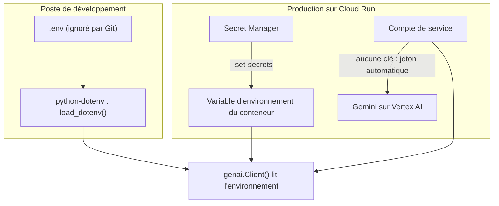

# Les secrets : .env, Secret Manager, et l'option sans clé

> [!NOTE]
> Dans cette leçon, vous allez voir où ranger une clé d'API à chaque étape (poste de développement, production) et pourquoi, sur Google Cloud, la meilleure clé est celle qu'on n'a pas : Gemini via Vertex AI avec l'identité du service. Fichier de référence : [.env.example](../files/.env.example).

## Un secret, c'est quoi ?

Un **secret** est une valeur qui donne un pouvoir à qui la possède : une clé d'API Gemini permet de consommer **votre** quota et de vous faire payer. Une clé qui fuit (dans un dépôt Git, une image Docker, une capture d'écran) doit être considérée comme compromise et révoquée.



## En local : `.env` et `python-dotenv`

```python title="files/main.py"
from dotenv import load_dotenv
load_dotenv()   # copie les lignes de .env dans os.environ, sans écraser ce qui existe déjà
```

`genai.Client()` sans argument lit lui-même l'environnement : `GOOGLE_API_KEY` pour l'API Gemini, ou `GOOGLE_GENAI_USE_VERTEXAI=TRUE` + `GOOGLE_CLOUD_PROJECT` + `GOOGLE_CLOUD_LOCATION` pour Vertex AI. Le code ne contient **aucune** clé et ne change pas d'un environnement à l'autre.

Trois réflexes :

1. `.env` dans `.gitignore` **et** dans `.dockerignore` (voir [.dockerignore](../files/.dockerignore)) ;
2. un `.env.example` versionné, avec des valeurs **factices**, pour documenter les variables ;
3. ne jamais afficher une clé dans un journal ou un message d'erreur.

```quiz
question: "Vous avez committé une clé d'API, puis l'avez supprimée dans le commit suivant. Est-ce suffisant ?"
options:
  - "Oui, la clé n'est plus dans le dépôt"
  - "Non : elle reste dans l'historique Git ; il faut la révoquer et en créer une nouvelle"
  - "Oui, si le dépôt est privé"
answer: 1
explanation: "L'historique garde toutes les versions. Une clé exposée doit être révoquée ; la réécriture de l'historique ne protège pas des copies déjà faites."
```

## En production avec une clé : Secret Manager

Si vous devez garder une clé (un fournisseur sans identité Google, un webhook signé), rangez-la dans **Secret Manager**, le coffre-fort de Google Cloud : chaque secret a des **versions**, des droits d'accès IAM et un historique d'accès.

```bash title="terminal"
# Créer le secret (la valeur est lue sur l'entrée standard, jamais dans l'historique du shell)
printf '%s' "$MA_CLE" | gcloud secrets create lab-api-ia-cle --data-file=- \
  --replication-policy=user-managed --locations=europe-west1 --project "$PROJECT_ID"

# Autoriser UNIQUEMENT le compte de service de l'API à le lire
gcloud secrets add-iam-policy-binding lab-api-ia-cle --project "$PROJECT_ID" \
  --member "serviceAccount:lab-api-ia@${PROJECT_ID}.iam.gserviceaccount.com" \
  --role roles/secretmanager.secretAccessor

# Le monter en variable d'environnement du service
gcloud run deploy lab-api-ia ... --set-secrets "GOOGLE_API_KEY=lab-api-ia-cle:latest"
```

| Façon de passer la clé | Visible par | Verdict |
| --- | --- | --- |
| en dur dans le code | tout lecteur du dépôt | jamais |
| `ENV` dans le Dockerfile | quiconque récupère l'image | jamais |
| `--set-env-vars` | quiconque peut lire la configuration du service | à éviter |
| `--set-secrets` (Secret Manager) | le compte de service autorisé | oui, si une clé est indispensable |
| **pas de clé** (Vertex AI + compte de service) | personne : il n'y a rien à voler | **le mieux** |

> [!TIP]
> `:latest` prend la dernière version du secret **au démarrage de l'instance**. Pour une rotation maîtrisée, épinglez une version (`lab-api-ia-cle:3`) et redéployez.

## Sur Google Cloud : pas de clé du tout

Cloud Run donne à chaque service une **identité** : un **compte de service** (un compte Google pour une application, pas pour une personne). Le SDK obtient automatiquement des jetons de courte durée pour cette identité. Si ce compte a le rôle **Vertex AI User** (`roles/aiplatform.user`), le service appelle Gemini sur Vertex AI **sans aucune clé** :

```bash title="files/deploy.sh (extrait)"
--set-env-vars "GOOGLE_GENAI_USE_VERTEXAI=TRUE,GOOGLE_CLOUD_PROJECT=${PROJECT_ID},GOOGLE_CLOUD_LOCATION=${REGION},MODEL=gemini-2.5-flash"
```

Ces variables ne sont **pas** des secrets : les connaître ne donne aucun droit.

> [!WARNING]
> Les noms de modèles diffèrent selon la plateforme et la région. Ce lab utilise `gemini-3.5-flash` avec la clé d'API et `gemini-2.5-flash` sur Vertex AI en `europe-west1` (validés le 2026-10-15). D'où la variable `MODEL` : on change de modèle sans toucher au code.

```quiz
question: "Quelles affirmations sont vraies pour l'API déployée avec Vertex AI et un compte de service ? (plusieurs réponses)"
options:
  - "Il n'y a aucune clé d'API à stocker ni à faire tourner"
  - "GOOGLE_CLOUD_PROJECT doit être rangé dans Secret Manager"
  - "Retirer le rôle Vertex AI User au compte de service coupe l'accès au modèle"
  - "Le code Python doit être modifié par rapport à la version locale"
answer: [0, 2]
explanation: "L'accès repose sur l'identité et ses rôles IAM. Le nom du projet n'est pas un secret, et le même code fonctionne partout car genai.Client() lit la configuration dans l'environnement."
```

## Exercice : faire tourner une clé sans coupure

Votre API utilise (exceptionnellement) une clé montée depuis Secret Manager avec `:latest`. Décrivez les étapes pour la remplacer par une nouvelle clé sans interrompre le service.

<details>
<summary>Voir la solution</summary>

1. Créer la nouvelle clé chez le fournisseur, **sans** révoquer l'ancienne.
2. Ajouter une version au secret : `printf '%s' "$NOUVELLE" | gcloud secrets versions add lab-api-ia-cle --data-file=-`.
3. Redéployer (ou créer une nouvelle révision) pour que les instances relisent `:latest` au démarrage : `gcloud run services update lab-api-ia --region europe-west1 --update-labels rotation=2`.
4. Vérifier dans les journaux que les appels réussissent sur la nouvelle révision.
5. Révoquer l'ancienne clé chez le fournisseur, puis désactiver l'ancienne version : `gcloud secrets versions disable 1 --secret lab-api-ia-cle`.

L'ordre compte : on ne révoque qu'une fois que plus rien n'utilise l'ancienne clé.

</details>

## Résultat obtenu

Vérification réelle du 2026-10-15 avec un secret **factice** (créé, lu, puis supprimé) :

```text
$ printf 'valeur-factice-pour-le-lab' | gcloud secrets create lab-api-ia-demo --data-file=- \
    --replication-policy=user-managed --locations=europe-west1 --labels=formation-lab=api-ia
Created version [1] of the secret [lab-api-ia-demo].
$ gcloud secrets versions access latest --secret lab-api-ia-demo
valeur-factice-pour-le-lab
$ gcloud secrets delete lab-api-ia-demo --quiet
Deleted secret [lab-api-ia-demo].
```

Le service déployé du projet final, lui, n'a utilisé **aucun** secret : Vertex AI et le compte de service suffisent.

## Je sais faire

- [ ] Charger la configuration locale avec `.env` et `python-dotenv`, sans jamais versionner `.env`
- [ ] Créer un secret, le restreindre à un compte de service et le monter avec `--set-secrets`
- [ ] Expliquer pourquoi Vertex AI + compte de service supprime le besoin de clé
- [ ] Faire tourner une clé sans coupure
