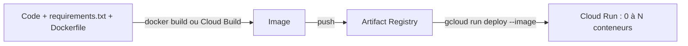

# Conteneuriser l'API : le Dockerfile

> [!NOTE]
> Dans cette leçon, vous allez lire ligne par ligne le [Dockerfile](../files/Dockerfile) de l'API, le construire, le lancer en local, puis comprendre comment Cloud Build le construit pour vous sur Google Cloud.

## Conteneur, image : de quoi parle-t-on ?

Une **image** est un paquet figé qui contient votre code, ses dépendances et un système minimal. Un **conteneur** est une image en cours d'exécution. Cloud Run ne connaît que cela : vous lui donnez une image, il démarre autant de conteneurs que nécessaire.

L'intérêt : « ça marche sur ma machine » devient « ça marche partout », car la machine est dans l'image.



## Le Dockerfile, ligne par ligne

```dockerfile title="files/Dockerfile"
FROM python:3.12-slim

# Pas de fichiers .pyc, journaux envoyés tout de suite sur stdout
ENV PYTHONDONTWRITEBYTECODE=1 PYTHONUNBUFFERED=1
WORKDIR /app

# Dépendances d'abord : cette couche reste en cache tant que requirements.txt ne change pas
COPY requirements.txt .
RUN pip install --no-cache-dir -r requirements.txt

COPY main.py .

# Utilisateur sans privilèges
RUN useradd --create-home appuser
USER appuser

# Cloud Run fournit le port dans $PORT (8080 par défaut).
# --no-access-log : le middleware de main.py écrit déjà une ligne JSON par requête
CMD exec uvicorn main:app --host 0.0.0.0 --port ${PORT:-8080} --no-access-log
```

| Ligne | Pourquoi |
| --- | --- |
| `python:3.12-slim` | image de base réduite : moins de choses à télécharger et moins de failles possibles |
| `PYTHONUNBUFFERED=1` | sans elle, Python garde les journaux en mémoire tampon : ils arrivent en retard (ou jamais, si le conteneur s'arrête) |
| `COPY requirements.txt` **avant** `COPY main.py` | Docker met chaque étape en cache : modifier `main.py` ne réinstalle pas les dépendances |
| versions épinglées dans [requirements.txt](../files/requirements.txt) | la même image aujourd'hui et dans six mois |
| `USER appuser` | si l'application est compromise, l'attaquant n'est pas `root` dans le conteneur |
| `--host 0.0.0.0` | écouter sur toutes les interfaces, sinon le trafic extérieur au conteneur n'arrive pas |
| `${PORT:-8080}` | Cloud Run impose le port via la variable `PORT` |
| `exec` | uvicorn remplace le shell et reçoit directement le signal d'arrêt (`SIGTERM`) envoyé par Cloud Run |

```quiz
question: "Vous modifiez une ligne de main.py et reconstruisez l'image. Quelle étape est rejouée ?"
options:
  - "Toutes, y compris pip install"
  - "Seulement COPY main.py et les étapes suivantes : pip install vient du cache"
  - "Aucune, Docker réutilise l'ancienne image"
answer: 1
explanation: "Le cache est invalidé à partir de la première étape dont l'entrée change. requirements.txt n'a pas changé, donc pip install est réutilisé."
```

## Ce qui ne doit PAS entrer dans l'image

```text title="files/.dockerignore"
.env
__pycache__/
.pytest_cache/
test_*.py
*.sh
```

Le fichier `.dockerignore` exclut ces fichiers de ce qui est envoyé au moteur de construction. Le plus important est `.env` : une image avec votre clé dedans, poussée dans un registre, c'est une fuite.

> [!WARNING]
> Même supprimé dans une étape ultérieure (`RUN rm .env`), un fichier copié dans une image reste lisible dans la couche où il a été ajouté. La seule protection est de ne jamais le copier.

## Construire et tester en local

```bash title="terminal"
cd files
docker build -t lab-api-ia:local .
docker run --rm -p 8766:8080 -e GOOGLE_API_KEY -e GOOGLE_GENAI_USE_VERTEXAI=FALSE lab-api-ia:local
curl -s localhost:8766/health
```

`-e GOOGLE_API_KEY` (sans `=valeur`) transmet la variable de votre shell au conteneur sans l'écrire dans la commande.

## Construire sur Google Cloud : Cloud Build

Pas de Docker sur votre poste ? **Cloud Build** construit l'image dans Google Cloud et la pousse dans **Artifact Registry** (le registre d'images du projet) :

```bash title="files/deploy.sh (extrait)"
gcloud artifacts repositories create lab-api-ia --repository-format=docker \
  --location europe-west1 --labels formation-lab=api-ia --project "$PROJECT_ID"
gcloud builds submit --tag "europe-west1-docker.pkg.dev/${PROJECT_ID}/lab-api-ia/api:v1" \
  --gcs-source-staging-dir "gs://lab-api-ia-build-${PROJECT_ID}/source" \
  --region europe-west1 --project "$PROJECT_ID" .
```

`--gcs-source-staging-dir` dépose l'archive des sources dans **notre** bucket, que [cleanup.sh](../files/cleanup.sh) supprime à la fin : on sait exactement ce qu'on a créé.

> [!TIP]
> `gcloud run deploy --source .` fait tout en une commande (construction + déploiement), mais crée un dépôt et un bucket nommés par Google. Pour un lab qu'on veut nettoyer à coup sûr, les commandes explicites sont plus lisibles.

```quiz
question: "Pourquoi l'instruction exec est-elle utile dans la ligne CMD ?"
options:
  - "Elle accélère le démarrage de Python"
  - "Elle permet à uvicorn de recevoir directement le SIGTERM de Cloud Run et de terminer proprement les requêtes en cours"
  - "Elle est obligatoire pour lire la variable PORT"
answer: 1
explanation: "Sans exec, le shell reste le processus principal et peut ne pas relayer le signal d'arrêt : le conteneur est alors tué brutalement après le délai de grâce."
```

## Exercice : réduire ce qui part au build

Le dossier contient aussi un `README.md` de 2 Mo et un dossier `data/` de 500 Mo d'exemples. Qu'ajoutez-vous, et comment vérifier ce qui est envoyé ?

<details>
<summary>Voir la solution</summary>

Ajoutez à `.dockerignore` :

```text
README.md
data/
```

Vérification : `gcloud builds submit` affiche la taille de l'archive envoyée (« Uploading tarball of [.] … ») ; en local, `docker build` affiche la taille du contexte transféré (« transferring context »). Les deux doivent rester petites (quelques kilo-octets ici). Bonus : `docker history lab-api-ia:local` montre la taille de chaque couche.

</details>

## Résultat obtenu

Construction et exécution locales du 2026-10-15 :

```text
$ docker images lab-api-ia:local --format "{{.Repository}}:{{.Tag}} {{.Size}}"
lab-api-ia:local 174MB
$ curl -s localhost:8766/health
{"status":"ok","model":"gemini-3.5-flash"}
$ curl -s -X POST localhost:8766/v1/tickets/analyze -H 'Content-Type: application/json' -d '{"subject":"Adresse de livraison", ...}'
{"summary":"Le client souhaite corriger l'adresse de livraison de sa commande avant que celle-ci ne soit expédiée.","category":"livraison","priority":"normale","sentiment":"neutre"}
$ docker exec lab-api-ia-test whoami
appuser
```

Le premier essai affichait deux lignes par requête : la ligne JSON de notre middleware et la ligne texte d'uvicorn (`INFO: 172.17.0.1 - "POST ..." 200 OK`). D'où l'ajout de `--no-access-log`. Sur Cloud Build, la même image a été construite en 33 s.

## Je sais faire

- [ ] Expliquer chaque ligne d'un Dockerfile Python pour Cloud Run
- [ ] Ordonner les étapes pour profiter du cache
- [ ] Empêcher `.env` d'entrer dans l'image avec `.dockerignore`
- [ ] Construire l'image en local ou avec Cloud Build vers Artifact Registry
