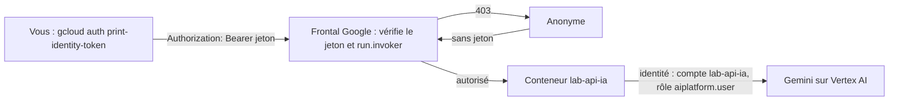

# Déployer en service privé avec un compte de service dédié

> [!NOTE]
> Dans cette leçon, vous allez déployer l'API sur Cloud Run en service **privé**, avec une identité qui n'a qu'un seul droit (appeler Vertex AI), puis l'appeler avec un **jeton d'identité**. Scripts : [deploy.sh](../files/deploy.sh) et [call.sh](../files/call.sh).

## Deux questions d'identité

Il y a deux identités en jeu, à ne pas confondre :

1. **Qui a le droit d'appeler l'API ?** Les appelants : vous, un autre service. C'est contrôlé par le rôle **Cloud Run Invoker** (`roles/run.invoker`) et l'option `--no-allow-unauthenticated`.
2. **Qu'a le droit de faire l'API elle-même ?** Son **compte de service** : ici, seulement appeler Vertex AI (`roles/aiplatform.user`).



**IAM** (*Identity and Access Management*) est le système de droits de Google Cloud : on donne un **rôle** (un paquet de permissions) à un **membre** (personne ou compte de service) sur une **ressource** (projet, service, secret).

## Le compte de service dédié

Par défaut, Cloud Run utilise le compte de service Compute Engine par défaut, qui a souvent des droits très larges sur le projet. Une faille dans l'API donnerait alors accès à tout. Le principe du **moindre privilège** : un compte par service, avec seulement ce dont il a besoin.

```bash title="files/deploy.sh (extrait)"
gcloud iam service-accounts create lab-api-ia --display-name "API tickets (lab)" --project "$PROJECT_ID"
gcloud projects add-iam-policy-binding "$PROJECT_ID" \
  --member "serviceAccount:lab-api-ia@${PROJECT_ID}.iam.gserviceaccount.com" \
  --role roles/aiplatform.user --condition=None
```

## Le déploiement

```bash title="files/deploy.sh (extrait)"
gcloud run deploy lab-api-ia \
  --image "$IMAGE" \
  --region "$REGION" --project "$PROJECT_ID" \
  --service-account "$SA" \
  --no-allow-unauthenticated \
  --set-env-vars "GOOGLE_GENAI_USE_VERTEXAI=TRUE,GOOGLE_CLOUD_PROJECT=${PROJECT_ID},GOOGLE_CLOUD_LOCATION=${REGION},MODEL=gemini-2.5-flash,LLM_TIMEOUT_S=20" \
  --cpu 1 --memory 512Mi \
  --concurrency 20 --min-instances 0 --max-instances 2 \
  --timeout 60 \
  --labels "$LABEL"
```

| Option | Effet |
| --- | --- |
| `--service-account` | l'identité du conteneur (sinon : le compte par défaut, trop puissant) |
| `--no-allow-unauthenticated` | toute requête sans jeton valide est refusée **avant** d'atteindre votre code |
| `--set-env-vars` | la configuration Vertex AI, sans secret |
| `--concurrency`, `--min/max-instances`, `--timeout` | capacité, coût et délai (leçon suivante) |
| `--labels` | retrouver et facturer par projet ou par lab |

```quiz
question: "Un appel anonyme arrive sur un service déployé avec --no-allow-unauthenticated. Votre code FastAPI est-il exécuté ?"
options:
  - "Oui, et il doit vérifier lui-même l'en-tête Authorization"
  - "Non : le frontal de Cloud Run renvoie 403 sans démarrer ni solliciter le conteneur"
  - "Oui, mais seulement la route /health"
answer: 1
explanation: "La vérification IAM est faite par l'infrastructure de Cloud Run. Les requêtes refusées ne consomment ni votre code, ni vos appels au modèle."
```

## Appeler le service privé

Un **jeton d'identité** (*ID token*) est un jeton signé par Google qui dit « je suis telle personne ou tel compte ». `gcloud auth print-identity-token` en produit un pour votre compte ; un autre service Cloud Run en obtient un pour son compte de service via le serveur de métadonnées.

```bash title="files/call.sh (extrait)"
URL=$(gcloud run services describe lab-api-ia --region "$REGION" --project "$PROJECT_ID" --format 'value(status.url)')
TOKEN=$(gcloud auth print-identity-token)
curl -s -o /dev/null -w "%{http_code}\n" "$URL/health"                 # sans jeton : 403
curl -s -H "Authorization: Bearer $TOKEN" "$URL/health"                 # avec jeton : 200
```

Pour autoriser un collègue ou un autre service :

```bash title="terminal"
gcloud run services add-iam-policy-binding lab-api-ia --region europe-west1 \
  --member "serviceAccount:outil-support@${PROJECT_ID}.iam.gserviceaccount.com" --role roles/run.invoker
```

> [!WARNING]
> Piège réel rencontré pendant ce lab : la première version exposait `/healthz`. Sur Cloud Run, elle répondait **404** même avec un jeton valide, car certains chemins se terminant par `z` sont **réservés** par l'infrastructure Google. La documentation recommande d'éviter tous les chemins qui finissent par `z`. La route s'appelle donc `/health`.

```quiz
question: "Quel rôle le compte de service lab-api-ia doit-il avoir pour que l'API fonctionne ?"
options:
  - "roles/owner sur le projet, pour éviter les erreurs de droits"
  - "roles/aiplatform.user, et rien d'autre"
  - "roles/run.invoker sur son propre service"
answer: 1
explanation: "L'API n'a besoin que d'appeler Gemini sur Vertex AI. run.invoker concerne les appelants, pas le service lui-même ; owner violerait le moindre privilège."
```

## Exercice : un deuxième appelant

Vous voulez qu'un script lancé par Cloud Scheduler (compte de service `planif-tickets`) puisse appeler l'API, et **rien d'autre** que cette API. Quelle commande, et que ne faut-il surtout pas faire ?

<details>
<summary>Voir la solution</summary>

Donner `run.invoker` **sur le service**, pas sur le projet :

```bash
gcloud run services add-iam-policy-binding lab-api-ia --region europe-west1 \
  --member "serviceAccount:planif-tickets@${PROJECT_ID}.iam.gserviceaccount.com" \
  --role roles/run.invoker
```

À éviter : `gcloud projects add-iam-policy-binding ... --role roles/run.invoker` (le compte pourrait appeler **tous** les services du projet), et surtout `--allow-unauthenticated` « pour simplifier » : n'importe qui sur Internet pourrait consommer votre quota Gemini.

</details>

## Résultat obtenu

Déploiement réel du 2026-10-15 dans un projet de test (identifiants masqués) :

```text
Service [lab-api-ia] revision [lab-api-ia-00002-795] has been deployed and is serving 100 percent of traffic.
Service URL: https://lab-api-ia-XXXXXXXXXXXX.europe-west1.run.app

$ ./call.sh
--- sans jeton (doit être refusé)
403
--- avec jeton
{"status":"ok","model":"gemini-2.5-flash"}
{"summary":"Le client a été débité deux fois pour la commande de mars et demande un remboursement pour le prélèvement en double.","category":"facturation","priority":"haute","sentiment":"negatif"}
```

La révision `00001` (avec `/healthz`) renvoyait `404` sur cette route, avec ou sans jeton : c'est ce qui a conduit au renommage.

## Je sais faire

- [ ] Distinguer l'identité des appelants (`run.invoker`) de celle du service (compte de service)
- [ ] Créer un compte de service avec le seul rôle `aiplatform.user`
- [ ] Déployer avec `--no-allow-unauthenticated` et vérifier le 403 sans jeton
- [ ] Appeler le service avec un jeton d'identité et autoriser un appelant précis
