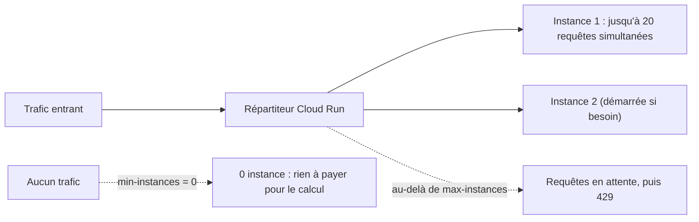

# Autoscaling, latence et coûts

> [!NOTE]
> Dans cette leçon, vous allez choisir les réglages de capacité de Cloud Run (concurrence, instances min et max, délai) pour une API qui passe l'essentiel de son temps à **attendre** le modèle, puis estimer latence et coût à partir de mesures réelles.

## Comment Cloud Run monte en charge

Cloud Run démarre des **instances** (des copies de votre conteneur) selon le trafic, et les arrête quand il n'y en a plus. Chaque instance traite jusqu'à `--concurrency` requêtes **en même temps**.



Une API IA a un profil particulier : une requête dure plusieurs secondes, mais l'instance **ne calcule presque rien** pendant ce temps, elle attend la réponse de Gemini. Comme le code est **asynchrone** (`async def`, `await`), une seule instance peut attendre de nombreuses réponses en parallèle sans bloquer.

| Réglage | Valeur du lab | Raisonnement |
| --- | --- | --- |
| `--concurrency` | 20 | requêtes surtout en attente réseau : une instance en gère plusieurs ; le défaut de Cloud Run est 80 |
| `--min-instances` | 0 | coût nul au repos ; au prix d'un **démarrage à froid** sur la première requête |
| `--max-instances` | 2 | **plafond de coût** et protection du quota du modèle |
| `--timeout` | 60 s | au-dessus du délai de la route (20 s), en dessous de la patience d'un client |
| `--cpu 1 --memory 512Mi` | | largement suffisant pour une API qui relaie des appels |

```quiz
question: "Pourquoi une concurrence de 1 serait-elle un mauvais choix pour cette API ?"
options:
  - "Parce que FastAPI ne fonctionne pas avec une concurrence de 1"
  - "Parce que chaque requête, qui attend Gemini plusieurs secondes, bloquerait une instance entière : il en faudrait beaucoup plus pour le même trafic"
  - "Parce que Cloud Run l'interdit"
answer: 1
explanation: "Avec concurrency=1, 20 requêtes simultanées exigent 20 instances, alors qu'une seule instance asynchrone peut attendre 20 réponses du modèle en même temps."
```

## Le démarrage à froid

Un **démarrage à froid** (*cold start*) est le temps nécessaire pour lancer une instance : télécharger l'image, démarrer Python, importer les bibliothèques. Il s'ajoute à la première requête après une période sans trafic. Leviers :

- une image légère (`python:3.12-slim`, peu de dépendances) ;
- des imports rapides (ne rien charger d'inutile au démarrage) ;
- `--min-instances 1` si la première requête doit être rapide, mais vous payez alors une instance en permanence ;
- `--cpu-boost` : plus de CPU pendant le démarrage.

## Où va la latence ?

Les journaux de l'API séparent le temps passé chez le modèle (`llm_ms`) et le temps total de la requête (`latency_ms`). Sur les appels mesurés (voir plus bas), l'écart est de quelques millisecondes : **presque toute la latence vient du modèle**. Optimiser le code Python ne servirait à rien ; les vrais leviers sont ailleurs :

| Levier | Effet sur la latence |
| --- | --- |
| modèle plus léger (variante *lite*) | souvent plus rapide et moins cher, à valider sur la qualité |
| prompt et sortie plus courts | moins de jetons à lire et à générer |
| streaming (SSE) | même durée totale, mais le premier mot arrive vite |
| région proche des utilisateurs et du modèle | moins d'aller-retours réseau |

## Les coûts : deux postes

1. **Cloud Run** : facturé au temps CPU et mémoire des instances (par défaut, seulement pendant le traitement des requêtes) et au nombre de requêtes. Avec `min-instances=0`, rien au repos.
2. **Le modèle** : facturé au **nombre de jetons** en entrée et en sortie. C'est en général le poste principal d'une API IA.

Les journaux donnent les jetons de chaque appel. Méthode de calcul, avec des **prix d'exemple** à remplacer par ceux de la page Tarifs de votre modèle :

$$\text{coût par ticket} = \frac{\text{jetons entrée} \times P_{in} + \text{jetons sortie} \times P_{out}}{10^6}$$

Par exemple, avec les 161 jetons d'entrée et 57 de sortie mesurés ci-dessous, et des prix hypothétiques de 0,30 $ et 2,50 $ par million de jetons : $161 \times 0{,}30 / 10^6 + 57 \times 2{,}50 / 10^6 \approx 0{,}0002$ $ par ticket.

> [!TIP]
> Mettez une **alerte budgétaire** sur le projet et un `--max-instances` : c'est ce qui borne le coût si un client boucle sur votre API. Le plafond protège aussi le quota du modèle, partagé par tous vos services.

```quiz
question: "Quels réglages bornent la dépense maximale si un appelant autorisé envoie des requêtes en boucle ? (plusieurs réponses)"
options:
  - "--max-instances"
  - "--min-instances 0"
  - "max_length sur le corps du ticket"
  - "Une alerte budgétaire"
answer: [0, 2, 3]
explanation: "max-instances plafonne la capacité, max_length plafonne le coût de chaque appel, l'alerte prévient. min-instances=0 réduit le coût au repos mais ne limite rien sous la charge."
```

## Exercice : dimensionner

Vous attendez au plus 60 tickets simultanés aux heures de pointe, chacun prend environ 5 s. Le quota du modèle a été jugé suffisant. Proposez `--concurrency` et `--max-instances`, et dites ce qui arrive au 61e ticket simultané.

<details>
<summary>Voir la solution</summary>

Par exemple `--concurrency 20 --max-instances 3` : 3 × 20 = 60 requêtes simultanées. On peut prendre une marge (`--max-instances 4`) si le budget le permet.

Au-delà, Cloud Run met brièvement la requête en attente d'une place libre ; si aucune ne se libère à temps, il répond **429**. Le client doit donc réessayer avec attente. Vérifiez aussi que le **quota du modèle** suit : plus d'instances ne sert à rien si Gemini renvoie lui-même des 429, ce qui est arrivé pendant ce lab (voir plus bas).

</details>

## Résultat obtenu

Trois appels successifs à `/v1/tickets/analyze` sur le service déployé, le 2026-10-15 (temps total vu du client, depuis un poste en France) :

```text
analyze 200 2.748863s
analyze 200 5.672453s
analyze 503 4.851666s
```

Et les journaux correspondants dans Cloud Logging :

```text
INFO  {"message": "analyse", "llm_ms": 2673, "tokens_in": 161, "tokens_out": 57, "model": "gemini-2.5-flash", ...}
INFO  {"message": "requete", "path": "/v1/tickets/analyze", "status": 200, "latency_ms": 2675}
ERROR {"message": "llm_error", "code": 429, "detail": "429 RESOURCE_EXHAUSTED. ..."}
INFO  {"message": "requete", "path": "/v1/tickets/analyze", "status": 503, "latency_ms": 4779}
```

Le troisième appel a reçu un **429 de Vertex AI** (capacité partagée momentanément saturée) : le SDK a réessayé, puis l'API a renvoyé un **503 avec `Retry-After`**, comme prévu en leçon 1.2. Le même ticket a été classé `haute` puis `urgente` sur deux appels : même à `temperature=0`, la sortie peut varier.

## Je sais faire

- [ ] Choisir concurrence et instances pour une API qui attend un modèle
- [ ] Expliquer le démarrage à froid et ses leviers
- [ ] Lire `llm_ms` et `latency_ms` pour savoir où passe le temps
- [ ] Estimer le coût par requête à partir des jetons journalisés
