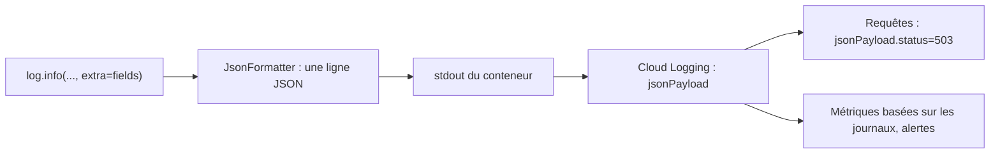

# Journaux structurés et diagnostic

> [!NOTE]
> Dans cette leçon, vous allez écrire des journaux **JSON** que Cloud Logging comprend (gravité, champs filtrables, lien avec la trace de la requête), puis les interroger pour répondre à des questions concrètes : quelles requêtes échouent, combien de jetons, quelle latence.

## Texte libre contre JSON

Un **journal** (*log*) est une ligne écrite par l'application pour raconter ce qu'elle fait. En texte libre (`"analyse OK en 2673 ms"`), il faut des expressions régulières pour en tirer quoi que ce soit. En **JSON structuré**, chaque information est un champ que l'on peut filtrer, compter et grapher.

Sur Cloud Run, tout ce que le conteneur écrit sur la sortie standard part dans **Cloud Logging**. Si la ligne est un objet JSON, il devient un `jsonPayload` dont certains champs ont un sens spécial :

| Champ | Effet dans Cloud Logging |
| --- | --- |
| `severity` | la gravité (INFO, WARNING, ERROR) : couleur, filtres, alertes |
| `message` | le texte affiché dans la liste des journaux |
| `logging.googleapis.com/trace` | relie la ligne à la requête (et à sa trace dans Cloud Trace) |
| tout autre champ | consultable et filtrable : `jsonPayload.tokens_in`, `jsonPayload.status`... |



## Le formateur

```python title="files/main.py"
class JsonFormatter(logging.Formatter):
    def format(self, record: logging.LogRecord) -> str:
        entry = {"severity": record.levelname, "message": record.getMessage()}
        entry.update(getattr(record, "fields", {}))
        return json.dumps(entry, ensure_ascii=False)
```

Pas de bibliothèque supplémentaire : le module `logging` de Python suffit. Les champs métier passent par `extra={"fields": {...}}`.

## Une ligne par requête, une ligne par appel au modèle

```python title="files/main.py"
@app.middleware("http")
async def access_log(request: Request, call_next):
    start = time.perf_counter()
    response = await call_next(request)
    fields = {"path": request.url.path, "status": response.status_code,
              "latency_ms": round((time.perf_counter() - start) * 1000)}
    trace = request.headers.get("x-cloud-trace-context", "").split("/")[0]
    if trace and PROJECT:
        fields["logging.googleapis.com/trace"] = f"projects/{PROJECT}/traces/{trace}"
    log.info("requete", extra={"fields": fields})
    return response
```

Un **middleware** est une fonction qui entoure toutes les requêtes : idéal pour mesurer la latence et le code de retour partout. La route `/analyze` ajoute sa propre ligne avec `model`, `category`, `priority`, `llm_ms`, `tokens_in`, `tokens_out`.

> [!WARNING]
> Ne journalisez **pas** le texte des tickets : il contient des données personnelles (noms, adresses, numéros de commande). Les catégories, les tailles et les jetons suffisent pour exploiter le service. Si vous devez garder des exemples, faites-le dans un stockage à accès restreint, avec une durée de conservation.

```quiz
question: "Pour la route SSE, le middleware journalise une latence de quelques millisecondes alors que le flux dure plusieurs secondes. Pourquoi ?"
options:
  - "Parce que le streaming est très rapide"
  - "Parce que call_next rend la main dès que les en-têtes sont prêts : le corps est envoyé ensuite, après la mesure"
  - "Parce que Cloud Run coupe les flux"
answer: 1
explanation: "Pour une réponse en flux, call_next renvoie la réponse avant que le générateur soit consommé. Pour mesurer la durée réelle, il faut journaliser à la fin du générateur (après l'événement end)."
```

## Interroger les journaux

```bash title="terminal"
# Les 20 dernières erreurs du service
gcloud logging read 'resource.type="cloud_run_revision"
  AND resource.labels.service_name="lab-api-ia" AND severity>=ERROR' \
  --project "$PROJECT_ID" --limit 20 --format json

# Les requêtes lentes (plus de 5 s)
gcloud logging read 'resource.labels.service_name="lab-api-ia"
  AND jsonPayload.message="requete" AND jsonPayload.latency_ms>5000' --project "$PROJECT_ID" --limit 20
```

La même syntaxe de filtre fonctionne dans l'**Explorateur de journaux** de la console. Pour suivre une tendance (taux de 503, jetons par heure), créez une **métrique basée sur les journaux** puis une alerte dessus.

> [!TIP]
> Cherchez une requête précise : cliquez sur une ligne `requete`, puis « Afficher les entrées de cette trace ». Grâce au champ `logging.googleapis.com/trace`, toutes les lignes de cette requête (`analyse`, `llm_error`) apparaissent ensemble.

```quiz
question: "Quel filtre retrouve les appels au modèle qui ont consommé plus de 1 000 jetons en entrée ?"
options:
  - "textPayload:\"1000\""
  - "jsonPayload.message=\"analyse\" AND jsonPayload.tokens_in>1000"
  - "severity=ERROR"
answer: 1
explanation: "Les champs JSON sont filtrables avec des comparaisons numériques. C'est tout l'intérêt de journaux structurés par rapport à du texte libre."
```

## Exercice : mesurer la vraie durée du flux

Modifiez la route SSE pour qu'elle journalise, à la fin du flux, sa durée réelle et le nombre de morceaux envoyés.

<details>
<summary>Voir la solution</summary>

```python title="main.py"
@app.post("/v1/tickets/summarize-stream", response_class=EventSourceResponse)
async def summarize_stream(ticket: Ticket, llm: GeminiLLM = Depends(get_llm)):
    start, chunks = time.perf_counter(), 0
    try:
        async for piece in llm.stream_summary(ticket):
            chunks += 1
            yield ServerSentEvent(data={"text": piece}, event="delta")
        yield ServerSentEvent(data={"done": True}, event="end")
    except errors.APIError as e:
        log.error("llm_stream_error", extra={"fields": {"code": e.code}})
        yield ServerSentEvent(data={"error": "erreur du modèle"}, event="error")
    finally:
        log.info("stream_fin", extra={"fields": {
            "chunks": chunks, "stream_ms": round((time.perf_counter() - start) * 1000)}})
```

Le `finally` s'exécute aussi si le client ferme la connexion en cours de route : vous saurez combien de flux sont abandonnés.

</details>

## Résultat obtenu

Extrait réel de `gcloud logging read` sur le service déployé, le 2026-10-15 (la colonne de droite indique si l'entrée est reliée à une trace) :

```text
INFO  {"latency_ms": 3, "message": "requete", "path": "/v1/tickets/analyze", "status": 422}                 trace
INFO  {"latency_ms": 4779, "message": "requete", "path": "/v1/tickets/analyze", "status": 503}              trace
ERROR {"code": 429, "detail": "429 RESOURCE_EXHAUSTED. {'error': {'code': 429, 'message': 'Resource exhausted. Please try again later. ...", "message": "llm_error"}
INFO  {"latency_ms": 2675, "message": "requete", "path": "/v1/tickets/analyze", "status": 200}              trace
INFO  {"category": "compte", "llm_ms": 2673, "message": "analyse", "model": "gemini-2.5-flash", "priority": "haute", "tokens_in": 161, "tokens_out": 57}
INFO  {"latency_ms": 7, "message": "requete", "path": "/v1/tickets/summarize-stream", "status": 200}       trace
```

Deux constats réels : la ligne SSE affiche 7 ms (le piège du quiz ci-dessus), et seules les lignes du middleware portent la trace. Pour relier aussi `analyse` et `llm_error`, passez l'identifiant de trace à ces lignes (par exemple via une variable de contexte `contextvars`).

## Je sais faire

- [ ] Écrire des journaux JSON avec `severity` et `message` sans bibliothèque externe
- [ ] Relier une ligne à sa requête avec `logging.googleapis.com/trace`
- [ ] Filtrer les journaux sur des champs numériques (`latency_ms`, `tokens_in`)
- [ ] Éviter de journaliser des données personnelles
