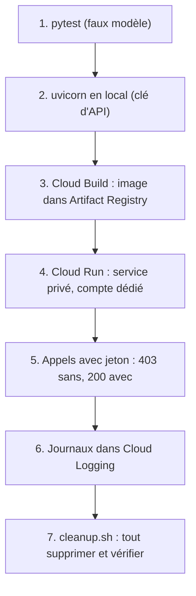

# Projet final : l'API tickets de bout en bout

> [!NOTE]
> Dans ce projet, vous enchaînez tout : tests sans clé, essai local avec un vrai modèle, construction de l'image, déploiement privé sur Cloud Run, appels avec un jeton, lecture des journaux et **suppression complète**. Tout le code est dans [files/](../files/) ; comptez 45 minutes, dont environ 5 minutes d'attente pour Cloud Build et Cloud Run.

## Le cahier des charges

L'équipe support reçoit des tickets en vrac. Elle veut une API interne qui :

| Exigence | Où c'est fait |
| --- | --- |
| résume, catégorise, priorise et lit le sentiment de chaque ticket | `POST /v1/tickets/analyze` ([main.py](../files/main.py)) |
| affiche un résumé en direct dans l'outil des agents | `POST /v1/tickets/summarize-stream` (SSE) |
| refuse les entrées absurdes ou trop longues | modèle Pydantic `Ticket` |
| ne reste jamais bloquée | délais SDK + `asyncio.wait_for` + `--timeout` |
| n'est accessible qu'aux personnes autorisées | `--no-allow-unauthenticated` + `run.invoker` |
| ne stocke aucune clé | Vertex AI + compte de service dédié |
| coûte zéro au repos et a un plafond | `min-instances 0`, `max-instances 2` |
| est exploitable | journaux JSON avec jetons et latences |



## Étape 1 : les tests sans clé

```bash title="terminal"
cd files
pip install -r requirements.txt pytest httpx
pytest -q
```

Les 7 tests de [test_main.py](../files/test_main.py) couvrent : santé, analyse, validation (3 cas), délai dépassé (504), quota (503 + `Retry-After`), format SSE, format des journaux. Ensuite, en local, la documentation interactive est sur `/docs`.

## Étape 2 : en local avec le vrai modèle

```bash title="terminal"
cp .env.example .env        # puis mettez votre clé dans .env
uvicorn main:app --port 8080
# dans un autre terminal
curl -s -X POST localhost:8080/v1/tickets/analyze -H 'Content-Type: application/json' \
  -d '{"subject":"Prélevé deux fois","body":"Ma carte a été débitée deux fois pour la commande de mars."}'
```

## Étapes 3 à 5 : déployer et appeler

```bash title="terminal"
export PROJECT_ID="mon-projet"
./deploy.sh      # APIs, dépôt, bucket de build, compte de service, image, service
./call.sh        # 403 sans jeton, puis /health, /analyze et le flux SSE avec jeton
```

```quiz
question: "Dans quel ordre deploy.sh doit-il créer les ressources ?"
options:
  - "Service Cloud Run, puis compte de service, puis image"
  - "Dépôt d'images et compte de service, puis image, puis service Cloud Run"
  - "L'ordre n'a pas d'importance"
answer: 1
explanation: "Le service a besoin d'une image déjà poussée dans le dépôt et d'un compte de service existant au moment du déploiement."
```

## Étape 6 : lire les journaux

Avec les filtres de la leçon 3.3 (`jsonPayload.message="analyse"`, `severity>=ERROR`) : vérifiez jetons, latences et éventuels 429.

## Étape 7 : tout supprimer

Un service Cloud Run à zéro instance ne coûte rien en calcul, mais l'image stockée, le bucket et surtout le **compte de service avec son rôle** restent. Un compte oublié est une porte d'entrée oubliée.

```bash title="files/cleanup.sh (extrait)"
gcloud run services delete lab-api-ia --region "$REGION" --project "$PROJECT_ID" --quiet
gcloud artifacts repositories delete lab-api-ia --location "$REGION" --project "$PROJECT_ID" --quiet
gcloud storage rm --recursive "gs://lab-api-ia-build-${PROJECT_ID}"
gcloud projects remove-iam-policy-binding "$PROJECT_ID" \
  --member "serviceAccount:${SA}" --role roles/aiplatform.user --condition=None --quiet
gcloud iam service-accounts delete "$SA" --project "$PROJECT_ID" --quiet
```

> [!WARNING]
> Retirez le rôle **avant** de supprimer le compte de service. Sinon, la politique IAM du projet garde une ligne `deleted:serviceAccount:...` orpheline, qu'il faudra nettoyer à la main.

```quiz
question: "Quelles ressources de ce lab continuent d'exister si on supprime seulement le service Cloud Run ? (plusieurs réponses)"
options:
  - "Le dépôt Artifact Registry et son image"
  - "Le compte de service et son rôle Vertex AI User"
  - "Le bucket des sources de Cloud Build"
  - "Les instances du conteneur"
answer: [0, 1, 2]
explanation: "Supprimer le service arrête les instances, mais l'image, le bucket et l'identité IAM sont des ressources indépendantes : cleanup.sh les supprime une par une puis vérifie."
```

## Exercice : aller plus loin

Choisissez une amélioration et implémentez-la : (a) une route `POST /v1/tickets/analyze-batch` qui accepte jusqu'à 20 tickets et les analyse **en parallèle** ; (b) un test qui vérifie que le texte du ticket n'apparaît jamais dans les journaux.

<details>
<summary>Voir la solution</summary>

(a) Parallélisme borné avec `asyncio.gather` :

```python title="main.py"
class TicketBatch(BaseModel):
    tickets: list[Ticket] = Field(min_length=1, max_length=20)

@app.post("/v1/tickets/analyze-batch", response_model=list[Analysis])
async def analyze_batch(batch: TicketBatch, llm: GeminiLLM = Depends(get_llm)):
    sem = asyncio.Semaphore(5)  # au plus 5 appels simultanés au modèle

    async def one(t):
        async with sem:
            return (await asyncio.wait_for(llm.analyze(t), timeout=LLM_TIMEOUT_S))[0]
    return await asyncio.gather(*(one(t) for t in batch.tickets))
```

Le `max_length=20` borne le coût d'une requête ; le sémaphore évite de saturer le quota. Au-delà de quelques dizaines de documents, passez au traitement par lots de la formation [Traiter des milliers de documents : IA en lot](../../05-traitement-ia-grande-echelle-batch/index.md).

(b) Test des journaux :

```python title="test_main.py"
def test_ticket_text_never_logged(capsys):
    main.handler.setStream(__import__("sys").stdout)
    client(FakeLLM()).post("/v1/tickets/analyze", json=TICKET)
    assert TICKET["body"] not in capsys.readouterr().out
```

</details>

## Résultat obtenu

Exécution complète du 2026-10-15 (projet de test, identifiants masqués ; révision 2, après le renommage de `/healthz` en `/health` vu en leçon 3.1) :

```text
$ pytest -q
.......                                                                  [100%]
7 passed in 0.45s

$ ./deploy.sh
...
ID          CREATE_TIME                DURATION  ...  STATUS
0a27c076-…  2026-10-15T14:33:01+00:00  32S       ...  SUCCESS
Service [lab-api-ia] revision [lab-api-ia-00002-795] has been deployed and is serving 100 percent of traffic.

$ ./call.sh
--- sans jeton (doit être refusé)
403
--- avec jeton
{"status":"ok","model":"gemini-2.5-flash"}
{"summary":"Le client a été débité deux fois pour la commande de mars et demande un remboursement pour le prélèvement en double.","category":"facturation","priority":"haute","sentiment":"negatif"}
--- flux SSE
event: delta
data: {"text": "*   **Probl\u00e8me** : Double pr\u00e9l\u00e8vement."}
...
event: end
data: {"done": true}

$ ./cleanup.sh
...
Updated IAM policy for project [mon-projet].
deleted service account [lab-api-ia@mon-projet.iam.gserviceaccount.com]
--- vérification (tout doit être vide)
--- fin
```

## Je sais faire

- [ ] Enchaîner tests, essai local, build, déploiement privé et appels authentifiés
- [ ] Vérifier qu'un appel sans jeton est refusé
- [ ] Retrouver les jetons et la latence d'un appel dans Cloud Logging
- [ ] Supprimer toutes les ressources du lab, dans le bon ordre, et le vérifier
