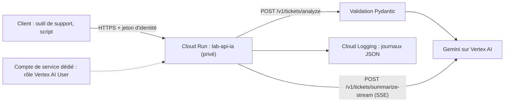

Un prototype qui appelle Gemini dans un notebook n'est pas une API. Entre les deux, il y a tout ce qui fait qu'un service tient debout : des **entrées validées**, des **délais maximum**, des **erreurs propres**, une réponse **en flux** quand c'est long, **aucune clé dans le code**, un **conteneur**, un **accès privé** et des **journaux** qu'on peut interroger à 3 heures du matin.

Fil rouge : une API de **tri de tickets de support**. On lui envoie un ticket (sujet + texte), elle renvoie un résumé, une catégorie, une priorité et le sentiment du client ; une deuxième route renvoie un résumé **au fil de l'eau** (streaming). Le code complet est dans [files/](files/) et a été testé de bout en bout le 2026-10-15, en local puis sur Cloud Run.

## Pour qui ?

- Développeurs Python qui ont déjà appelé l'API Gemini (sinon : la formation « Premiers pas avec l'API Gemini » du parcours Débuter).
- Vous connaissez les bases du HTTP (GET, POST, codes 200/400/500) et du JSON.
- Aucune expérience de Docker ou de Cloud Run n'est nécessaire : tout est expliqué.

## Ce que l'on construit

## Objectifs

À la fin, vous saurez :

1. écrire un endpoint FastAPI dont l'entrée et la sortie sont **validées** et qui renvoie du **JSON structuré** produit par Gemini ;
2. ajouter une route en **Server-Sent Events**, un **délai maximum** et une traduction propre des erreurs du modèle (429 → 503 + `Retry-After`) ;
3. gérer les **secrets** (`.env` en local, Secret Manager en production) et savoir quand on n'en a plus besoin ;
4. écrire un **Dockerfile** et construire l'image avec Cloud Build ;
5. déployer sur **Cloud Run** en service **privé**, avec un **compte de service dédié** et Gemini via **Vertex AI**, puis l'appeler avec un **jeton d'identité** ;
6. régler **autoscaling**, **concurrence** et **délais**, estimer **latence et coûts**, lire les **journaux structurés**, et **tout supprimer** à la fin.

## Prérequis techniques

- Python 3.10 ou plus récent, `pip install -r files/requirements.txt` (plus `pytest` et `httpx` pour les tests).
- En local : une clé de l'API Gemini (Google AI Studio) dans un fichier `.env`.
- Sur Google Cloud (modules 2 et 3) : un projet avec facturation, la CLI `gcloud` connectée, et le droit de créer un compte de service.

## Programme

| Module | Leçons | Durée indicative |
| --- | --- | --- |
| 1. Concevoir l'endpoint | Contrat d'API et validation ; streaming SSE, délais et erreurs | 1h30 |
| 2. Secrets et conteneur | Secrets, `.env`, Secret Manager, Vertex AI sans clé ; le Dockerfile | 1h |
| 3. Déployer et exploiter | Déploiement privé avec compte de service ; autoscaling, latence, coûts ; journaux structurés | 1h45 |
| 4. Projet final | L'API tickets de bout en bout, testée, déployée, appelée, nettoyée | 45 min |

## En local ou sur Google Cloud ?

| | En local | Sur Google Cloud |
| --- | --- | --- |
| Modèle | API Gemini avec une clé (`GOOGLE_API_KEY`) | Gemini sur Vertex AI, **sans clé** |
| Lancement | `uvicorn main:app --port 8080` | `./deploy.sh` (Cloud Build + Cloud Run) |
| Identité | votre clé | le compte de service `lab-api-ia` |
| Coût | les appels au modèle | les appels au modèle + Cloud Run (zéro au repos avec `min-instances=0`) |
| Leçons | 1 à 4 | 5 à 8 |

Le **même code** tourne dans les deux cas : seule la configuration (variables d'environnement) change.

## Les fichiers du lab

| Fichier | Rôle |
| --- | --- |
| [main.py](files/main.py) | l'API : validation, Gemini, SSE, délais, erreurs, journaux JSON |
| [test_main.py](files/test_main.py) | 7 tests sans clé ni réseau (faux modèle) |
| [Dockerfile](files/Dockerfile) | l'image du service |
| [deploy.sh](files/deploy.sh), [call.sh](files/call.sh), [cleanup.sh](files/cleanup.sh) | déployer, appeler avec un jeton, tout supprimer |
| [.env.example](files/.env.example) | modèle de configuration (valeurs factices) |
