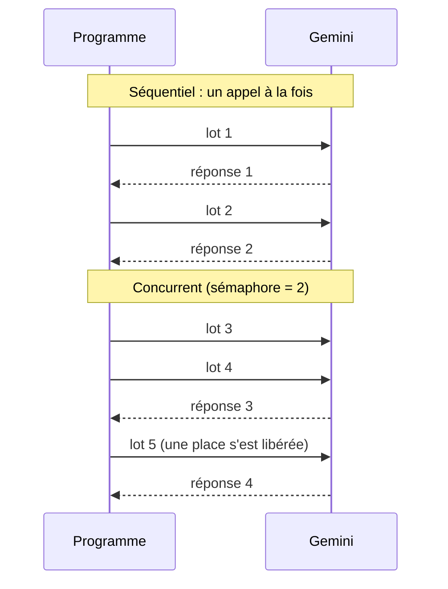

# Concurrence maîtrisée : asyncio et sémaphore

> [!NOTE]
> Dans cette leçon, vous allez comprendre pourquoi une boucle `for` qui appelle Gemini document par document est lente, puis la remplacer par des appels **simultanés mais plafonnés** avec `asyncio` et un `Semaphore`. Code : [classer.py](../files/classer.py).

## Le problème : on attend, on ne calcule pas

Un appel à Gemini prend en général une à quelques secondes. Pendant ce temps, votre programme ne fait **rien** : il attend la réponse du réseau. Avec une boucle séquentielle, 10 000 documents × 2 s = plus de 5 heures d'attente, processeur au repos.

La solution : envoyer plusieurs requêtes **en même temps** et attendre leurs réponses en parallèle. C'est exactement ce que fait **asyncio**, la bibliothèque standard de Python pour la programmation asynchrone : une fonction `async def` peut se mettre en pause sur un `await` (une attente réseau) pendant que d'autres avancent, le tout dans un seul fil d'exécution.



## Pourquoi pas « tout en même temps » ?

Lancer 10 000 requêtes d'un coup avec `asyncio.gather` est la pire idée : le quota de requêtes par minute explose, presque tout revient en **429** (*Too Many Requests*), la mémoire gonfle, et le fournisseur peut vous ralentir encore plus. Il faut un **plafond**.

Un **sémaphore** est un compteur de places : `asyncio.Semaphore(4)` laisse entrer au plus 4 tâches à la fois dans le bloc `async with` ; la 5e attend qu'une place se libère.

```python title="files/classer.py"
sem, debit = asyncio.Semaphore(concurrence), Debit(rpm)

async def un_lot(lot):
    async with sem:  # au plus `concurrence` lots en vol
        await debit.attendre()
        res = await avec_reessais(lambda: traiter_lot(client, lot))
        ecrire_lot(sortie, {"lot": [a["id"] for a in lot], "modele": MODEL, **res})

await asyncio.gather(*(un_lot(lot) for lot in lots))
```

On crée bien une tâche par lot (`gather`), mais le sémaphore garantit qu'au plus `concurrence` d'entre elles appellent le modèle au même moment.

| Approche | Durée | Risque de 429 | Code |
| --- | --- | --- | --- |
| boucle `for` séquentielle | la plus longue | faible | trivial |
| `gather` sans limite | courte... jusqu'aux erreurs | très élevé | trivial |
| `gather` + `Semaphore(N)` | divisée par environ N, tant que le quota suit | maîtrisé | quelques lignes |
| threads (`ThreadPoolExecutor`) | comparable | maîtrisé avec `max_workers` | utile si la bibliothèque n'est pas asynchrone |

```quiz
question: "Avec asyncio.Semaphore(4) et 20 lots lancés via gather, combien d'appels au modèle sont en cours au maximum au même instant ?"
options:
  - "20"
  - "4"
  - "1"
answer: 1
explanation: "Les 20 tâches existent, mais seules 4 peuvent être à l'intérieur du bloc async with sem à un instant donné. Les autres attendent une place."
```

## Le client asynchrone de Gemini

Le SDK `google-genai` fournit une version asynchrone de chaque méthode sous `client.aio`. On l'ouvre avec `async with`, ce qui ferme proprement les connexions à la fin, même en cas d'interruption :

```python title="files/classer.py"
async with genai.Client().aio as client:  # ferme proprement les connexions, même sur Ctrl-C
    stats = await traiter(client, lire_avis(a.entree), a.sortie, a.lot, a.concurrence, a.rpm)
```

```python title="files/classer.py"
r = await asyncio.wait_for(client.models.generate_content(
    model=MODEL, contents=prompt_lot(avis), config=...), timeout=60)
```

`asyncio.wait_for(..., timeout=60)` borne chaque appel : une requête bloquée ne garde pas sa place de sémaphore indéfiniment.

> [!TIP]
> Commencez avec une concurrence modeste (2 à 4), mesurez, puis augmentez tant que la durée baisse **et** que les 429 restent rares. Au-delà, ajouter des places ne fait qu'ajouter des erreurs.

## Vérifier le plafond par un test

Un test sans réseau mesure le nombre maximal de tâches simultanées :

```python title="files/test_lot.py"
def test_concurrence_bornee(tmp_path):
    en_vol, pic = 0, 0

    async def lent(client, lot):
        nonlocal en_vol, pic
        en_vol += 1
        pic = max(pic, en_vol)
        await asyncio.sleep(0.1)
        en_vol -= 1
        return {"resultats": [], "tokens_in": 0, "tokens_out": 0}
    lancer(generer(100, 1), tmp_path / "r.jsonl", concurrence=3, traiter_lot=lent)
    assert pic == 3
```

```quiz
question: "Pourquoi asyncio accélère-t-il ce traitement alors qu'il n'utilise qu'un seul cœur de processeur ?"
options:
  - "Parce qu'il compile le code Python"
  - "Parce que le temps est passé à attendre le réseau : pendant une attente, d'autres requêtes peuvent partir"
  - "Parce qu'il répartit automatiquement les calculs sur plusieurs machines"
answer: 1
explanation: "Le travail est limité par les entrées-sorties (attente des réponses), pas par le calcul. asyncio occupe ces temps d'attente avec d'autres requêtes."
```

## Exercice : mesurer le gain

Lancez `classer.py` sur les 40 premiers avis avec `--concurrence 1` puis `--concurrence 4`, dans deux fichiers de sortie différents. Le gain est-il exactement de 4 ? Pourquoi ?

<details>
<summary>Voir la solution</summary>

```bash
head -41 avis.csv > avis40.csv     # l'en-tête + 40 avis
python classer.py --entree avis40.csv --sortie c1.jsonl --concurrence 1 --rpm 600
python classer.py --entree avis40.csv --sortie c4.jsonl --concurrence 4 --rpm 600
```

Les fichiers de sortie doivent être différents : sinon, la deuxième exécution trouverait tout « déjà fait » (c'est la reprise, leçon 2.1).

Le gain est rarement exactement 4 : chaque appel a une durée variable, la durée totale est celle du lot **le plus lent** de chaque vague, et il n'y a ici que 4 lots (une seule vague). Sur des milliers de lots, le gain se rapproche de N, tant que le quota ne sature pas.

</details>

## Résultat obtenu

Mesure réelle du 2026-10-15, 40 avis en 4 lots de 10, modèle `gemini-3.5-flash-lite` :

```text
$ python classer.py --entree avis40.csv --sortie c1.jsonl --concurrence 1 --rpm 600
Terminé en 6.8 s : {'lots_ok': 4, 'lots_echec': 0, 'avis_ok': 40}
$ python classer.py --entree avis40.csv --sortie c4.jsonl --concurrence 4 --rpm 600
Terminé en 2.1 s : {'lots_ok': 4, 'lots_echec': 0, 'avis_ok': 40}
```

Environ 3 fois plus rapide avec 4 places, sur cet essai. Les tests sans réseau : `pytest -q` → `9 passed`.

## Je sais faire

- [ ] Expliquer pourquoi un traitement IA est limité par l'attente réseau
- [ ] Lancer des appels concurrents avec `client.aio` et `asyncio.gather`
- [ ] Plafonner la concurrence avec `asyncio.Semaphore`
- [ ] Borner chaque appel avec `asyncio.wait_for`
