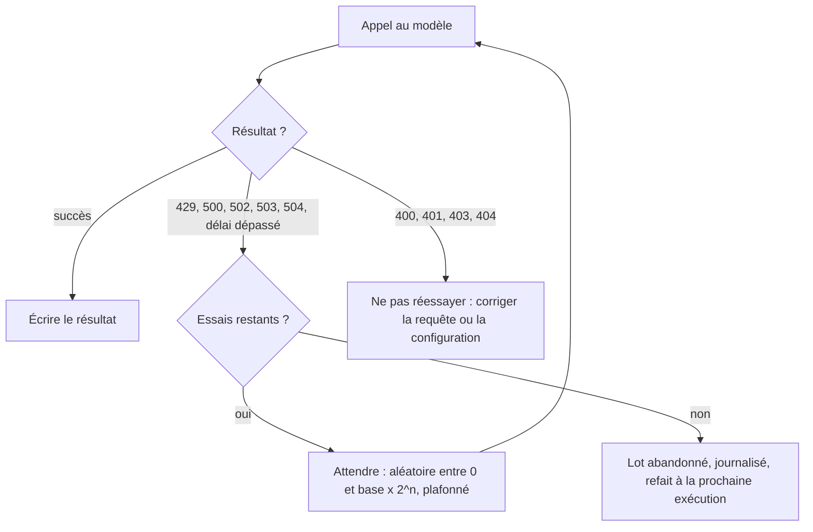

# Limites de débit et réessais exponentiels

> [!NOTE]
> Dans cette leçon, vous allez respecter un plafond de requêtes par minute, distinguer les erreurs qu'il faut réessayer de celles qu'il ne faut surtout pas réessayer, et écrire un réessai **exponentiel avec gigue**. Code : [classer.py](../files/classer.py).

## Les limites de débit

Chaque fournisseur limite l'usage de ses modèles. Pour l'API Gemini, les limites sont exprimées notamment en **requêtes par minute** (RPM), **jetons par minute** (TPM) et **requêtes par jour** (RPD) ; elles dépendent du modèle et du niveau de votre projet (consultez la page « Rate limits »). Sur Vertex AI, une partie de la capacité est **partagée** entre clients : un 429 peut arriver même si **vous** envoyez peu.

Dépasser une limite renvoie l'erreur **429 RESOURCE_EXHAUSTED**. Ce n'est pas un bug : c'est un signal « ralentissez ».



## Deux mécanismes complémentaires

1. **Prévenir** : ne pas dépasser le débit. La classe `Debit` espace les démarrages de requêtes (au plus `rpm` par minute).
2. **Guérir** : quand un 429 ou un 5xx arrive quand même, attendre puis réessayer.

```python title="files/classer.py"
class Debit:
    """Au plus `rpm` démarrages de requêtes par minute (espacement régulier)."""

    def __init__(self, rpm: int):
        self.intervalle, self.prochain, self.verrou = 60 / rpm, 0.0, asyncio.Lock()

    async def attendre(self) -> None:
        async with self.verrou:
            maintenant = time.monotonic()
            attente = max(0.0, self.prochain - maintenant)
            self.prochain = max(maintenant, self.prochain) + self.intervalle
        await asyncio.sleep(attente)
```

Le sémaphore (leçon précédente) borne le nombre de requêtes **simultanées** ; `Debit` borne leur **fréquence**. Avec des appels rapides, la concurrence seule pourrait dépasser le RPM.

```quiz
question: "Avec une concurrence de 4 et des appels qui durent 1 seconde, combien de requêtes par minute partent au maximum sans limiteur de débit ?"
options:
  - "4"
  - "Environ 240"
  - "60"
answer: 1
explanation: "4 requêtes à la fois, renouvelées chaque seconde : environ 4 x 60 = 240 par minute. Si votre quota est de 100 RPM, il faut aussi un limiteur de débit."
```

## Le réessai exponentiel avec gigue

```python title="files/classer.py"
RETRY_CODES = {429, 500, 502, 503, 504}

async def avec_reessais(fn, essais=6, base=1.0, plafond=30.0, journal=print):
    for n in range(essais):
        try:
            return await fn()
        except Exception as e:
            code = code_erreur(e)            # 504 pour un délai dépassé
            if code not in RETRY_CODES or n == essais - 1:
                raise
            # Exponentiel avec gigue complète : 0..1 s, 0..2 s, 0..4 s... plafonné
            pause = random.uniform(0, min(plafond, base * 2 ** n))
            journal(f"  réessai {n + 1} après erreur {code}, pause {pause:.1f} s")
            await asyncio.sleep(pause)
```

- **Exponentiel** : l'attente maximale double à chaque échec (1, 2, 4, 8, 16, puis 30 s), pour laisser au service le temps de récupérer.
- **Gigue** (*jitter*) : on tire l'attente **au hasard** entre 0 et ce maximum. Sans gigue, toutes les tâches tombées en erreur au même moment réessaieraient au même moment, et provoqueraient un nouveau pic.
- **Plafond** et **nombre d'essais** : au bout de 6 échecs, on abandonne ce lot (il sera refait à la prochaine exécution grâce à la reprise).

| Code | Signification | Réessayer ? |
| --- | --- | --- |
| 429 | trop de requêtes, quota | oui, avec attente |
| 500, 502, 503, 504 | erreur temporaire côté serveur, délai dépassé | oui |
| 400 | requête invalide (schéma, prompt trop long) | **non** : elle échouera toujours |
| 401, 403 | clé ou droits invalides | **non** : corriger la configuration |
| 404 | modèle inexistant (nom erroné) | **non** |

> [!WARNING]
> Réessayer une erreur 400 en boucle, c'est payer (et attendre) pour rien, et masquer un vrai bug. Un lot qui échoue définitivement doit être **journalisé** et laissé de côté, sans bloquer les autres.

> [!TIP]
> Le SDK `google-genai` sait aussi réessayer tout seul (`types.HttpRetryOptions`). Ici, le réessai est écrit à la main pour être visible, testable, et couvrir aussi notre propre délai `asyncio.wait_for`.

## Exercice : calculer le pire cas

Avec `essais=6`, `base=1` et `plafond=30`, quelle est l'attente totale **maximale** avant qu'un lot soit abandonné (sans compter la durée des appels) ? Et en moyenne ?

<details>
<summary>Voir la solution</summary>

Il y a 5 pauses (après les essais 1 à 5 ; après le 6e, on abandonne). Leurs maxima sont `min(30, 2^n)` pour n = 0 à 4 : 1 + 2 + 4 + 8 + 16 = **31 s au maximum**.

Avec la gigue complète, chaque pause est uniforme entre 0 et son maximum, donc en moyenne la moitié : environ **15,5 s**.

Si votre traitement tourne la nuit sur des milliers de lots, vous pouvez augmenter `essais` : quelques minutes d'attente valent mieux qu'un lot abandonné. En interactif (une API), on garde au contraire peu d'essais.

</details>

```quiz
question: "Pourquoi ajoute-t-on de l'aléatoire (gigue) aux attentes de réessai ?"
options:
  - "Pour rendre le programme plus difficile à déboguer"
  - "Pour éviter que toutes les tâches en échec réessaient en même temps et recréent le pic qui a causé l'erreur"
  - "Parce que l'API Gemini l'exige dans l'en-tête de la requête"
answer: 1
explanation: "Des tâches synchronisées réessaieraient en vague. La gigue étale les réessais dans le temps et laisse le service récupérer."
```

## Résultat obtenu

Pendant les exécutions réelles du 2026-10-15, l'API Gemini n'a renvoyé **aucun** 429 (200 avis, plafond de 30 RPM). Le comportement est donc vérifié par les tests avec pannes simulées (`pytest -s`) :

```text
0 avis déjà traités, 30 à faire en 3 lots
  lot A0001..A0010 : 10/10 avis
  réessai 1 après erreur 429, pause 0.9 s
  réessai 2 après erreur 429, pause 0.9 s
  lot A0011..A0020 : 10/10 avis
  lot A0021..A0030 : 10/10 avis
.0 avis déjà traités, 30 à faire en 3 lots
  lot A0001..A0010 : 10/10 avis
  lot A0011 abandonné : ErreurApi 400
  lot A0021..A0030 : 10/10 avis
```

Le premier test injecte deux 429 sur un lot : il est réessayé puis réussit. Le second injecte un 400 : le lot est abandonné **sans réessai**, et les autres lots continuent. Un vrai 429 de Vertex AI, lui, a bien été observé le même jour dans la formation [Une API IA en production](../../04-api-ia-production-fastapi-cloud-run/index.md).

## Je sais faire

- [ ] Citer les limites RPM, TPM, RPD et lire celles de mon projet
- [ ] Plafonner la fréquence des requêtes en plus de leur nombre simultané
- [ ] Écrire un réessai exponentiel avec gigue complète
- [ ] Ne réessayer que les erreurs temporaires (429, 5xx, délai)
