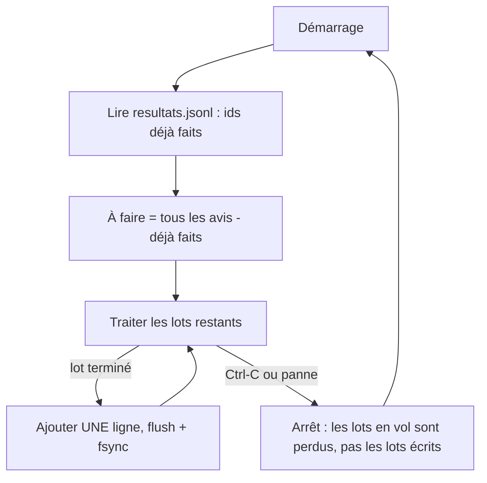

# Idempotence et reprise après incident

> [!NOTE]
> Dans cette leçon, vous allez faire en sorte qu'un traitement de plusieurs heures puisse être **coupé n'importe quand** (Ctrl-C, panne, redémarrage) et **relancé** sans perdre ni refaire le travail déjà payé. Code : [classer.py](../files/classer.py), tests : [test_lot.py](../files/test_lot.py).

## Deux mots à connaître

- Un **point de reprise** (*checkpoint*) est une trace durable de ce qui est terminé. Ici : un fichier `resultats.jsonl` (JSON Lines : un objet JSON par ligne) où chaque **lot terminé** ajoute une ligne.
- Une opération est **idempotente** si la lancer une ou plusieurs fois donne le même résultat. Relancer `classer.py` dix fois ne doit ni dupliquer les résultats, ni repayer les avis déjà classés.



## Écrire : une ligne complète, sur le disque

```python title="files/classer.py"
def ecrire_lot(chemin: str, entree: dict) -> None:
    with open(chemin, "a", encoding="utf-8") as f:
        f.write(json.dumps(entree, ensure_ascii=False) + "\n")
        f.flush()
        os.fsync(f.fileno())  # sur le disque avant de passer à la suite
```

- Mode `"a"` (*append*) : on **ajoute** à la fin, on ne réécrit jamais le fichier entier (une coupure pendant une réécriture détruirait tout).
- `flush()` vide le tampon de Python, `os.fsync()` demande au système de l'écrire réellement sur le disque.
- L'unité de reprise est le **lot** : la ligne contient les ids du lot, les résultats validés et les jetons consommés.

## Relire : tolérer la ligne coupée

Si la coupure arrive **pendant** l'écriture, la dernière ligne peut être tronquée. La relecture l'ignore (ce lot sera refait), et ajoute un retour à la ligne pour que la ligne suivante ne soit pas collée à ce morceau :

```python title="files/classer.py"
def deja_faits(chemin: str) -> set[str]:
    ...
    for ligne in contenu.decode("utf-8", errors="replace").splitlines():
        try:
            faits.update(r["id"] for r in json.loads(ligne)["resultats"])
        except (json.JSONDecodeError, KeyError):
            pass  # ligne tronquée par une coupure : ignorée, ce lot sera refait
    if contenu and not contenu.endswith(b"\n"):
        with open(chemin, "ab") as f:  # sinon la prochaine ligne serait collée à la ligne tronquée
            f.write(b"\n")
    return faits
```

> [!WARNING]
> Ce dernier détail a été trouvé par le test `test_reprise_apres_coupure` : sans lui, le premier lot écrit après la relance se retrouvait sur la même ligne que le fragment tronqué, et devenait lui aussi illisible. Un lot payé, puis perdu.

Les ids sont **stables** (`A0001`, `A0002`...) : c'est la clé de l'idempotence. Si vos documents n'ont pas d'identifiant, fabriquez-en un stable, par exemple une empreinte (`hashlib.sha256`) du contenu.

```quiz
question: "Le programme est interrompu pendant que 4 lots sont en cours d'appel au modèle. Que se passe-t-il à la relance ?"
options:
  - "Les 4 lots sont perdus définitivement"
  - "Les 4 lots n'ont pas de ligne dans resultats.jsonl, ils sont donc refaits ; les lots déjà écrits ne le sont pas"
  - "Tout est refait depuis le début"
answer: 1
explanation: "Seuls les lots terminés sont écrits. Les lots en vol au moment de la coupure ont été payés mais pas enregistrés : ils sont refaits. C'est le coût maximal d'une coupure : au plus `concurrence` lots."
```

## Le rapport aussi est idempotent

Si un lot était refait alors qu'il avait déjà été écrit (cas rare, par exemple deux exécutions lancées en même temps par erreur), `rapport.py` garde **une seule** ligne par id :

```python title="files/rapport.py"
for r in lot["resultats"]:
    classes[r["id"]] = r  # idempotent : un id vu deux fois garde une seule ligne
```

| Choix | Pourquoi |
| --- | --- |
| JSONL en ajout | une coupure ne détruit jamais les lignes précédentes |
| une ligne = un lot | atomicité simple : le lot est fait ou ne l'est pas |
| ids stables | relancer = filtrer, pas recommencer |
| déduplication au rapport | robustesse même en cas de double exécution |

> [!TIP]
> Au-delà d'une machine (plusieurs workers), le fichier ne suffit plus : utilisez une table (BigQuery, Firestore, PostgreSQL) avec une contrainte d'unicité sur l'id du document, ou la prédiction par lot du module 3.

```quiz
question: "Pourquoi ne pas simplement réécrire tout resultats.json à la fin de chaque lot ?"
options:
  - "Parce que c'est plus lent, et qu'une coupure pendant la réécriture peut détruire tous les résultats"
  - "Parce que JSON ne permet pas de stocker des listes"
  - "Parce que Python ne sait pas écrire de gros fichiers"
answer: 0
explanation: "Réécrire tout le fichier coûte de plus en plus cher et crée une fenêtre où le fichier est vide ou à moitié écrit. L'ajout ligne à ligne ne met en jeu que la dernière ligne."
```

## Exercice : un id stable sans identifiant

Vos documents sont des textes bruts sans identifiant. Écrivez une fonction qui leur donne un id stable, identique d'une exécution à l'autre, et dites ce qui se passe si un même texte apparaît deux fois.

<details>
<summary>Voir la solution</summary>

```python
import hashlib

def id_stable(texte: str) -> str:
    normalise = " ".join(texte.split()).lower()        # espaces et casse ignorés
    return "D" + hashlib.sha256(normalise.encode("utf-8")).hexdigest()[:16]
```

Deux textes identiques reçoivent le même id : le second est considéré comme déjà traité. C'est souvent souhaitable (pas de double paiement pour un doublon), mais si vous devez garder chaque occurrence, combinez l'empreinte avec la position ou la source : `id_stable(f"{fichier}:{ligne}:{texte}")`.

N'utilisez pas `hash(texte)` de Python : sa valeur change d'une exécution à l'autre pour les chaînes.

</details>

## Résultat obtenu

Exécution réelle du 2026-10-15 : 200 avis, interruption par Ctrl-C (signal SIGINT envoyé par `timeout -s INT 8`) puis relance.

```text
=== 1re exécution, interrompue (Ctrl-C) après 8 s
0 avis déjà traités, 200 à faire en 20 lots
  lot A0001..A0010 : 10/10 avis
  lot A0011..A0020 : 10/10 avis
  lot A0021..A0030 : 10/10 avis
Interrompu : relancez la même commande pour reprendre là où vous en étiez.
$ wc -l resultats.jsonl
3 resultats.jsonl
=== relance
30 avis déjà traités, 170 à faire en 17 lots
  lot A0031..A0040 : 10/10 avis
  ...
=== relance à nouveau (idempotence)
200 avis déjà traités, 0 à faire en 0 lots
Terminé en 0.2 s : {'lots_ok': 0, 'lots_echec': 0, 'avis_ok': 0}
```

Les tests de reprise (avec une ligne tronquée simulée) passent : `pytest -q` → `9 passed`.

## Je sais faire

- [ ] Écrire un point de reprise JSONL en ajout, avec `flush` et `fsync`
- [ ] Relire un point de reprise en tolérant une dernière ligne coupée
- [ ] Rendre un traitement idempotent grâce à des ids stables
- [ ] Estimer ce qu'une coupure coûte au pire (les lots en vol)
