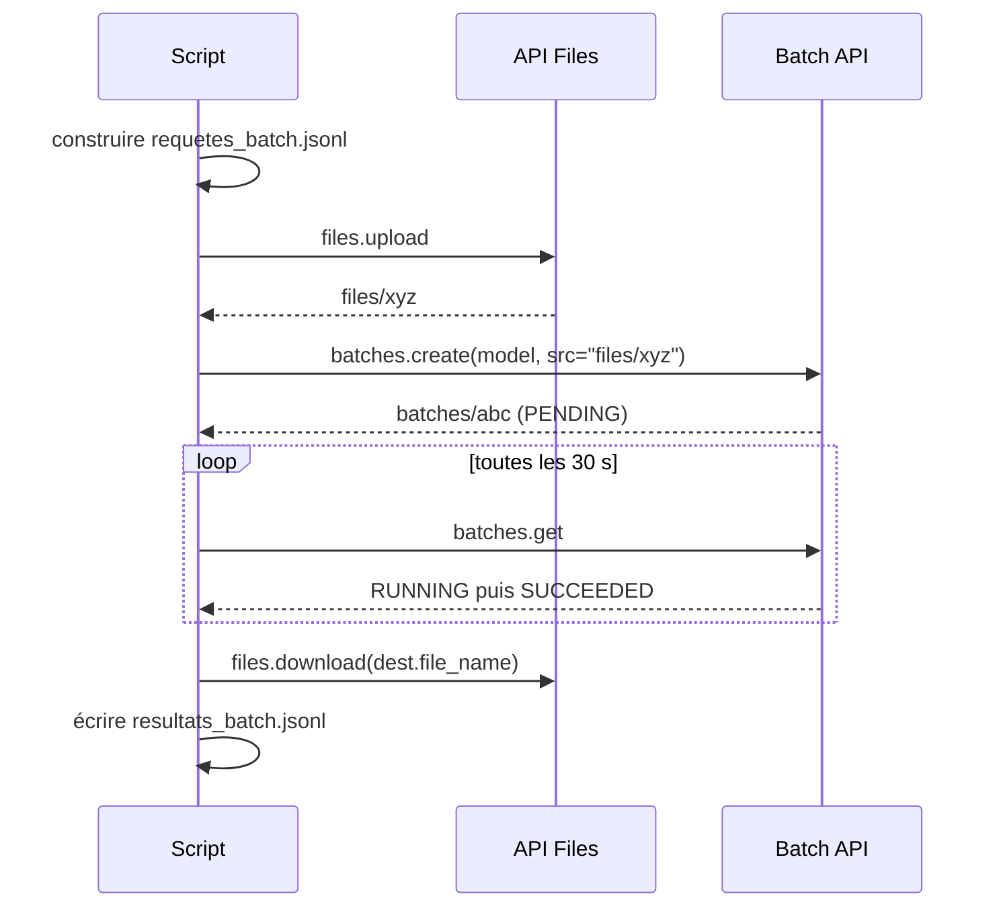

# La Batch API de Gemini : un fichier JSONL, moitié prix

> [!NOTE]
> Dans cette leçon, vous allez confier le classement à la **Batch API** de Gemini : on dépose un fichier de requêtes, Google le traite quand il veut (dans les 24 heures), et facture moitié prix. Lancé pour de vrai sur un petit lot de 20 avis. Code : [batch_api.py](../files/batch_api.py).

## Synchrone ou en lot ?

Jusqu'ici, `classer.py` envoie les requêtes **en direct** (mode synchrone) : on obtient la réponse tout de suite, mais on gère soi-même concurrence, débit et réessais. La **Batch API** inverse la logique : vous envoyez **toutes** les requêtes d'un coup dans un fichier, et Google se charge de l'ordonnancement.



| | Synchrone (`classer.py`) | Batch API |
| --- | --- | --- |
| Délai de réponse | secondes | différé : objectif de 24 h, souvent bien moins |
| Prix | tarif standard | **la moitié** du tarif standard (page Tarifs) |
| Concurrence, débit, réessais | à votre charge | gérés par Google |
| Taille | limitée par vos quotas | fichier d'entrée jusqu'à 2 Go |
| Bon pour | interactif, petits volumes, besoin immédiat | gros volumes non urgents : nuit, historique, réindexation |

## Le fichier JSONL

Chaque ligne contient une **clé** choisie par vous et une **requête** complète au format REST de `generateContent` :

```python title="files/batch_api.py"
def requete(lot: list[dict]) -> dict:
    return {
        "contents": [{"role": "user", "parts": [{"text": prompt_lot(lot)}]}],
        "systemInstruction": {"parts": [{"text": SYSTEM}]},
        "generationConfig": {"temperature": 0, "responseMimeType": "application/json",
                             "responseJsonSchema": SCHEMA},
    }

ligne = {"key": f"lot-{i}", "request": requete(lot)}
```

On réutilise **le même** `SCHEMA`, la même instruction et le même `prompt_lot` que le mode synchrone : les deux chemins produisent des résultats comparables.

```text title="requetes_batch.jsonl (début de la 1re ligne)"
{"key": "lot-0", "request": {"contents": [{"role": "user", "parts": [{"text": "[A0001] Génial, mon grille-pain Nimbus est arrivé avec trois semaines de retard. Vraiment bravo.\n[A0002] ...
```

```quiz
question: "Les réponses d'un job de la Batch API ne reviennent pas forcément dans l'ordre des requêtes. Comment retrouver à quel lot correspond chaque réponse ?"
options:
  - "Par le numéro de ligne dans le fichier de sortie"
  - "Par la clé (key) donnée à chaque requête, renvoyée avec la réponse"
  - "Par l'heure de traitement"
answer: 1
explanation: "La clé est faite pour ça : on la choisit à l'envoi (lot-0, lot-1...) et elle accompagne la réponse. Ne vous fiez jamais à l'ordre."
```

## Envoyer, attendre, récupérer

```python title="files/batch_api.py"
fichier = client.files.upload(file="requetes_batch.jsonl",
                              config=types.UploadFileConfig(display_name="avis-lot", mime_type="jsonl"))
job = client.batches.create(model=os.environ.get("MODEL", "gemini-3.5-flash-lite"), src=fichier.name,
                            config={"display_name": "lab-batch-ia-avis"})
job = attendre(client, job.name, max_s)        # batches.get toutes les 30 s

contenu = client.files.download(file=job.dest.file_name).decode("utf-8")
for ligne in contenu.splitlines():
    r = json.loads(ligne)
    lot = lots[int(r["key"].split("-")[1])]  # la clé relie chaque réponse à sa requête
    if "response" in r:
        ecrire_lot(sortie, lire_reponse(lot, r["response"]))
```

Les états possibles d'un job : `JOB_STATE_PENDING`, `JOB_STATE_RUNNING`, puis l'un des états finaux `JOB_STATE_SUCCEEDED`, `JOB_STATE_FAILED`, `JOB_STATE_CANCELLED`, `JOB_STATE_EXPIRED` (un job resté plus de 48 heures en attente ou en cours expire).

> [!TIP]
> Notez le nom du job (`batches/...`) : si votre script s'arrête, le job, lui, continue. Vous pourrez récupérer le résultat plus tard avec `client.batches.get(name=...)`, sans rien renvoyer.

> [!WARNING]
> Chaque ligne de sortie peut contenir une `response` **ou** une `error` : un job « réussi » peut contenir des requêtes en échec. Traitez les erreurs ligne par ligne, et laissez la reprise refaire en synchrone ce qui manque.

## Nettoyer

Le fichier d'entrée est supprimé par le script (`client.files.delete`) dès que le job est terminé. Le job lui-même peut être supprimé avec `client.batches.delete(name=...)` ; les fichiers de l'API Files sont de toute façon supprimés automatiquement après un délai (voir la documentation).

```quiz
question: "Vous devez classer 2 millions d'avis historiques d'ici la semaine prochaine. Quelle approche choisir en priorité ?"
options:
  - "classer.py avec une concurrence de 500"
  - "La Batch API : moitié prix, pas de gestion de débit, et le délai n'est pas un problème"
  - "Un appel par avis en boucle séquentielle"
answer: 1
explanation: "Gros volume, pas d'urgence : c'est exactement le cas d'usage du mode lot. Une concurrence de 500 provoquerait surtout des 429."
```

## Exercice : reprendre un job

Votre script a été coupé alors que le job `batches/abc123` tournait. Écrivez les quelques lignes qui récupèrent ses résultats sans relancer de job.

<details>
<summary>Voir la solution</summary>

```python
from google import genai
import json
from batch_api import lire_reponse
from classer import ecrire_lot, lire_avis

client = genai.Client()
job = client.batches.get(name="batches/abc123")
print(job.state.name)
if job.state.name == "JOB_STATE_SUCCEEDED":
    avis = lire_avis("avis.csv")[:20]
    lots = [avis[i:i + 10] for i in range(0, len(avis), 10)]   # la même découpe qu'à l'envoi
    for ligne in client.files.download(file=job.dest.file_name).decode("utf-8").splitlines():
        r = json.loads(ligne)
        if "response" in r:
            ecrire_lot("resultats_batch.jsonl", lire_reponse(lots[int(r["key"].split("-")[1])], r["response"]))
```

Point clé : il faut reconstruire **exactement** la même découpe en lots (mêmes `--n` et `--lot`) pour que les clés correspondent. Une alternative plus robuste : mettre directement les ids dans la clé (`"key": "A0001-A0010"`).

</details>

## Résultat obtenu

Exécution réelle du 2026-10-15 : 20 avis, 2 requêtes de 10, `gemini-3.5-flash-lite`.

```text
$ python batch_api.py gemini --n 20
Job créé : batches/o4d9fd5c…
  16:40:57 JOB_STATE_RUNNING
  16:41:28 JOB_STATE_RUNNING
  ...
  16:43:29 JOB_STATE_SUCCEEDED
$ python rapport.py --resultats resultats_batch.jsonl
Avis classés : 20/200  (manquants : 180 ['A0021', 'A0022', ...])
Accord avec les réponses attendues : sentiment 95%, catégorie 100% ...
Jetons : 694 en entrée, 941 en sortie
```

Environ 3 minutes pour ce tout petit job (un délai indicatif, pas une garantie). Le job a ensuite été supprimé (`batches.delete`, vérifié par un `batches.get` qui renvoie 404).

## Je sais faire

- [ ] Choisir entre traitement synchrone et Batch API selon le volume et l'urgence
- [ ] Construire un fichier JSONL de requêtes avec des clés
- [ ] Envoyer, suivre et récupérer un job avec `files.upload`, `batches.create`, `batches.get`
- [ ] Gérer les erreurs ligne par ligne et nettoyer fichiers et job
