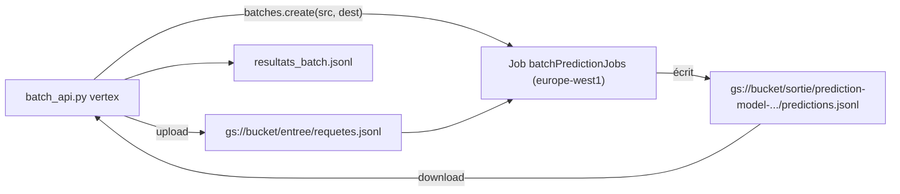

# Vertex AI batch prediction : le mode lot côté Google Cloud

> [!NOTE]
> Dans cette leçon, vous allez lancer le même classement avec la **prédiction par lot** de Vertex AI : le fichier de requêtes est dans **Cloud Storage**, les résultats y sont écrits, et l'authentification passe par votre identité Google Cloud, sans clé. Lancé pour de vrai sur 20 avis, puis tout a été supprimé. Code : [batch_api.py](../files/batch_api.py).

## Ce qui change par rapport à l'API Gemini

**Vertex AI** est la plateforme d'IA de Google Cloud. Elle sert les mêmes familles de modèles Gemini, mais dans votre projet : facturation, droits IAM, région et journaux d'audit de Google Cloud. Sa **prédiction par lot** (*batch prediction*) suit la même idée que la Batch API, avec Cloud Storage (ou BigQuery) comme entrée et sortie.



| | Batch API (API Gemini) | Vertex AI batch prediction |
| --- | --- | --- |
| Authentification | clé d'API | identité Google Cloud (ADC, compte de service), IAM |
| Entrée / sortie | API Files | Cloud Storage ou BigQuery |
| Format d'une ligne | `{"key": ..., "request": {...}}` | `{"request": {...}}` ; la sortie renvoie la requête avec la réponse |
| Région | gérée par Google | choisie (ici `europe-west1`) : utile pour la résidence des données |
| Bon pour | prototypes, projets hors Google Cloud | données déjà dans GCS ou BigQuery, gouvernance d'entreprise |

## Le code

Le même `requete(lot)` est réutilisé ; on écrit le fichier dans un bucket puis on crée le job avec le **même SDK** `google-genai`, en mode Vertex AI :

```python title="files/batch_api.py"
client = genai.Client(vertexai=True, project=projet, location=region)
construire_jsonl(lots, "requetes_batch.jsonl", avec_cle=False)
gcs.blob("entree/requetes.jsonl").upload_from_filename("requetes_batch.jsonl")
job = client.batches.create(
    model=os.environ.get("MODEL", "gemini-2.5-flash"),
    src=f"{bucket}/entree/requetes.jsonl",
    config=types.CreateBatchJobConfig(dest=f"{bucket}/sortie", display_name="lab-batch-ia-avis"),
)
```

La sortie contient, pour chaque ligne, la requête d'origine, un `status` et la `response`. On retrouve les ids du lot dans le texte de la requête renvoyée :

```python title="files/batch_api.py"
texte = r["request"]["contents"][0]["parts"][0]["text"]
lot = [par_id[i] for i in re.findall(r"^\[(\w+)\]", texte, flags=re.M)]
```

```quiz
question: "Pourquoi le script relit-il les ids dans la requête renvoyée plutôt que de se fier à l'ordre des lignes ?"
options:
  - "Parce que Vertex AI renvoie les ids en majuscules"
  - "Parce que l'ordre des lignes de sortie n'est pas garanti ; la requête renvoyée permet de rattacher chaque réponse à son lot"
  - "Parce que c'est plus rapide"
answer: 1
explanation: "Comme pour la Batch API, on ne se fie jamais à l'ordre. Ici, on n'a pas mis de clé : c'est la requête elle-même, renvoyée avec la réponse, qui sert d'identifiant."
```

## Lancer le lab sur Google Cloud

```bash title="terminal"
export PROJECT_ID="mon-projet" REGION="europe-west1"
BUCKET="gs://lab-batch-ia-${PROJECT_ID}"
gcloud storage buckets create "$BUCKET" --location "$REGION" --uniform-bucket-level-access --project "$PROJECT_ID"
gcloud storage buckets update "$BUCKET" --update-labels formation-lab=batch-ia --project "$PROJECT_ID"

env -u GOOGLE_API_KEY GOOGLE_GENAI_USE_VERTEXAI=TRUE GOOGLE_CLOUD_PROJECT="$PROJECT_ID" \
  GOOGLE_CLOUD_LOCATION="$REGION" MODEL=gemini-2.5-flash \
  python batch_api.py vertex --n 20 --bucket "$BUCKET"
```

`env -u GOOGLE_API_KEY` retire la clé de l'environnement pour être sûr que l'appel passe bien par Vertex AI et votre identité.

> [!WARNING]
> Un tout petit lot comme celui-ci coûte une fraction de centime, mais le même script sur un million de documents coûterait réellement. Avant un gros job : testez sur 20 documents, mesurez les jetons par document avec `rapport.py`, multipliez, et posez une **alerte budgétaire**.

## Nettoyer : bucket et job

```bash title="terminal"
gcloud storage rm --recursive "$BUCKET"
gcloud storage buckets list --project "$PROJECT_ID" --filter "name~lab-batch-ia" --format "value(name)"   # doit être vide
```

```python title="supprimer le job (Python)"
client = genai.Client(vertexai=True, project=PROJECT_ID, location="europe-west1")
client.batches.delete(name="projects/.../locations/europe-west1/batchPredictionJobs/...")
```

```quiz
question: "Quelles ressources faut-il supprimer après ce lab Vertex AI ? (plusieurs réponses)"
options:
  - "Le bucket, qui contient les requêtes et les prédictions"
  - "Le job de prédiction par lot (historique)"
  - "Le modèle gemini-2.5-flash"
  - "Le projet Google Cloud"
answer: [0, 1]
explanation: "Le bucket stocke vos données (et coûte un peu tant qu'il existe) ; le job est un historique qu'on peut supprimer. Le modèle appartient à Google, et le projet sert à bien d'autres choses."
```

## Exercice : choisir l'entrée BigQuery

Vos 2 millions d'avis sont déjà dans une table BigQuery `boutique.avis`. Qu'est-ce qui change dans l'appel `batches.create`, et quel contrôle de coût faire avant ?

<details>
<summary>Voir la solution</summary>

La prédiction par lot de Vertex AI accepte une table BigQuery en entrée et en sortie : `src` et `dest` deviennent des URI `bq://projet.dataset.table`. La table d'entrée doit contenir une colonne `request` au même format JSON que les lignes du fichier JSONL ; la préparer est une requête SQL qui construit ce JSON à partir de vos colonnes.

Contrôles avant de lancer :

1. un **dry run** BigQuery (`bq query --dry_run`) sur la requête de préparation, pour connaître le volume lu ;
2. un **essai sur 20 lignes** (`LIMIT 20`) pour mesurer les jetons par avis ;
3. coût estimé = jetons par avis × 2 millions × tarif batch, et une alerte budgétaire en conséquence.

</details>

## Résultat obtenu

Exécution réelle du 2026-10-15 dans un projet de test (`europe-west1`, `gemini-2.5-flash`, 20 avis en 2 requêtes ; identifiants masqués) :

```text
Job créé : projects/XXXX/locations/europe-west1/batchPredictionJobs/5529…
  16:42:07 JOB_STATE_PENDING
  ...
  16:46:40 JOB_STATE_RUNNING
  16:47:40 JOB_STATE_SUCCEEDED

$ gcloud storage ls -r gs://lab-batch-ia-mon-projet
gs://lab-batch-ia-mon-projet/entree/requetes.jsonl
gs://lab-batch-ia-mon-projet/sortie/prediction-model-2026-10-15T14:42:07.762205Z/predictions.jsonl

$ python rapport.py --resultats resultats_batch.jsonl
Accord avec les réponses attendues : sentiment 95%, catégorie 100% ...
Jetons : 822 en entrée, 3066 en sortie
```

Une ligne de `predictions.jsonl` contient les champs `request`, `status`, `response` et `processed_time`. Son `usageMetadata` montrait `"thoughtsTokenCount": 1106` pour seulement 467 jetons de réponse : `gemini-2.5-flash` **réfléchit** avant de répondre, et ces jetons de réflexion sont facturés comme de la sortie (leçon 4.1). Le bucket et le job ont été supprimés juste après ; la liste filtrée des buckets est revenue vide.

## Je sais faire

- [ ] Expliquer ce que Vertex AI batch prediction apporte par rapport à la Batch API
- [ ] Préparer l'entrée dans Cloud Storage et lancer un job avec `genai.Client(vertexai=True)`
- [ ] Rattacher chaque prédiction à son lot sans se fier à l'ordre
- [ ] Supprimer bucket et job, et le vérifier
